<p align="center">
  <a href="https://icosisenpai.github.io/AetherNX/">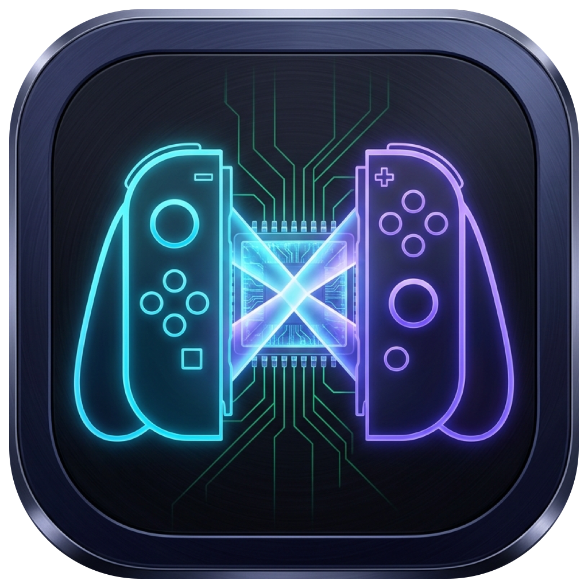</a>
</p>

<h1 align="center">AetherNX</h1>

<p align="center">
  <b>Your Switch games. Native on your Mac, iPhone and iPad.</b><br>
  AetherNX rewrites the code of the games you own, once, on your Mac, so Apple silicon runs it directly.<br>
  No emulator, no JIT: what comes out is an app of that game.
</p>

<p align="center">
  <a href="https://github.com/iCosiSenpai/AetherNX/releases/latest"></a>
  
  
  
  <a href="https://icosisenpai.github.io/AetherNX/"></a>
  <a href="LICENSE"></a>
</p>

<p align="center">
  <a href="https://icosisenpai.github.io/AetherNX/"><b>Website</b></a> ·
  <a href="https://github.com/iCosiSenpai/AetherNX/releases/latest"><b>Download</b></a> ·
  <a href="#get-started"><b>Get started</b></a> ·
  <a href="#the-app"><b>The app</b></a> ·
  <a href="#mods-and-cheats"><b>Mods and cheats</b></a> ·
  <a href="#iphone-and-ipad"><b>iPhone and iPad</b></a> ·
  <a href="#games"><b>Games</b></a> ·
  <a href="#thank-you"><b>Thank you</b></a>
</p>

<picture>
  <source media="(prefers-color-scheme: dark)" srcset="docs/images/studio/home-dark.png">
  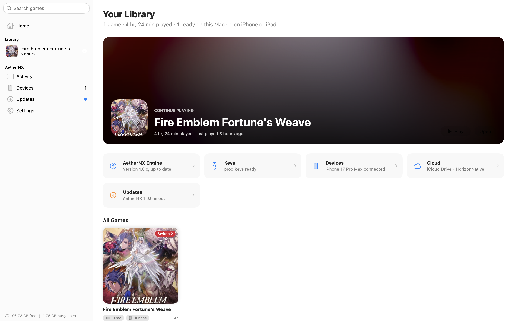
</picture>

## What it is

The Switch and Apple silicon speak the same processor language, 64-bit ARM. So a game's code does not need to be translated, instruction by instruction, while you play: it needs a few changes, made once. The engine in this repository, **HorizonNative**, makes them on your Mac:

1. **It rewrites the game's code once.** The few instructions that break Apple's rules (a Switch game uses the register `x18` freely; on Apple platforms it belongs to the system) move into small stubs beside the code.
2. **It stands in for the console's system.** When the game asks for a file, a thread, a save or a frame on screen, HorizonNative answers in place of Horizon OS, with the Mac's own services.
3. **It draws with Metal.** The game's graphics API, NVN (or Vulkan, or OpenGL), is implemented on Metal, and its shaders are translated to Metal ahead of time.

The result is an ordinary app of that game: a Mac app, or an app for your iPhone or iPad. **AetherNX** puts a home for your whole library on top of it:

- **AetherNX Studio**, a Mac app: your games with their files, builds, saves, mods and cheats, a Build button that says what it is doing, Play, and installs on your iPhone and iPad, in one window.
- **Console Mode**: the library full screen, driven by a game controller, so the Mac plays like a console from the couch.
- **`./aethernx`**, a command-line tool that does everything the app does.
- **Developer tools** for reverse engineering your own copy: function and symbol tables, and a C translation with [nxrt](https://github.com/fedebuonco/nxrt).

HorizonNative is a fork of [**nxnative**](https://github.com/seedds/nxnative) by seedds, which did the hard part. AetherNX bundles it with its game profiles; see [Thank you](#thank-you).

Nothing from any game is in this repository: you need **your own game files and the `prod.keys` dumped from your own Switch**.

<table>
<tr>
<td width="50%" valign="top">
<picture>
  <source media="(prefers-color-scheme: dark)" srcset="docs/images/studio/game-dark.png">
  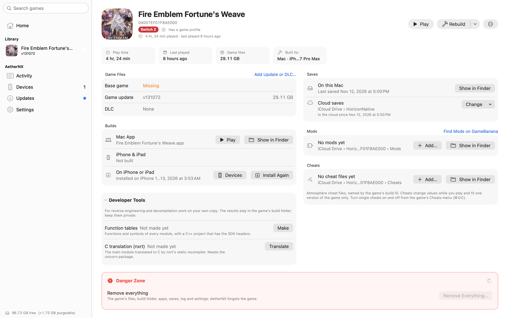
</picture>
<p><b>A page for every game.</b> Its play time, its files and updates, what was built from them and for which device, its saves on the Mac and in iCloud, its mods and cheats, and a Danger Zone that removes exactly what you tick.</p>
</td>
<td width="50%" valign="top">
<picture>
  <source media="(prefers-color-scheme: dark)" srcset="docs/images/studio/progress-dark.png">
  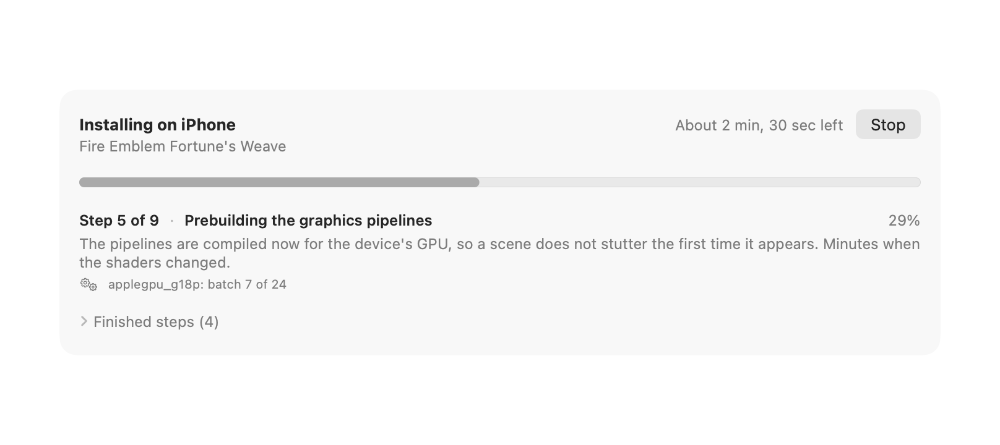
</picture>
<p><b>Builds that say what they are doing.</b> "Step 5 of 9", what that step does and why, the work within it and the time left. A finished build hands the window back by itself; one that fails says what went wrong, with Try Again.</p>
</td>
</tr>
<tr>
<td width="50%" valign="top">
<picture>
  <source media="(prefers-color-scheme: dark)" srcset="docs/images/studio/updates-dark.png">
  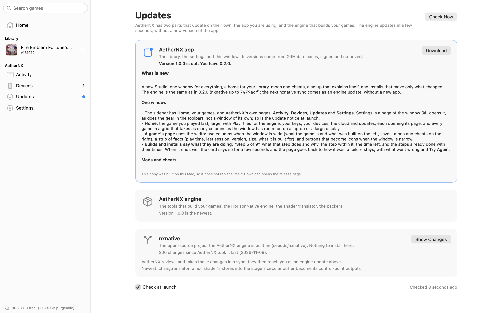
</picture>
<p><b>Updates you can read.</b> The app and the engine update apart, each saying what changed in plain words; nxnative's newest work arrives as an engine update, without a new app.</p>
</td>
<td width="50%" valign="top">
<picture>
  <source media="(prefers-color-scheme: dark)" srcset="docs/images/studio/settings-dark.png">
  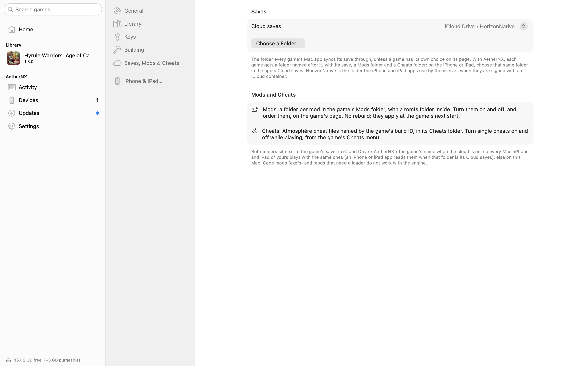
</picture>
<p><b>Settings in the same window.</b> General, Library, Keys, Building, and Saves, Mods &amp; Cheats: a page of the window, like everything else, no extra windows.</p>
</td>
</tr>
</table>

## Get started

You need a Mac with Apple silicon and macOS 26.6 or later. Everything else the builds use (Xcode 27.2 and its Metal toolchain, Homebrew, Python 3.12 or later and a few command-line tools) the app checks on its first launch: it says what each piece is for and why the builds need it, and installs what it can for you.

**1. Download AetherNX.app** from the [latest release](https://github.com/iCosiSenpai/AetherNX/releases/latest), move it to Applications and open it. The **Setup Assistant** finds or downloads the build tools into `~/AetherNX`, checks your Mac, takes your `prod.keys` and your library folder, and asks a few choices. Help → Setup Assistant opens it again.

**2. Put each game in its own folder**, with the base game, its update and its DLC (`.nsp`, `.xci`, `.nsz` or `.xcz`; subfolders such as `DLC/` are fine):

```
~/Games/
  Super Mario Bros. Wonder/
    Super Mario Bros. Wonder [010015100B514000][v0].nsp
    Super Mario Bros. Wonder [010015100B514800][v327680].nsp
```

Use the newest update you have: the game profiles are made for it. A game still in a `.zip`, `.rar` or `.7z` archive shows up too, with an **Unpack** button.

**3. Build, then Play.** Select a game and press **Build**. The first build of a game takes 30 to 60 minutes and needs free space of about twice the game plus 10 GB; later builds reuse most of the work. Then press **Play**, or **Install** to put it on your iPhone or iPad.

<details>
<summary><b>From a terminal, or installing the tools by hand</b></summary>

The tools the Setup Assistant installs, if you prefer to do it yourself ([Xcode](https://developer.apple.com/download/all/?q=Xcode%2027.2) 27.2 first, selected with `sudo xcode-select -s /Applications/Xcode.app`; building for iPhone also needs its iOS platform, in Xcode → Settings → Components; with several Xcode versions installed, select 27.2, whose Metal compiler builds the shaders):

```bash
xcodebuild -downloadComponent MetalToolchain
brew install xcodegen zstd glslang sevenzip libimobiledevice
brew install --cask dotnet-sdk
```

Then the repository itself, instead of the app's download:

```bash
git clone https://github.com/iCosiSenpai/AetherNX.git ~/AetherNX
cd ~/AetherNX
./aethernx setup      # a Python environment with the packages the build needs
./aethernx doctor     # checks Xcode, the tools and your keys, saying why each one matters
./aethernx studio     # builds and opens the app
```

`prod.keys` goes in Settings → Keys, or in `~/.switch/prod.keys`.
</details>

## The app

One window holds everything, and it follows its width: grids take as many columns as fit, two columns become one, and buttons fold into icons when the window narrows, so it works on a laptop and on a large display alike.

- **Home.** The game you played last, large, with Play; tiles for the engine, your keys, your devices and the cloud, each opening its page; and every game in a grid.
- **A game's page.** Play time and the last session, its files, updates and DLC, what was built from them, its saves, mods and cheats, and the actions. At the bottom, the **Danger Zone**: what the game takes on the Mac (game files, build folder, apps, saves, log and settings), with **Remove…** for each part and **Remove Everything…**, to the Trash or deleted for good. iCloud saves are only removed when you tick them.
- **Activity, Devices, Updates and Settings** are pages of the same window, in the sidebar: the running build and the full log; the iPhones and iPads paired with this Mac and how a game's files travel to them; what is new for the app and the engine; and the settings.
- **The Setup Assistant** checks Xcode, its license and Metal toolchain, Homebrew, Git, Python and its packages, the command-line tools, `afcclient` and the signing identities, says what each is for, and installs what is missing.
- **Game artwork from the internet.** Icons and banners of Switch games come from [nlib.cc](https://api.nlib.cc) by title ID; a game it does not list, Switch 2 games among them, gets its box art from Wikipedia by name. Only the title ID or the name is sent, the pictures are kept on the Mac, and the icon in the game's own files is the fallback. Nothing is looked up before the Setup Assistant is done or skipped; Settings → General turns it off.
- **Builds on another disk.** Settings → Library → *Builds and Mac apps* puts every new build folder and Mac app in a folder on an external drive or a network share, so they take no room on this Mac; a game's page shows where its build is, with **Move to** that disk (or back), checked file by file before the original goes. Keep the games there too by adding a folder of that disk to the library.
- **Room for the first build.** Before a first build the app checks the free space the build needs. When it is short only because macOS keeps it in local Time Machine snapshots of files you deleted, it offers to remove those snapshots and start the build.
- **Play time.** Time played and the last session of each game, counted whenever its Mac app runs while AetherNX is open, also when opened from Finder; Home and Console Mode put the last played game first.
- **Updates**, checked at launch and from AetherNX → Check for Updates: a new release of the app (downloaded, checked against the release's checksum and for its Developer ID signature, installed and reopened; a copy you built yourself opens the release page instead), new changes of the engine (**Update** pulls them), and how far nxnative has moved since AetherNX's engine last synced with it. The menu bar item shows them, and a running build.
- **Saves.** Each game's page shows its save on this Mac and its **cloud saves**: the folder its Mac app syncs through (iCloud Drive › AetherNX, which gives each game a folder with its name; iCloud Drive › HorizonNative; another folder; or off), when the cloud's copy last changed and what the last session said about the sync. **Back Up Now** and **Restore** use the backups kept beside the save (the cloud sync's own, before it replaces a save, and yours); a restore sets this Mac's save aside first. One folder for the whole library is in Settings → Saves, Mods & Cheats; a game with a choice of its own keeps it ([Cloud saves](docs/settings.md#cloud-saves)).
- **A build queue.** Press Build or Install on other games while one builds: they wait their turn under the running job and start one after the other; a stopped job pauses the queue until Continue.
- **Notifications** when a build ends while the app is in the background, and **bug reports**: More → **Make Bug Report…** writes a zip with the game's logs, versions and settings to the Desktop, never any game data.

The app is in English and Italian.

| Shortcut | Action |
|---|---|
| <kbd>⌘</kbd> <kbd>R</kbd> | Play the selected game's Mac app |
| <kbd>⌘</kbd> <kbd>B</kbd> | Build the Mac app |
| <kbd>⇧</kbd> <kbd>⌘</kbd> <kbd>I</kbd> | Build, sign and install on your iPhone or iPad |
| <kbd>⇧</kbd> <kbd>⌘</kbd> <kbd>B</kbd> | Build for iPhone and iPad |
| <kbd>⌥</kbd> <kbd>⇧</kbd> <kbd>⌘</kbd> <kbd>B</kbd> | Build for iPhone and iPad, game files separate |
| <kbd>⌥</kbd> <kbd>⌘</kbd> <kbd>B</kbd> | Prepare an Xcode project |
| <kbd>⌘</kbd> <kbd>.</kbd> | Stop the running build |
| <kbd>⌘</kbd> <kbd>1</kbd> … <kbd>⌘</kbd> <kbd>4</kbd> | Home, Activity, Devices, Updates |
| <kbd>⌘</kbd> <kbd>O</kbd> | Add a library folder |
| <kbd>⇧</kbd> <kbd>⌘</kbd> <kbd>O</kbd> | Unpack an archive |
| <kbd>⌘</kbd> <kbd>I</kbd> | Add an update or DLC to the selected game |
| <kbd>⇧</kbd> <kbd>⌘</kbd> <kbd>R</kbd> | Rescan the library |
| <kbd>⌥</kbd> <kbd>⌘</kbd> <kbd>R</kbd> | Show the game in Finder |
| <kbd>⇧</kbd> <kbd>⌘</kbd> <kbd>Y</kbd> | Show or hide the activity log |
| <kbd>⌃</kbd> <kbd>⌘</kbd> <kbd>C</kbd> | Console Mode (or ≡ on a controller) |
| <kbd>⌘</kbd> <kbd>F</kbd> | Search the library |
| <kbd>⌘</kbd> <kbd>,</kbd> | Settings |

## Mods and cheats

Each game has a **Mods** folder and a **Cheats** folder next to its save. With its cloud saves in iCloud Drive (iCloud Drive › AetherNX › the game's name), every Mac of yours plays with the same ones; with cloud saves off, they stay on this Mac. The game's page lists them, with **Add…** and **Show in Finder**.

- **Mods** replace the game's files: one folder per mod, with a `romfs` folder inside (Atmosphère's `atmosphere/contents/<title ID>/romfs` layout works too). Turn them on and off and put them in order on the game's page; the first mod that has a file wins. They apply at the game's next start, with no rebuild. **Find Mods on GameBanana** searches for the game there. Code mods (`exefs`) and mods that need a loader do not run.
- **Cheats** are Atmosphère cheat files, named after the game's build ID. Turn single cheats on and off while you play, from the game's Cheats menu.

The iPhone and iPad apps do not read mods and cheats yet; the format is in [Mods and cheats from a front end](docs/frontends.md#mods-and-cheats-from-a-front-end-mac).

## Console Mode

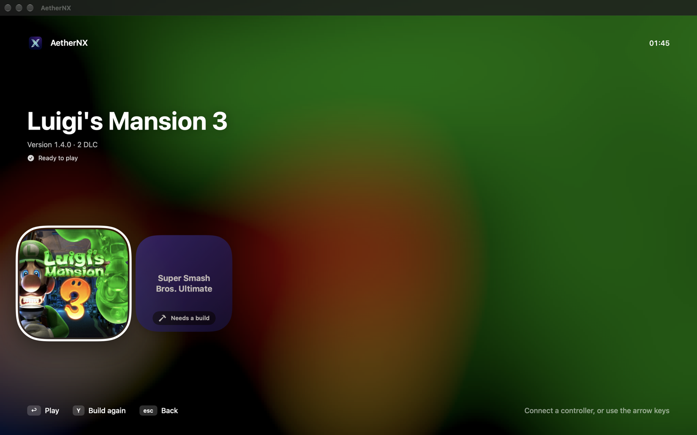

Pick up a controller and press **≡** (Menu), or choose View → Console Mode (<kbd>⌃</kbd> <kbd>⌘</kbd> <kbd>C</kbd>): the library fills the screen, with each game's art behind it. Move with the stick, the d-pad or the arrow keys; **A** plays the game, or builds it if it is not built yet; **Y** builds it again; **B** goes back. The hints show your controller's own buttons (Xbox, PlayStation, Switch Pro and other MFi controllers), and a build's progress shows right on the game.

## Command line

`./aethernx` does everything the app does; the app runs it.

| Command | What it does |
|---|---|
| `./aethernx scan [folders] [--json]` | List the games in your library folders (default: `$AETHERNX_LIBRARY`, else `~/Games`) |
| `./aethernx build <game folder> [--target mac\|ios\|ios-slim\|xcode]` | Build a game; other options go to the packing script (`-k` for the keys, `--language it`, `--progress json`, …) |
| `./aethernx devices [--json]` | List the iPhones and iPads paired with this Mac, over the cable or Wi-Fi, and the Apple teams it can sign with |
| `./aethernx install <game folder> [--device <UDID or name>] [--team <team ID>] [--files auto\|bundle\|separate]` | Build a game, sign it with your Apple team and install it on an iPhone or iPad; `auto` keeps large game files on the device, so the next install copies only the app |
| `./aethernx move-build <game folder> [--to <folder> \| --here]` | Move a game's build folder and Mac app to the builds folder (`$AETHERNX_BUILDS`, Studio's setting) or back beside the game |
| `./aethernx unpack <archive or folder>` | Extract `.zip`, `.rar`, `.7z` and `.tar` archives of game packages |
| `./aethernx doctor [--json]` | Check Xcode, the tools, the Python packages and your keys: what each is for, and the command that fixes each missing piece |
| `./aethernx report <game folder>` | Collect a game's logs, versions and settings into one zip for a bug report (no game data) |
| `./aethernx setup [--tools]` | Create `.venv` with the Python packages (`--tools` adds the developer tools' ones) |
| `./aethernx decomp-init <game folder>` | Function and symbol tables of a built game, with a C++ starter project |
| `./aethernx lift <game folder>` | Translate the game's `main` module to C with nxrt |
| `./aethernx studio` | Build and open the app |

`build` finds your keys in `-k`, then `$AETHERNX_KEYS`, then `~/.switch/prod.keys`. Everything about the packing script itself (`scripts/build_ipa_from_nsp.py`, which `build` runs) is in [The packing script in detail](docs/development.md#the-packing-script-in-detail).

## iPhone and iPad

There are two ways to get a game onto the device.

**Install from the Mac.** The first time, connect the iPhone or iPad with a cable, unlock it, choose Trust and turn on Developer Mode (Settings › Privacy & Security). In AetherNX, pick the device and your Apple team on the Devices page, then press **Install** on the game's page (or Game → **Install on iPhone or iPad**, <kbd>⇧</kbd> <kbd>⌘</kbd> <kbd>I</kbd>): the app builds the game, has Xcode sign it with your own team, free or paid, and installs it, saying at every step what it is doing. Installing again keeps the saves. Once paired, a device on the same Wi-Fi network works too (in Finder, turn on *Show this iPhone when on Wi-Fi*). From a terminal it is `./aethernx install <game folder>`. Your team comes from the Apple ID you add in Xcode › Settings › Accounts ([Install on a device from the Mac](docs/development.md#install-on-a-device-from-the-mac)).

**The game files stay on the device.** With **Game files: Automatic** (the Devices page; `--files auto`) and `afcclient` installed (`brew install libimobiledevice`), a game's files are copied once, next to the app instead of inside it, and the next install copies only the app: Fire Emblem Fortune's Weave copies its 27 GB of data once, then only the app, after an engine update say. The copy runs at about 30 MB/s over the cable and 8 MB/s over Wi-Fi, so over Wi-Fi Automatic copies them only once the device already has them; choose **On the device, copied once** to make the first copy there anyway.

**Sideload an IPA.** **Build for iPhone & iPad** makes an unsigned IPA next to the game files. Install it with a sideloading tool such as AltStore, SideStore, Sideloadly or LiveContainer. To sign in Xcode yourself, **Prepare Xcode Project** makes the project the install uses ([Build and run on a device with Xcode](docs/development.md#build-and-run-on-a-device-with-xcode)).

- **Big games need the Increased Memory Limit.** Without it iOS gives an app about 3.4 GB and closes a game that needs more, with no message. The app asks for it; an install from the Mac or from Xcode carries it, a sideloading tool may drop it ([which keep it, and how to check](docs/playing.md#the-increased-memory-limit)).
- **No JIT.** The game's code is rewritten and compiled into the app on the Mac, so iOS runs it like any other app: no JIT, no debugger, no second device.
- **Free Apple ID.** Apps signed with a free account expire after 7 days; install again from the Mac (the game files stay), or let SideStore or AltStore sign a sideloaded IPA again from the phone.
- **Saves on both.** The Mac app and the iPhone app of a game share a save through iCloud Drive ([Cloud saves](docs/settings.md#cloud-saves)).
- **A companion app** that lists the games you installed from your Macs, with their saves, mods and cheats, is in the works ([AetherNX Companion](docs/companion.md)).
- It needs iOS or iPadOS 26 on an iPhone 15 Pro or later, or an iPad with an M1 chip or later.

Controls, saves and in-game settings: [Playing](docs/playing.md) and [Settings](docs/settings.md).

## Games

The engine has profiles for 154 games: their patches, shaders and tested settings. The [website](https://icosisenpai.github.io/AetherNX/#games) puts the ones below on a shelf. A game without a profile still gets a best-effort build and a survey, which may not start. The results below come from the nxnative project and its contributors; see each game's note for the platforms and known issues ([all game notes](dm/games/README.md#games)). Under a game, "60 fps with 1.2.0" means it runs at 60 fps (30 on the Switch) with that update.

<details>
<summary><b>Show the games reported working</b></summary>

<!-- gallery: written by dm/tools/docs_gallery.py from docs/images/gallery.tsv; change the table, then run it -->
<table>
<tr>
<td align="center" valign="top" width="33%">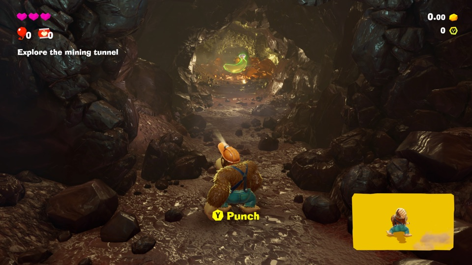<br><small><b><a href="dm/games/040074A01BF12000/README.md">Donkey Kong Bananza</a></b><br>Switch 2, Mac only, from a dump</small></td>
<td align="center" valign="top" width="33%"><br><small><b><a href="dm/games/0400380020056000/README.md">Splatoon Raiders</a></b><br>Switch 2, Mac only, from a dump</small></td>
<td align="center" valign="top" width="33%">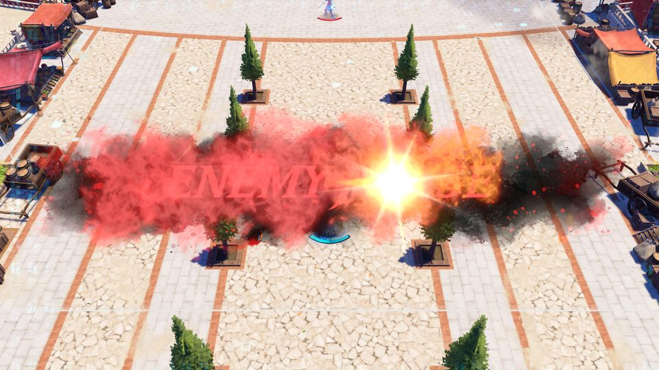<br><small><b><a href="dm/games/04007EF01F8AE000/README.md">Fire Emblem Fortune's Weave</a></b><br>Switch 2, Mac only, from a dump, up to 120 fps</small></td>
</tr>
<tr>
<td align="center" valign="top" width="33%">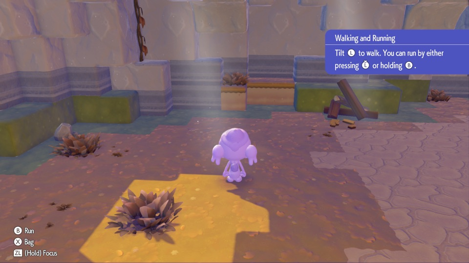<br><small><b><a href="dm/games/0400A3A01EE4C000/README.md">Pokémon Pokopia</a></b><br>Switch 2, Mac only, from a dump</small></td>
<td align="center" valign="top" width="33%">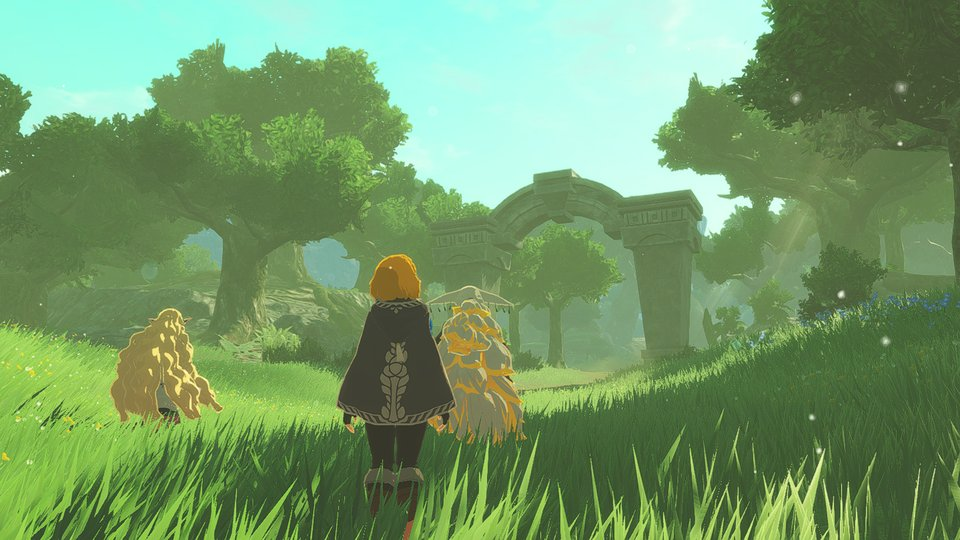<br><small><b><a href="dm/games/04003F40232DE000/README.md">Hyrule Warriors: Age of Imprisonment</a></b><br>Switch 2, Mac only, from a NUP</small></td>
<td align="center" valign="top" width="33%">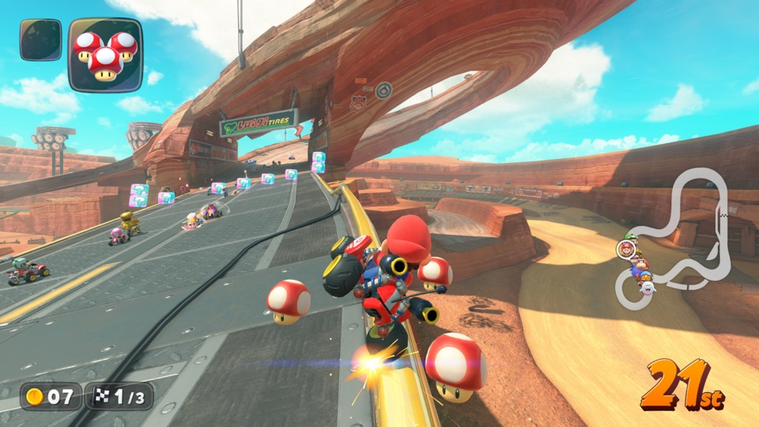<br><small><b><a href="dm/games/0400C3F00006E000/README.md">Mario Kart World</a></b><br>Switch 2, Mac only, from a dump</small></td>
</tr>
<tr>
<td align="center" valign="top" width="33%">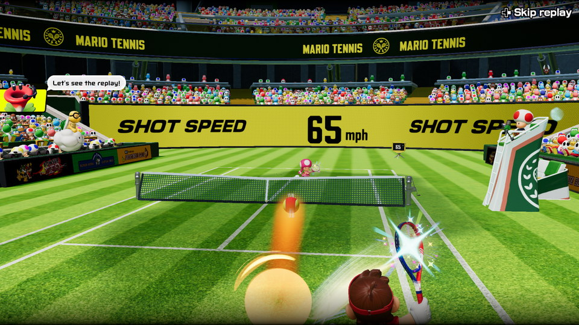<br><small><b><a href="dm/games/0400D4201C6EA000/README.md">Mario Tennis Fever</a></b><br>Switch 2, Mac only, from a dump</small></td>
<td align="center" valign="top" width="33%">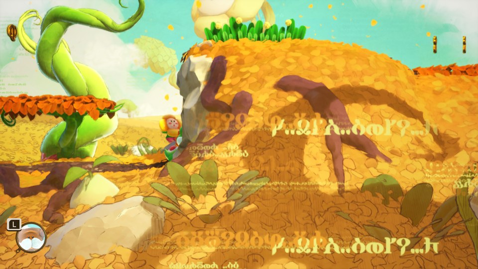<br><small><b><a href="dm/games/0400245021D2C000/README.md">Yoshi and the Mysterious Book</a></b><br>Switch 2, Mac only</small></td>
<td align="center" valign="top" width="33%"><br><small><b><a href="dm/games/0400486024DEC000/README.md">The Legend of Zelda: Ocarina of Time</a></b><br>Switch 2, Mac only, from a NUP</small></td>
</tr>
<tr>
<td align="center" valign="top" width="33%"><br><small><b><a href="dm/games/0100152000022000/README.md">Mario Kart 8 Deluxe</a></b><br>no Mii heads</small></td>
<td align="center" valign="top" width="33%">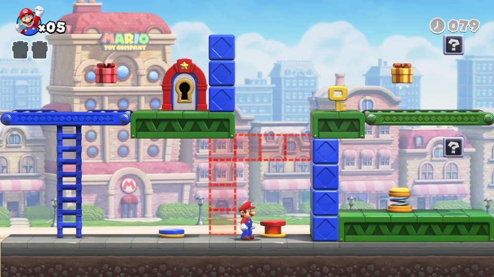<br><small><b><a href="dm/games/0100B99019412000/README.md">Mario vs. Donkey Kong</a></b></small></td>
<td align="center" valign="top" width="33%"><br><small><b><a href="dm/games/0100ECD018EBE000/README.md">Paper Mario: The Thousand-Year Door</a></b><br>60 fps with 1.0.1</small></td>
</tr>
<tr>
<td align="center" valign="top" width="33%"><br><small><b><a href="dm/games/010028600EBDA000/README.md">Super Mario 3D World + Bowser's Fury</a></b></small></td>
<td align="center" valign="top" width="33%"><br><small><b><a href="dm/games/010015100B514000/README.md">Super Mario Bros. Wonder</a></b></small></td>
<td align="center" valign="top" width="33%">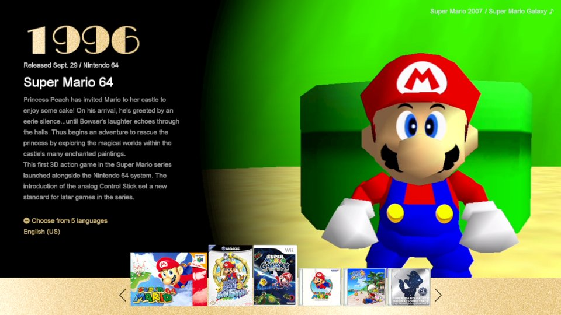<br><small><b><a href="dm/games/010049900F546000/README.md">Super Mario 3D All-Stars</a></b><br>Super Mario 64 and Sunshine; Galaxy is 32-bit ARM, which Apple silicon cannot run</small></td>
</tr>
<tr>
<td align="center" valign="top" width="33%"><br><small><b><a href="dm/games/010099C022B96000/README.md">Super Mario Galaxy</a></b></small></td>
<td align="center" valign="top" width="33%"><br><small><b><a href="dm/games/0100FD8022DAA000/README.md">Super Mario Galaxy 2</a></b></small></td>
<td align="center" valign="top" width="33%"><br><small><b><a href="dm/games/0100000000010000/README.md">Super Mario Odyssey</a></b></small></td>
</tr>
<tr>
<td align="center" valign="top" width="33%"><br><small><b><a href="dm/games/01007EF00011E000/README.md">The Legend of Zelda: Breath of the Wild</a></b><br>60 fps with 1.9.0</small></td>
<td align="center" valign="top" width="33%"><br><small><b><a href="dm/games/01006BB00C6F0000/README.md">The Legend of Zelda: Link's Awakening</a></b></small></td>
<td align="center" valign="top" width="33%"><br><small><b><a href="dm/games/0100F2C0115B6000/README.md">The Legend of Zelda: Tears of the Kingdom</a></b><br>60 fps with 1.4.3</small></td>
</tr>
<tr>
<td align="center" valign="top" width="33%"><br><small><b><a href="dm/games/01003FC01670C000/README.md">13 Sentinels: Aegis Rim</a></b></small></td>
<td align="center" valign="top" width="33%"><br><small><b><a href="dm/games/0100A83022A22000/README.md">Absolum</a></b></small></td>
<td align="center" valign="top" width="33%">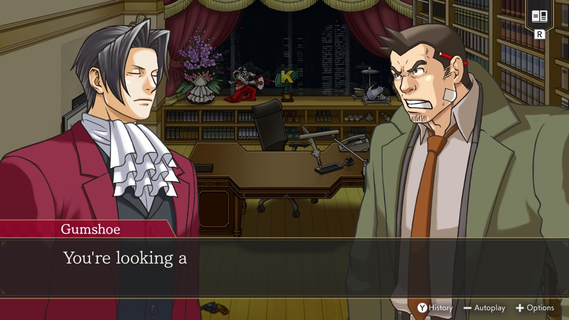<br><small><b><a href="dm/games/010005501E68C000/README.md">Ace Attorney Investigations Collection</a></b></small></td>
</tr>
<tr>
<td align="center" valign="top" width="33%"><br><small><b><a href="dm/games/0100300012F2A000/README.md">Advance Wars 1+2: Re-Boot Camp</a></b></small></td>
<td align="center" valign="top" width="33%">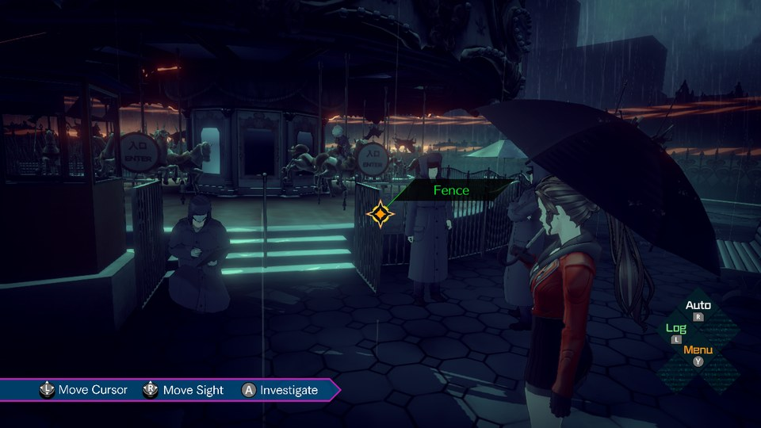<br><small><b><a href="dm/games/010089B00D09C000/README.md">AI: THE SOMNIUM FILES</a></b></small></td>
<td align="center" valign="top" width="33%"><br><small><b><a href="dm/games/0100713016CCC000/README.md">AI: THE SOMNIUM FILES - nirvanA Initiative</a></b></small></td>
</tr>
<tr>
<td align="center" valign="top" width="33%"><br><small><b><a href="dm/games/01006F8002326000/README.md">Animal Crossing: New Horizons</a></b></small></td>
<td align="center" valign="top" width="33%"><br><small><b><a href="dm/games/010020D01AD24000/README.md">ANIMAL WELL</a></b></small></td>
<td align="center" valign="top" width="33%">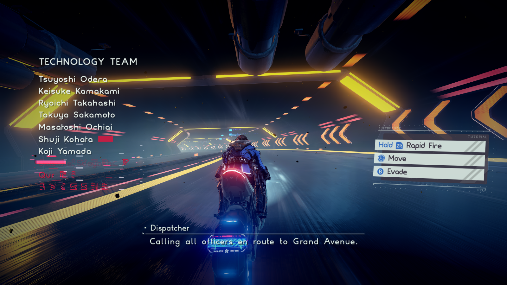<br><small><b><a href="dm/games/01007300020FA000/README.md">ASTRAL CHAIN</a></b><br>60 fps target with 1.0.1</small></td>
</tr>
<tr>
<td align="center" valign="top" width="33%"><br><small><b><a href="dm/games/0100CD801CE5E000/README.md">Balatro</a></b><br>played by touch</small></td>
<td align="center" valign="top" width="33%">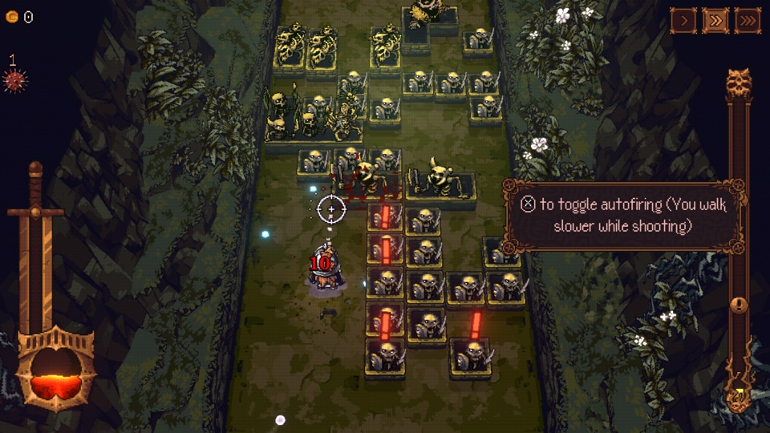<br><small><b><a href="dm/games/010086A022444000/README.md">BALL x PIT</a></b></small></td>
<td align="center" valign="top" width="33%"><br><small><b><a href="dm/games/010076F0049A2000/README.md">Bayonetta</a></b></small></td>
</tr>
<tr>
<td align="center" valign="top" width="33%"><br><small><b><a href="dm/games/01007960049A0000/README.md">Bayonetta 2</a></b></small></td>
<td align="center" valign="top" width="33%">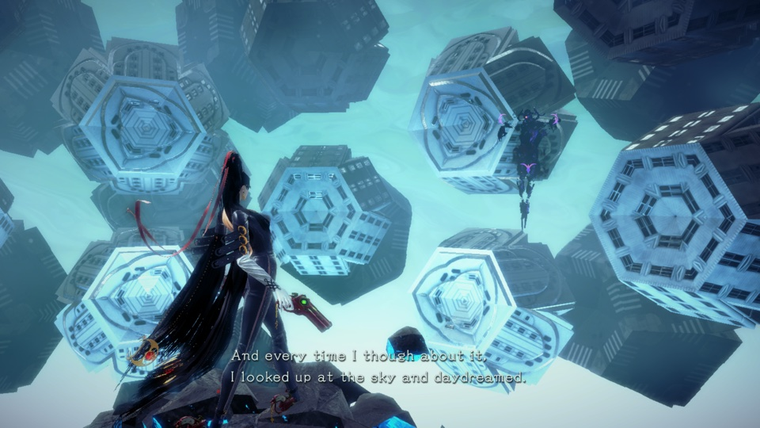<br><small><b><a href="dm/games/01004A4010FEA000/README.md">Bayonetta 3</a></b></small></td>
<td align="center" valign="top" width="33%"><br><small><b><a href="dm/games/0100620012D6E000/README.md">Big Brain Academy: Brain vs. Brain</a></b></small></td>
</tr>
<tr>
<td align="center" valign="top" width="33%">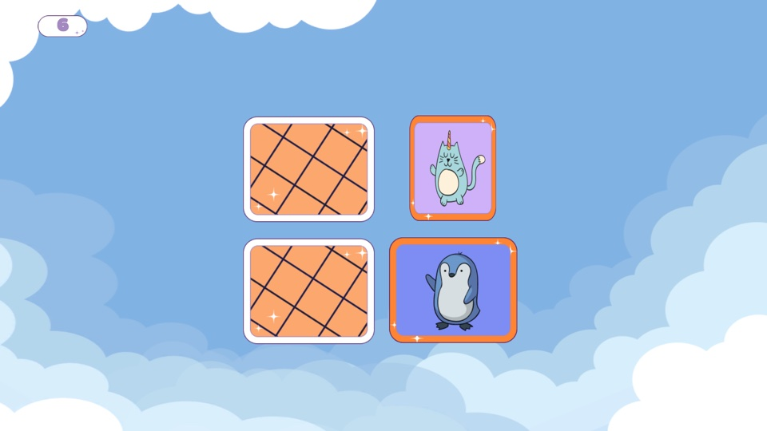<br><small><b><a href="dm/games/0100F5D01DA3A000/README.md">Brain Memory Training Academy</a></b></small></td>
<td align="center" valign="top" width="33%">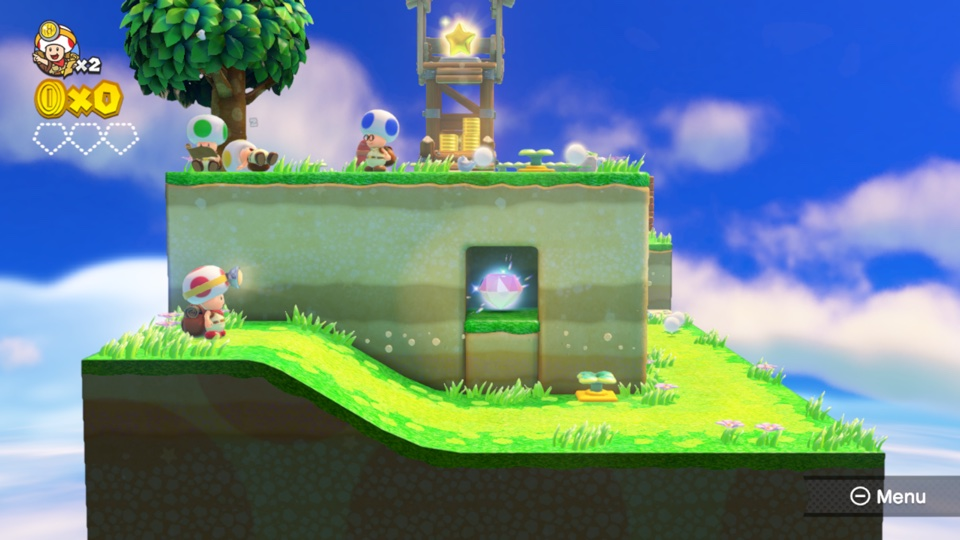<br><small><b><a href="dm/games/01009BF0072D4000/README.md">Captain Toad: Treasure Tracker</a></b></small></td>
<td align="center" valign="top" width="33%"><br><small><b><a href="dm/games/0100BF00112C0000/README.md">Catherine: Full Body</a></b></small></td>
</tr>
<tr>
<td align="center" valign="top" width="33%"><br><small><b><a href="dm/games/01002B30028F6000/README.md">Celeste</a></b></small></td>
<td align="center" valign="top" width="33%"><br><small><b><a href="dm/games/0100A5C00D162000/README.md">Cuphead</a></b></small></td>
<td align="center" valign="top" width="33%"><br><small><b><a href="dm/games/01004AB00A260000/README.md">DARK SOULS: REMASTERED</a></b><br>60 fps with 1.0.3</small></td>
</tr>
<tr>
<td align="center" valign="top" width="33%"><br><small><b><a href="dm/games/010014E00DB56000/README.md">Digimon Story Cyber Sleuth: Complete Edition</a></b></small></td>
<td align="center" valign="top" width="33%">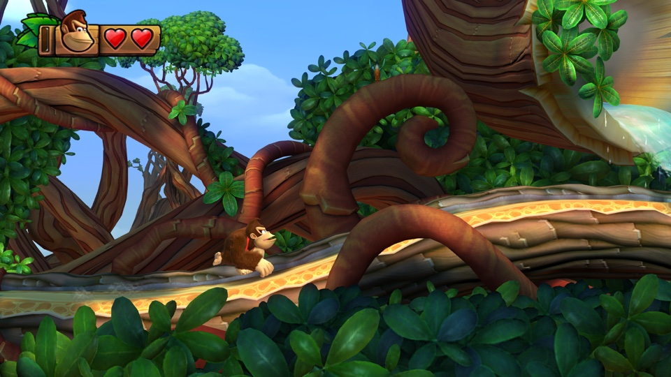<br><small><b><a href="dm/games/0100C1F0051B6000/README.md">Donkey Kong Country: Tropical Freeze</a></b></small></td>
<td align="center" valign="top" width="33%">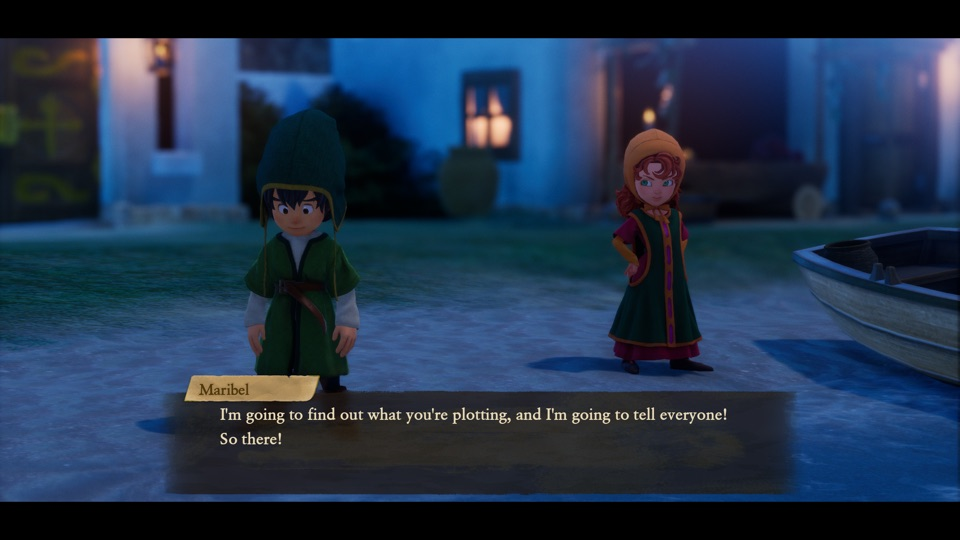<br><small><b><a href="dm/games/0100A9D01C446000/README.md">DRAGON QUEST VII Reimagined</a></b><br>60 fps with 1.2.0</small></td>
</tr>
<tr>
<td align="center" valign="top" width="33%">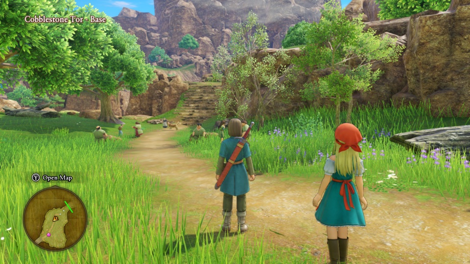<br><small><b><a href="dm/games/01006C300E9F0000/README.md">DRAGON QUEST XI S: Echoes of an Elusive Age – Definitive Edition</a></b><br>60 fps with 1.0.4</small></td>
<td align="center" valign="top" width="33%">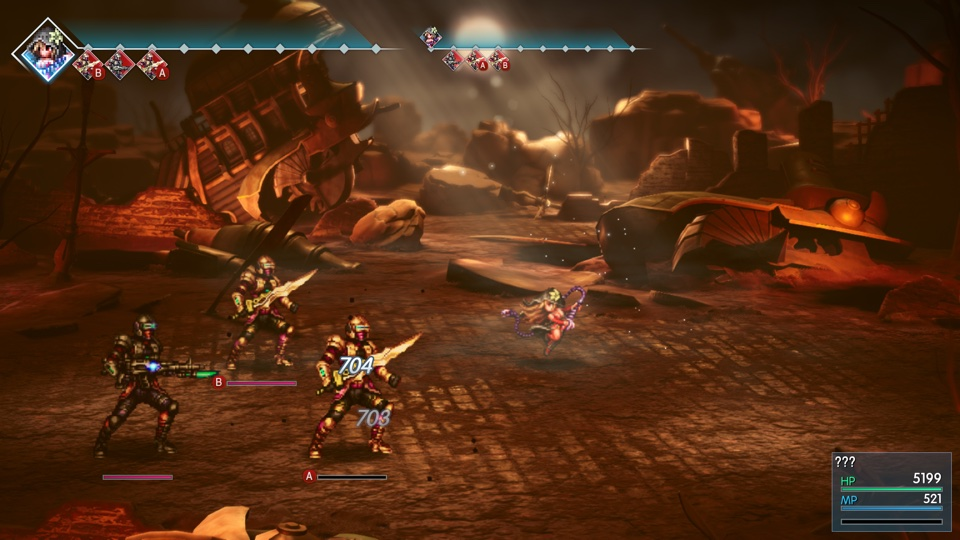<br><small><b><a href="dm/games/0100606026F12000/README.md">FINAL FANTASY RESONANCE</a></b><br>60 fps with 1.0.1</small></td>
<td align="center" valign="top" width="33%"><br><small><b><a href="dm/games/010038B015560000/README.md">FINAL FANTASY TACTICS - The Ivalice Chronicles</a></b></small></td>
</tr>
<tr>
<td align="center" valign="top" width="33%"><br><small><b><a href="dm/games/0100A6301214E000/README.md">Fire Emblem Engage</a></b><br>60 fps</small></td>
<td align="center" valign="top" width="33%">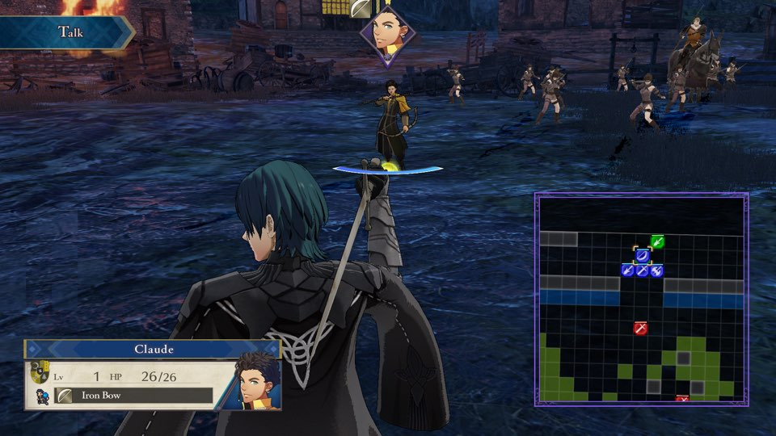<br><small><b><a href="dm/games/010055D009F78000/README.md">Fire Emblem: Three Houses</a></b><br>60 fps with 1.2.0</small></td>
<td align="center" valign="top" width="33%"><br><small><b><a href="dm/games/010029B018432000/README.md">Ghost Trick: Phantom Detective</a></b></small></td>
</tr>
<tr>
<td align="center" valign="top" width="33%">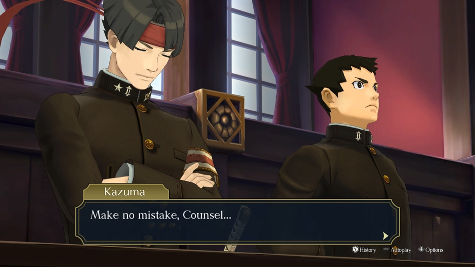<br><small><b><a href="dm/games/010036E00FB20000/README.md">The Great Ace Attorney Chronicles</a></b></small></td>
<td align="center" valign="top" width="33%"><br><small><b><a href="dm/games/0100535012974000/README.md">Hades</a></b></small></td>
<td align="center" valign="top" width="33%"><br><small><b><a href="dm/games/0100A00019DE0000/README.md">Hades II</a></b></small></td>
</tr>
<tr>
<td align="center" valign="top" width="33%"><br><small><b><a href="dm/games/010013C00E930000/README.md">Hollow Knight: Silksong</a></b></small></td>
<td align="center" valign="top" width="33%">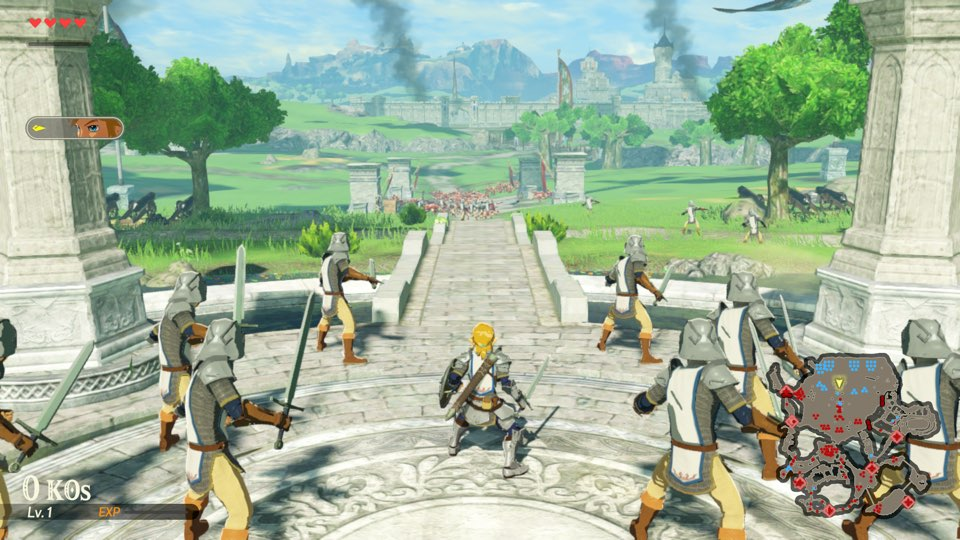<br><small><b><a href="dm/games/01002B00111A2000/README.md">Hyrule Warriors: Age of Calamity</a></b><br>60 fps with 1.3.0</small></td>
<td align="center" valign="top" width="33%"><br><small><b><a href="dm/games/01004D300C5AE000/README.md">Kirby and the Forgotten Land</a></b></small></td>
</tr>
<tr>
<td align="center" valign="top" width="33%"><br><small><b><a href="dm/games/0100DCA0064A6000/README.md">Luigi's Mansion 3</a></b><br>60 fps with 1.4.0</small></td>
<td align="center" valign="top" width="33%"><br><small><b><a href="dm/games/010093801237C000/README.md">Metroid Dread</a></b></small></td>
<td align="center" valign="top" width="33%">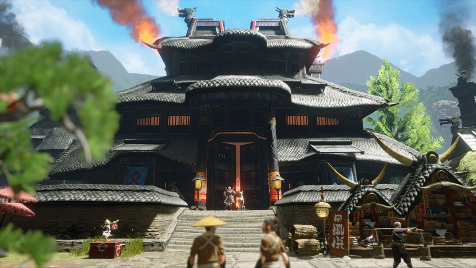<br><small><b><a href="dm/games/0100B04011742000/README.md">Monster Hunter Rise</a></b><br>60 fps with 16.0.2</small></td>
</tr>
<tr>
<td align="center" valign="top" width="33%">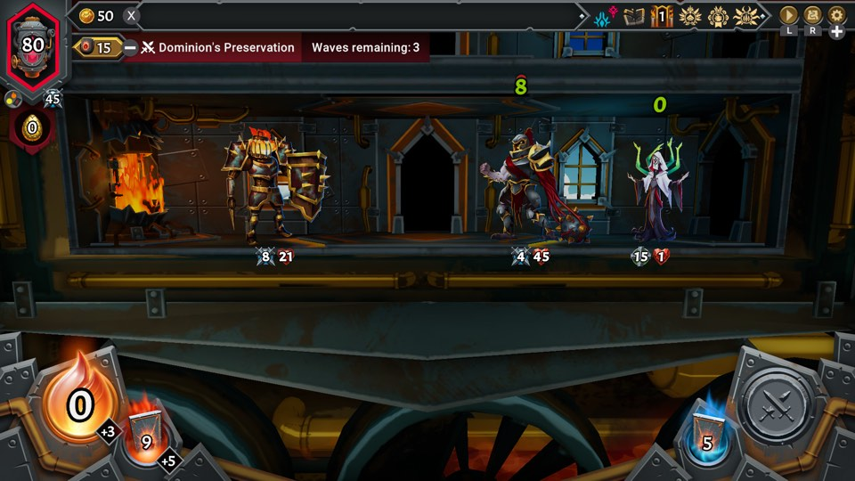<br><small><b><a href="dm/games/010051701FB46000/README.md">Monster Train 2</a></b><br>60 fps with 1.1.1</small></td>
<td align="center" valign="top" width="33%"><br><small><b><a href="dm/games/010057D006492000/README.md">OCTOPATH TRAVELER</a></b><br>60 fps</small></td>
<td align="center" valign="top" width="33%">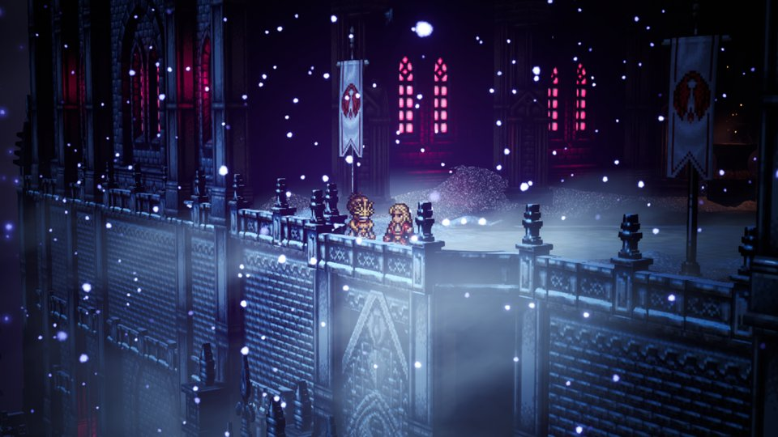<br><small><b><a href="dm/games/01005270232F2000/README.md">Octopath Traveler 0</a></b><br>60 fps with 1.0.5</small></td>
</tr>
<tr>
<td align="center" valign="top" width="33%"><br><small><b><a href="dm/games/0100A3501946E000/README.md">Octopath Traveler II</a></b><br>60 fps with 1.1.1</small></td>
<td align="center" valign="top" width="33%"><br><small><b><a href="dm/games/0100E44016C22000/README.md">Patrick's Parabox</a></b></small></td>
<td align="center" valign="top" width="33%"><br><small><b><a href="dm/games/01005CA01580E000/README.md">Persona 5 Royal</a></b></small></td>
</tr>
<tr>
<td align="center" valign="top" width="33%"><br><small><b><a href="dm/games/0100B7C00933A000/README.md">Pikmin 4</a></b><br>60 fps, up to 120 on the Mac</small></td>
<td align="center" valign="top" width="33%"><br><small><b><a href="dm/games/0100000011D90000/README.md">Pokémon Brilliant Diamond</a></b><br>60 fps</small></td>
<td align="center" valign="top" width="33%">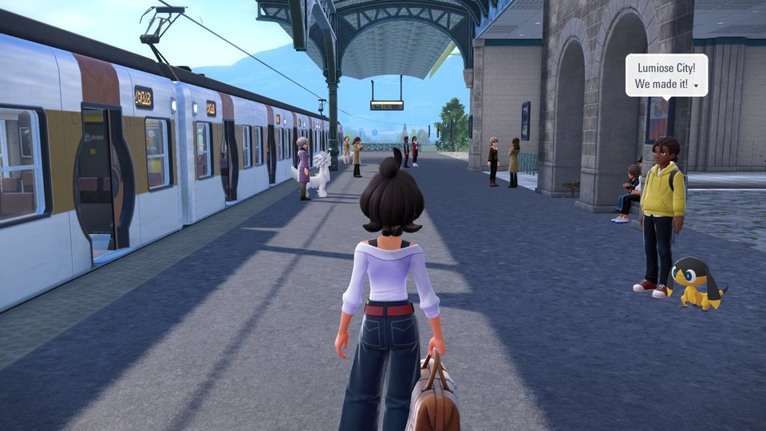<br><small><b><a href="dm/games/0100F43008C44000/README.md">Pokémon Legends: Z-A</a></b></small></td>
</tr>
<tr>
<td align="center" valign="top" width="33%"><br><small><b><a href="dm/games/0100A3D008C5C000/README.md">Pokémon Scarlet</a></b></small></td>
<td align="center" valign="top" width="33%"><br><small><b><a href="dm/games/01008F6008C5E000/README.md">Pokémon Violet</a></b></small></td>
<td align="center" valign="top" width="33%">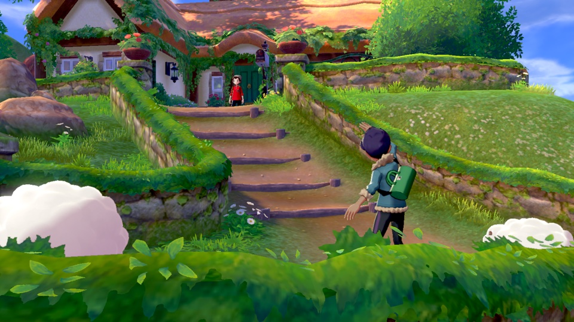<br><small><b><a href="dm/games/0100ABF008968000/README.md">Pokémon Sword</a></b></small></td>
</tr>
<tr>
<td align="center" valign="top" width="33%"><br><small><b><a href="dm/games/01008DB008C2C000/README.md">Pokémon Shield</a></b></small></td>
<td align="center" valign="top" width="33%"><br><small><b><a href="dm/games/01007BB017812000/README.md">Portal</a></b></small></td>
<td align="center" valign="top" width="33%">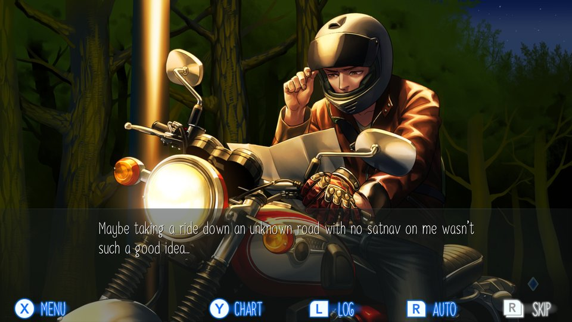<br><small><b><a href="dm/games/010020400E1C2000/README.md">Raging Loop</a></b></small></td>
</tr>
<tr>
<td align="center" valign="top" width="33%"><br><small><b><a href="dm/games/0100D9F01D474000/README.md">Rhythm Heaven Groove</a></b></small></td>
<td align="center" valign="top" width="33%"><br><small><b><a href="dm/games/0100C2A01A730000/README.md">ROMANCE OF THE THREE KINGDOMS 8 REMAKE</a></b><br>controller only</small></td>
<td align="center" valign="top" width="33%"><br><small><b><a href="dm/games/01008C0016544000/README.md">Sea of Stars</a></b></small></td>
</tr>
<tr>
<td align="center" valign="top" width="33%"><br><small><b><a href="dm/games/010069C01AB82000/README.md">SHIN MEGAMI TENSEI V: Vengeance</a></b><br>60 fps with 1.0.3</small></td>
<td align="center" valign="top" width="33%"><br><small><b><a href="dm/games/0100E65002BB8000/README.md">Stardew Valley</a></b></small></td>
<td align="center" valign="top" width="33%"><br><small><b><a href="dm/games/01008BC024FDE000/README.md">STEINS;GATE RE:BOOT</a></b></small></td>
</tr>
<tr>
<td align="center" valign="top" width="33%">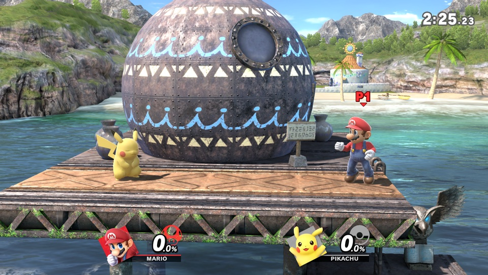<br><small><b><a href="dm/games/01006A800016E000/README.md">Super Smash Bros. Ultimate</a></b><br>offline</small></td>
<td align="center" valign="top" width="33%"><br><small><b><a href="dm/games/0100346017304000/README.md">Taiko Risshiden V DX</a></b><br>Japanese · played by touch</small></td>
<td align="center" valign="top" width="33%">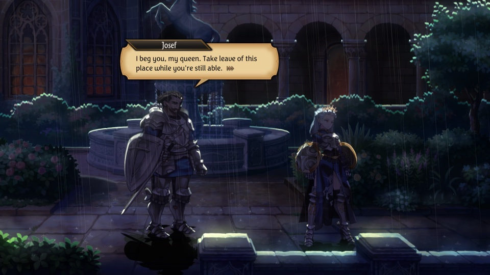<br><small><b><a href="dm/games/010069401ADB8000/README.md">Unicorn Overlord</a></b></small></td>
</tr>
<tr>
<td align="center" valign="top" width="33%"><br><small><b><a href="dm/games/01006000040C2000/README.md">Yoshi's Crafted World</a></b></small></td>
<td align="center" valign="top" width="33%"><br><small><b><a href="dm/games/010056B015FE8000/README.md">NieR:Automata The End of YoRHa Edition</a></b><br>60 fps with 1.0.3</small></td>
<td align="center" valign="top" width="33%"><br><small><b><a href="dm/games/01008CF01BAAC000/README.md">The Legend of Zelda: Echoes of Wisdom</a></b></small></td>
</tr>
<tr>
<td align="center" valign="top" width="33%"><br><small><b><a href="dm/games/01009D901BC56000/README.md">Donkey Kong Country Returns HD</a></b></small></td>
<td align="center" valign="top" width="33%"><br><small><b><a href="dm/games/0100317013770000/README.md">Mario + Rabbids Sparks of Hope</a></b></small></td>
<td align="center" valign="top" width="33%"><br><small><b><a href="dm/games/0100E95004038000/README.md">Xenoblade Chronicles 2</a></b></small></td>
</tr>
<tr>
<td align="center" valign="top" width="33%"><br><small><b><a href="dm/games/010074F013262000/README.md">Xenoblade Chronicles 3</a></b></small></td>
<td align="center" valign="top" width="33%"><br><small><b><a href="dm/games/0100CE4010AAC000/README.md">FINAL FANTASY CRYSTAL CHRONICLES Remastered Edition</a></b></small></td>
<td align="center" valign="top" width="33%"><br><small><b><a href="dm/games/010032E00E6E2000/README.md">Return of the Obra Dinn</a></b></small></td>
</tr>
<tr>
<td align="center" valign="top" width="33%"><br><small><b><a href="dm/games/010040801A4C8000/README.md">Blasphemous 2</a></b></small></td>
<td align="center" valign="top" width="33%"><br><small><b><a href="dm/games/0100D5B026844000/README.md">Silver Pines</a></b></small></td>
<td align="center" valign="top" width="33%">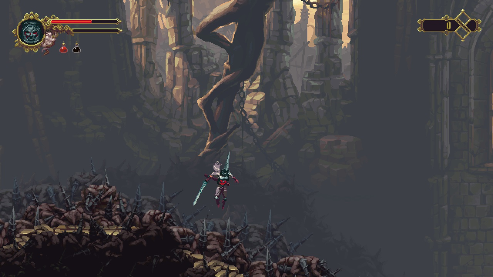<br><small><b><a href="dm/games/0100698009C6E000/README.md">Blasphemous</a></b></small></td>
</tr>
<tr>
<td align="center" valign="top" width="33%"><br><small><b><a href="dm/games/0100BC300CB48000/README.md">FINAL FANTASY X/X-2 HD Remaster</a></b></small></td>
<td align="center" valign="top" width="33%"><br><small><b><a href="dm/games/010067300059A000/README.md">Mario + Rabbids Kingdom Battle</a></b></small></td>
<td align="center" valign="top" width="33%"><br><small><b><a href="dm/games/010062B01525C000/README.md">Persona 4 Golden</a></b></small></td>
</tr>
<tr>
<td align="center" valign="top" width="33%">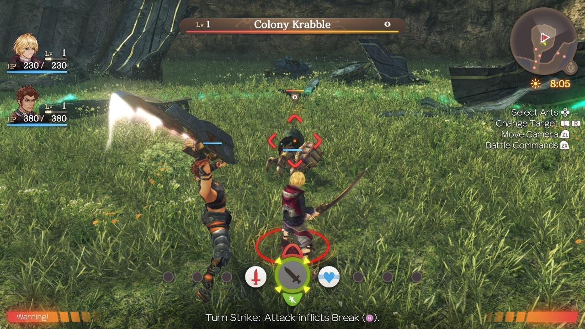<br><small><b><a href="dm/games/0100FF500E34A000/README.md">Xenoblade Chronicles: Definitive Edition</a></b></small></td>
<td align="center" valign="top" width="33%"><br><small><b><a href="dm/games/01001F5010DFA000/README.md">Pokémon Legends: Arceus</a></b></small></td>
<td align="center" valign="top" width="33%">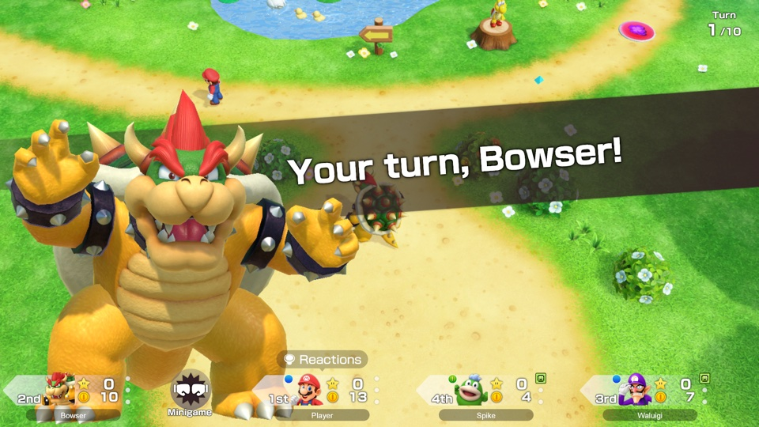<br><small><b><a href="dm/games/0100965017338000/README.md">Super Mario Party Jamboree</a></b></small></td>
</tr>
<tr>
<td align="center" valign="top" width="33%"><br><small><b><a href="dm/games/01002E7016C46000/README.md">Cult of the Lamb</a></b></small></td>
<td align="center" valign="top" width="33%"><br><small><b><a href="dm/games/0100A3900C3E2000/README.md">Paper Mario: The Origami King</a></b></small></td>
<td align="center" valign="top" width="33%"><br><small><b><a href="dm/games/0100ACD0163D0000/README.md">Batman: Arkham Knight</a></b></small></td>
</tr>
<tr>
<td align="center" valign="top" width="33%"><br><small><b><a href="dm/games/010038600B27E000/README.md">Bastion</a></b></small></td>
<td align="center" valign="top" width="33%">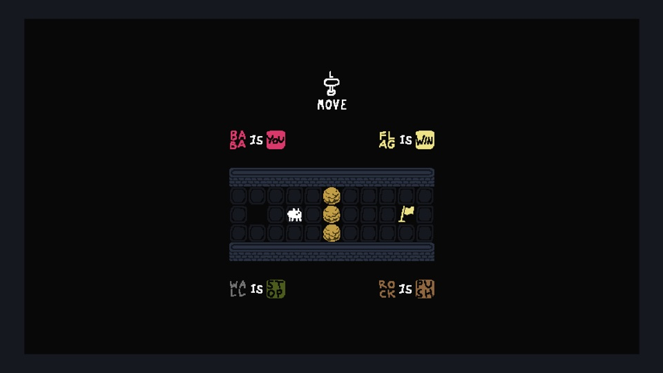<br><small><b><a href="dm/games/01002CD00A51C000/README.md">Baba Is You</a></b></small></td>
<td align="center" valign="top" width="33%"><br><small><b><a href="dm/games/010089C01E9CA000/README.md">SteamWorld Heist II</a></b></small></td>
</tr>
<tr>
<td align="center" valign="top" width="33%">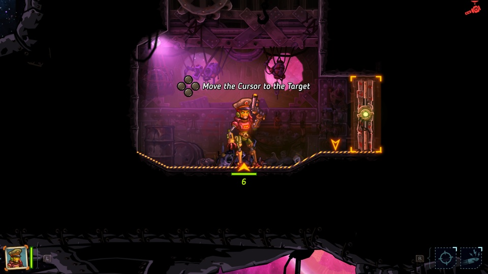<br><small><b><a href="dm/games/010016100A186000/README.md">SteamWorld Heist: Ultimate Edition</a></b></small></td>
<td align="center" valign="top" width="33%"><br><small><b><a href="dm/games/010014C011146000/README.md">Subnautica: Below Zero</a></b></small></td>
<td align="center" valign="top" width="33%">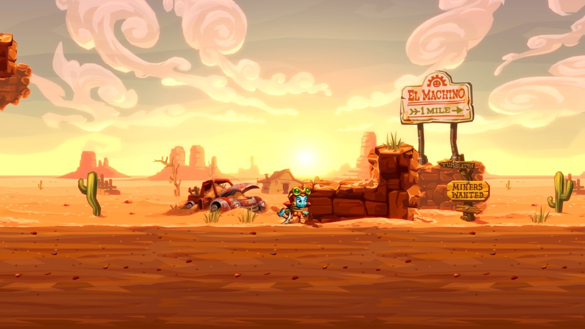<br><small><b><a href="dm/games/0100CA9002322000/README.md">SteamWorld Dig 2</a></b></small></td>
</tr>
<tr>
<td align="center" valign="top" width="33%"><br><small><b><a href="dm/games/0100EC9010258000/README.md">Streets of Rage 4</a></b></small></td>
<td align="center" valign="top" width="33%"><br><small><b><a href="dm/games/01006FE013472000/README.md">Mario Party Superstars</a></b></small></td>
<td align="center" valign="top" width="33%"><br><small><b><a href="dm/games/0100429011144000/README.md">Subnautica</a></b></small></td>
</tr>
<tr>
<td align="center" valign="top" width="33%">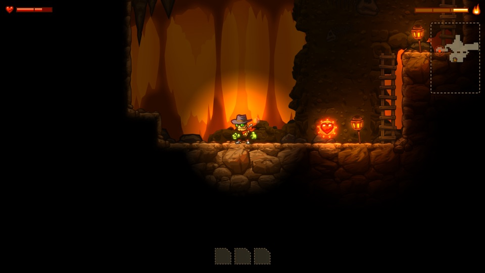<br><small><b><a href="dm/games/01009320084A4000/README.md">SteamWorld Dig</a></b></small></td>
<td align="center" valign="top" width="33%"><br><small><b><a href="dm/games/010092B0091D0000/README.md">Team Sonic Racing</a></b></small></td>
<td align="center" valign="top" width="33%">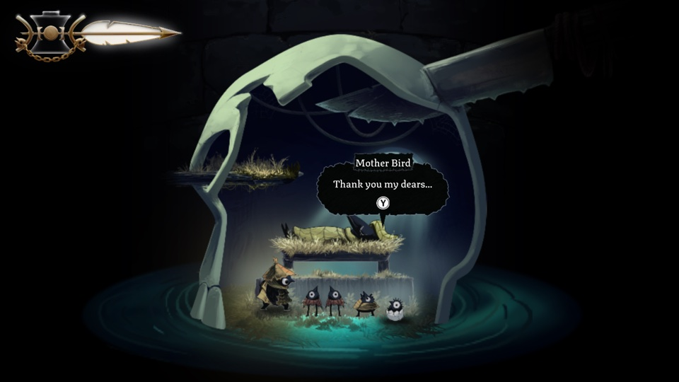<br><small><b><a href="dm/games/0100217023F6C000/README.md">Well Dweller</a></b></small></td>
</tr>
<tr>
<td align="center" valign="top" width="33%"><br><small><b><a href="dm/games/010029B0118E8000/README.md">Need for Speed: Hot Pursuit Remastered</a></b><br>60 fps with 1.0.3</small></td>
<td align="center" valign="top" width="33%"><br><small><b><a href="dm/games/0100C49025D3E000/README.md">EA SPORTS FC 27</a></b><br>60 fps with 1.8d.310c</small></td>
<td align="center" valign="top" width="33%">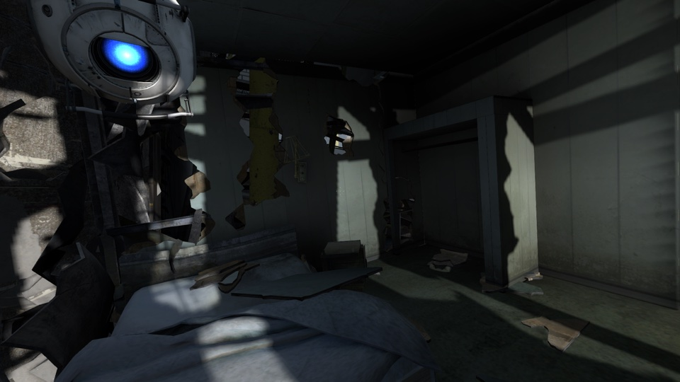<br><small><b><a href="dm/games/0100ABD01785C000/README.md">Portal 2</a></b></small></td>
</tr>
<tr>
<td align="center" valign="top" width="33%"><br><small><b><a href="dm/games/010031F019294000/README.md">Super Monkey Ball Banana Rumble</a></b></small></td>
<td align="center" valign="top" width="33%"><br><small><b><a href="dm/games/0100199023B2E000/README.md">Atelier Ryza: Ever Darkness &amp; the Secret Hideout DX</a></b></small></td>
<td align="center" valign="top" width="33%"><br><small><b><a href="dm/games/01003E601E324000/README.md">DRAGON QUEST III HD-2D Remake</a></b><br>60 fps with 1.1.2</small></td>
</tr>
<tr>
<td align="center" valign="top" width="33%"><br><small><b><a href="dm/games/0100AE00096EA000/README.md">Hyrule Warriors: Definitive Edition</a></b></small></td>
<td align="center" valign="top" width="33%">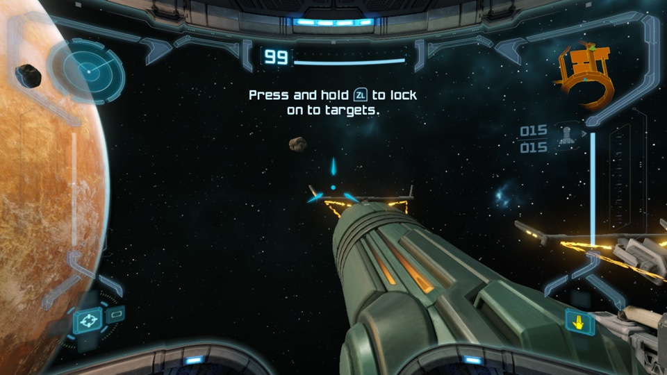<br><small><b><a href="dm/games/010012101468C000/README.md">Metroid Prime Remastered</a></b></small></td>
<td align="center" valign="top" width="33%">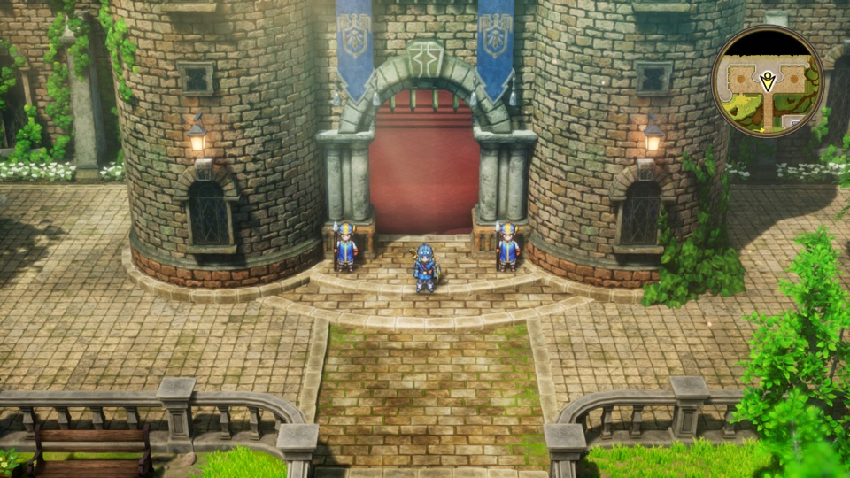<br><small><b><a href="dm/games/0100D7C01F254000/README.md">DRAGON QUEST I &amp; II HD-2D Remake</a></b></small></td>
</tr>
<tr>
<td align="center" valign="top" width="33%">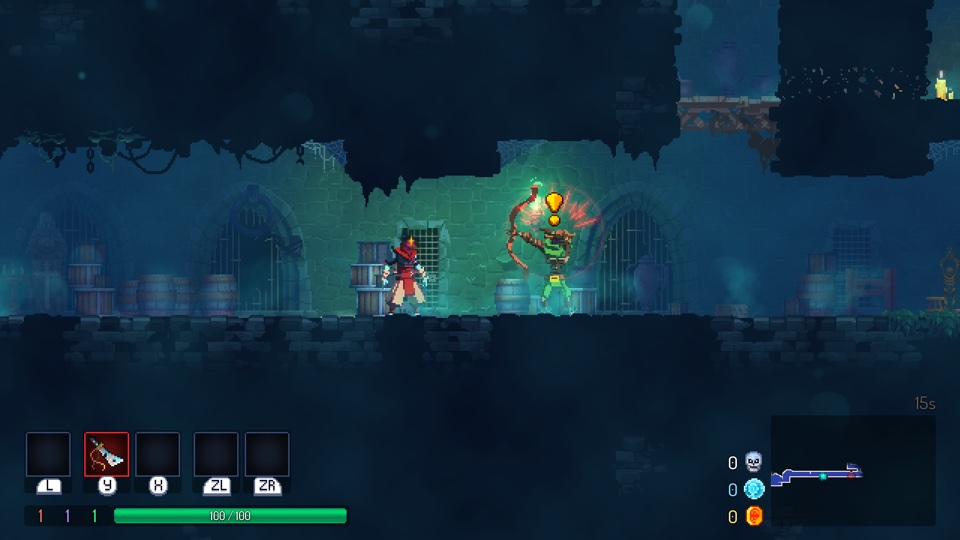<br><small><b><a href="dm/games/0100646009FBE000/README.md">Dead Cells</a></b></small></td>
<td align="center" valign="top" width="33%"><br><small><b><a href="dm/games/0100633007D48000/README.md">Hollow Knight</a></b></small></td>
<td align="center" valign="top" width="33%"><br><small><b><a href="dm/games/0100CC80140F8000/README.md">TRIANGLE STRATEGY</a></b><br>60 fps with 1.1.1</small></td>
</tr>
<tr>
<td align="center" valign="top" width="33%"><br><small><b><a href="dm/games/0100BA4026E94000/README.md">Castlevania: Belmont's Curse</a></b></small></td>
<td align="center" valign="top" width="33%"><br><small><b><a href="dm/games/010063301BD50000/README.md">SUPER ROBOT WARS Y</a></b></small></td>
<td align="center" valign="top" width="33%"><br><small><b><a href="dm/games/0100BC0018138000/README.md">Super Mario RPG</a></b></small></td>
</tr>
<tr>
<td align="center" valign="top" width="33%"><br><small><b><a href="dm/games/01002DA013484000/README.md">The Legend of Zelda: Skyward Sword HD</a></b></small></td>
<td align="center" valign="top" width="33%"><br><small><b><a href="dm/games/01007A3009184000/README.md">Princess Peach: Showtime!</a></b><br>60 fps with 1.0.0</small></td>
<td align="center" valign="top" width="33%"><br><small><b><a href="dm/games/01007E3006DDA000/README.md">Kirby Star Allies</a></b></small></td>
</tr>
<tr>
<td align="center" valign="top" width="33%"><br><small><b><a href="dm/games/010097F018538000/README.md">DAVE THE DIVER</a></b></small></td>
<td align="center" valign="top" width="33%"><br><small><b><a href="dm/games/01006D0017F7A000/README.md">Mario &amp; Luigi: Brothership</a></b><br>up to 120 fps</small></td>
<td align="center" valign="top" width="33%"><br><small><b><a href="dm/games/010042000A986000/README.md">DRAGON QUEST BUILDERS 2</a></b></small></td>
</tr>
<tr>
<td align="center" valign="top" width="33%"><br><small><b><a href="dm/games/0400E88025B1A000/README.md">Star Fox</a></b><br>Switch 2, Mac only, from a NUP</small></td>
<td align="center" valign="top" width="33%"><br><small><b><a href="dm/games/040077201BE50000/README.md">Kirby Air Riders</a></b><br>Switch 2, Mac only, from a NUP</small></td>
<td align="center" valign="top" width="33%"><br><small><b><a href="dm/games/0100276009872000/README.md">ŌKAMI HD</a></b></small></td>
</tr>
<tr>
<td align="center" valign="top" width="33%"><br><small><b><a href="dm/games/0100A7C01B792000/README.md">Minecraft Dungeons II</a></b><br>60 fps, up to 120 on the Mac</small></td>
<td align="center" valign="top" width="33%"><br><small><b><a href="dm/games/01008F701C074000/README.md">Sonic Superstars</a></b></small></td>
<td align="center" valign="top" width="33%"><br><small><b><a href="dm/games/010035F022078000/README.md">DRAGON BALL: Sparking! ZERO</a></b><br>60 fps, up to 120 on the Mac</small></td>
</tr>
<tr>
<td align="center" valign="top" width="33%"><br><small><b><a href="dm/games/0100ED7012DB2000/README.md">ROMANCE OF THE THREE KINGDOMS XIV</a></b></small></td>
<td align="center" valign="top" width="33%"><br><small><b><a href="dm/games/01008D9022462000/README.md">The Rogue Prince of Persia</a></b><br>60 fps, up to 120 on the Mac</small></td>
<td></td>
</tr>
</table>
<!-- end of gallery -->
</details>

Switch 2 games build from one `.nup` container or a folder of their files instead of packages, on the Mac only: see [the packing script](docs/development.md#the-packing-script-in-detail), `scripts/pack_nup.py` and `scripts/pack_dump.py`.

## Developer tools

For reverse engineering and decompilation work on your own copy. Both read the files a build extracted (keep them: Settings → Building → Keep extracted game files), and write into the game's build folder. Keep what they produce private: it describes the game's code.

- `./aethernx decomp-init <game folder>`: every module's functions (from its unwind tables and exports) and dynamic symbols, demangled, as TSV files, plus a C++ project with the Nintendo SDK and sead headers on its include path.
- `./aethernx lift <game folder>`: the `main` module translated to C by nxrt's static recompiler. Needs `./aethernx setup --tools`.

Related projects are in `vendor/` as Git submodules, each with its own license and history: static recompilers (nxrt, SwitchRecomp, mush8 and per-game recomp tools), decompilation headers and tools (nnheaders, sead, dread-decomp), other front ends and reverse-engineering guides. The engine does not need them; fetch the ones you want:

```bash
git submodule update --init --depth 1 vendor/nxrt vendor/nnheaders vendor/sead
```

More: [How the engine works](docs/development.md#how-it-works) · [Game notes](dm/games/README.md#games) · [Bring-up and debugging](docs/agents/README.md) · [Front-end contract](docs/frontends.md) · [Contributing](CONTRIBUTING.md)

## Thank you

AetherNX exists because many people did years of careful work and gave it away. To every one of them: thank you.

- **[seedds](https://github.com/seedds)** and everyone who contributed to **[nxnative](https://github.com/seedds/nxnative)**: the engine at the heart of AetherNX, from the rewriter and the Horizon host to NVN on Metal and the profile of every game listed above. HorizonNative carries their work forward, and every sync brings their newest in.
- **[d2r-mobile](https://github.com/jhaizhou-ops/d2r-mobile)**, where the approach began, for Diablo II: Resurrected.
- **The Ryujinx team**, whose shader translator is inside the engine, and **[Atmosphère](https://github.com/Atmosphere-NX/Atmosphere)**, **[switchbrew](https://switchbrew.org)**, **[LibHac](https://github.com/Thealexbarney/LibHac)**, **hactool** and **yuzu**, for what everyone knows today about Horizon OS, its services and its file formats. Atmosphère's mod and cheat formats are the ones AetherNX reads.
- **Khronos** ([SPIRV-Cross](https://github.com/KhronosGroup/SPIRV-Cross), [glslang](https://github.com/KhronosGroup/glslang), the Vulkan headers), **libvpx**, **dav1d**, **stb_vorbis**, **deko3d** and **NVIDIA FLIP**, inside the engine.
- The front ends that showed the way: **[NX2Apple](https://github.com/LNPANDY/NX2Apple)** by LNPANDY, whose device install and cloud saves AetherNX follows; **[NX Library](https://github.com/Bium23/NxLibrary)** by Bium23, for its mods, cheats and build progress; **[LumaNX](https://github.com/Xc1Ym/LumaNX)** by Xc1Ym and **[NX OS](https://github.com/tripathishubham1/nx-os)** by tripathishubham1.
- **[nxrt](https://github.com/fedebuonco/nxrt)** by fedebuonco, and the decompilation community: [open-ead](https://github.com/open-ead) (nnheaders, sead), [zeldaret](https://github.com/zeldaret), MonsterDruide1 and every project in `vendor/`.
- **[libimobiledevice](https://libimobiledevice.org)**, whose `afcclient` carries the game files to the device; **[Homebrew](https://brew.sh)**; **[XcodeGen](https://github.com/yonaskolb/XcodeGen)**; **Capstone**, **lz4** and **fontTools** in the build; **[Pillow](https://python-pillow.org)** for the website's pictures; **[Mona Sans](https://github.com/github/mona-sans)** by GitHub, the website's type.
- **[nlib.cc](https://nlib.cc)** and **Wikipedia**, for the game artwork.
- Every player who reported a game that stopped, with a log: the game notes are made of those reports.

Each project, with its authors and its license, is in [CREDITS.md](CREDITS.md).

## Credits and legal

**AetherNX** (the Studio app, the `aethernx` tool, the website and this packaging) is created by **Alessio Cosi** ([iCosiSenpai](https://github.com/iCosiSenpai)). **HorizonNative** is iCosiSenpai's fork of [nxnative](https://github.com/seedds/nxnative) by **seedds** and its contributors (MIT), which traces back to d2r-mobile (MIT). Third-party code in the engine keeps its own license ([dm/third_party](dm/third_party/README.md)).

**License.** MIT ([LICENSE](LICENSE)), © 2026 Alessio Cosi (iCosiSenpai) and © 2026 seedds. Code in `dm/third_party/` and in each `vendor/` submodule keeps its own license; the website's fonts are under the SIL Open Font License ([site/fonts/OFL.txt](site/fonts/OFL.txt)). Copies and forks keep [LICENSE](LICENSE), [NOTICE](NOTICE) and [CREDITS.md](CREDITS.md). Contributions are welcome under the same terms ([Contributing](CONTRIBUTING.md)).

**Legal.** AetherNX is not affiliated with, endorsed or sponsored by Nintendo or any game publisher. Nintendo Switch is a trademark of Nintendo; game names and images belong to their owners and appear only to identify the games. The repository contains no game, no game data, no keys and no system firmware, and it does not tell you where to find them: use games you own and keys dumped from your own console, as the law where you live allows. You are responsible for how you use it.

**Support.** AetherNX is free. If it lets you play your games, you can support it on [PayPal](https://paypal.me/AlessioCosi) or [Buy Me a Coffee](https://buymeacoffee.com/icosisenpai).

<p align="center"><sub>© 2026 Alessio Cosi (iCosiSenpai) · Made on a Mac, for the games you own.</sub></p>
