<p align="center">
  
</p>

<h1 align="center">AetherNX</h1>

<p align="center">
  <b>Turn the Switch games you own into native apps for Mac, iPhone and iPad.</b><br>
  A Mac app and a command-line tool for the HorizonNative engine. No emulator, no JIT.
</p>

<p align="center">
  <a href="https://github.com/iCosiSenpai/AetherNX/releases/latest"></a>
  
  
  <a href="LICENSE"></a>
</p>

<p align="center">
  <a href="#get-started"><b>Get started</b></a> ·
  <a href="#the-app"><b>The app</b></a> ·
  <a href="#console-mode"><b>Console Mode</b></a> ·
  <a href="#command-line"><b>Command line</b></a> ·
  <a href="#iphone-and-ipad"><b>iPhone and iPad</b></a> ·
  <a href="#games"><b>Games</b></a> ·
  <a href="#credits-and-legal"><b>Credits and legal</b></a>
</p>

<picture>
  <source media="(prefers-color-scheme: dark)" srcset="docs/images/studio-dark.png">
  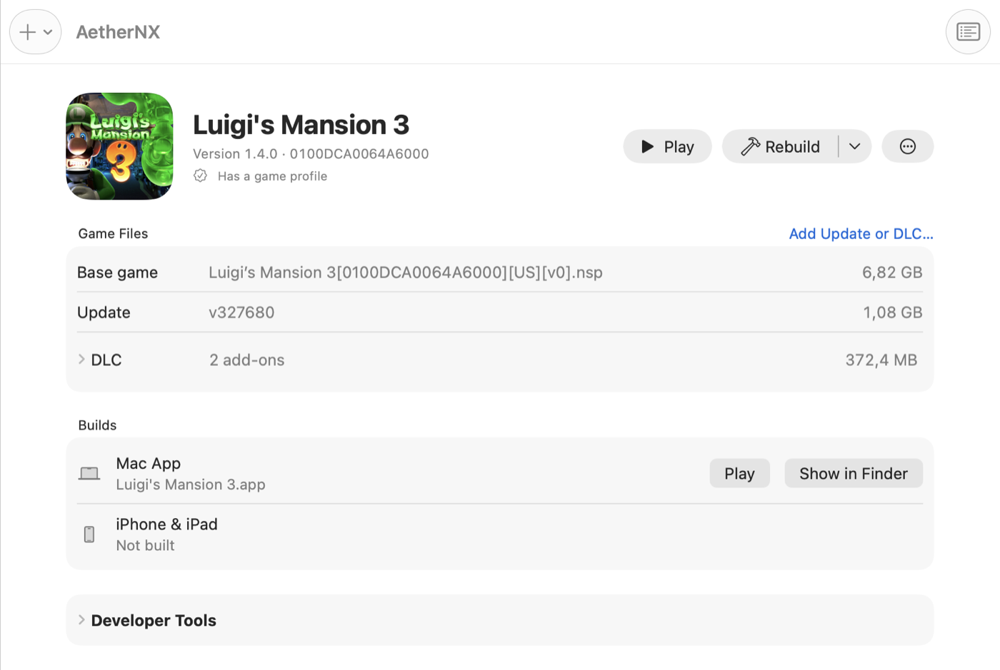
</picture>

## What it is

The Switch and Apple silicon run the same kind of processor code (64-bit ARM). The engine in this repository, **HorizonNative**, rewrites a game's own code once, on your Mac, so Apple's processor runs it directly; it stands in for the Switch's system services and draws the game's graphics with Metal. The result is an ordinary app of that game: a Mac app, or an IPA you install on an iPhone or iPad.

**AetherNX** puts a library and one-click builds on top of it:

- **AetherNX Studio**, a Mac app: your games with their files and builds, a Build button with live progress, Play, and settings in one place.
- **Console Mode**: the library full screen, driven by a game controller, so the Mac plays like a console from the couch.
- **`./aethernx`**, a command-line tool: scan a library, unpack archives, build, check your setup.
- **Developer tools** for reverse engineering your own copy: function and symbol tables, and a C translation with [nxrt](https://github.com/fedebuonco/nxrt).

HorizonNative is a fork of [**nxnative**](https://github.com/seedds/nxnative) by seedds, which did the hard part. AetherNX bundles it with its game profiles; see [Credits](#credits-and-legal).

Nothing from any game is in this repository: you need **your own game files and the `prod.keys` dumped from your own Switch**.

## Get started

You need a Mac with Apple silicon and macOS 26.6 or later, [Xcode](https://developer.apple.com/download/all/?q=Xcode%2027.2) 27.2 (select it with `sudo xcode-select -s /Applications/Xcode.app`), [Homebrew](https://brew.sh) and Python 3.12 or later. Building for iPhone also needs Xcode's iOS platform (Xcode → Settings → Components). The shaders are built with Xcode 27.2's Metal compiler: with several Xcode versions installed, select that one.

**1. Install the tools**, once:

```bash
xcodebuild -downloadComponent MetalToolchain
brew install xcodegen zstd glslang sevenzip
brew install --cask dotnet-sdk
```

**2. Get AetherNX.** Either download **AetherNX.app** from the [latest release](https://github.com/iCosiSenpai/AetherNX/releases/latest) and let it download the build tools into `~/AetherNX` on first launch, or clone the repository yourself:

```bash
git clone https://github.com/iCosiSenpai/AetherNX.git ~/AetherNX
cd ~/AetherNX
./aethernx setup      # a Python environment with the packages the build needs
./aethernx doctor     # checks Xcode, the tools and your keys
./aethernx studio     # builds and opens the app
```

**3. Put each game in its own folder**, with the base game, its update and its DLC (`.nsp`, `.xci`, `.nsz` or `.xcz`; subfolders such as `DLC/` are fine):

```
~/Games/
  Super Mario Bros. Wonder/
    Super Mario Bros. Wonder [010015100B514000][v0].nsp
    Super Mario Bros. Wonder [010015100B514800][v327680].nsp
```

Use the newest update you have: the game profiles are made for it. A game still in a `.zip`, `.rar` or `.7z` archive shows up too, with an **Unpack** button.

**4. Build.** In the app: add `~/Games` as a library folder, choose your `prod.keys` in Settings → Keys (or put it in `~/.switch/prod.keys`), select a game and press **Build**. The first build of a game takes 30 to 60 minutes and needs free space of about twice the game plus 10 GB; later builds reuse most of the work. Then press **Play**.

## The app

The first launch opens the **Setup Assistant**: it finds or downloads the build tools, runs the setup check, takes your `prod.keys` and your library folder, and asks a few choices. Help → Setup Assistant opens it again.

The sidebar lists your games, with the free space on their disk at the bottom; a game's page shows its files, what was built from them, and the actions. Everything else lives in the menus and in Settings.

- **Game artwork from the internet.** Icons and banners of Switch games come from [nlib.cc](https://api.nlib.cc) by title ID; a game it does not list, Switch 2 games among them, gets its box art from Wikipedia by name. Only the title ID or the name is sent, the pictures are kept on the Mac, and the icon in the game's own files is the fallback. Settings → General turns it off.
- **Danger Zone.** At the bottom of each game's page, in red: what the game takes on the Mac (game files, build folder, apps, saves, log and settings), with **Remove…** for each part and **Remove Everything…** for all of it, to the Trash or deleted for good. iCloud saves are only removed when you tick them.
- **Room for the first build.** Before a first build the app checks the free space the build needs. When it is short only because macOS keeps it in local Time Machine snapshots of files you deleted, it offers to remove those snapshots and start the build.
- **Play time.** Time played and the last session of each game, counted whenever its Mac app runs while AetherNX is open, also when opened from Finder; Console Mode puts the last played game first.
- **Notifications** when a build ends while the app is in the background.
- **Updates**, checked at launch, from AetherNX → Check for Updates, and from the AetherNX item in the menu bar: a new release of the app (downloaded, checked against the release's checksum and Developer ID signature, installed and reopened; a copy you built yourself opens the release page instead), new changes of the tools' Git checkout (**Update** pulls them), and how many changes nxnative has made since AetherNX's engine was last synced with it, with a link to them. The menu bar item also shows a running build. Both can be turned off in Settings → General.

| Shortcut | Action |
|---|---|
| <kbd>⌘</kbd> <kbd>R</kbd> | Play the selected game's Mac app |
| <kbd>⌘</kbd> <kbd>B</kbd> | Build the Mac app |
| <kbd>⇧</kbd> <kbd>⌘</kbd> <kbd>B</kbd> | Build for iPhone and iPad |
| <kbd>⌥</kbd> <kbd>⌘</kbd> <kbd>B</kbd> | Prepare an Xcode project |
| <kbd>⌘</kbd> <kbd>.</kbd> | Stop the running build |
| <kbd>⌘</kbd> <kbd>O</kbd> | Add a library folder |
| <kbd>⇧</kbd> <kbd>⌘</kbd> <kbd>O</kbd> | Unpack an archive |
| <kbd>⌘</kbd> <kbd>I</kbd> | Add an update or DLC to the selected game |
| <kbd>⇧</kbd> <kbd>⌘</kbd> <kbd>R</kbd> | Rescan the library |
| <kbd>⌥</kbd> <kbd>⌘</kbd> <kbd>R</kbd> | Show the game in Finder |
| <kbd>⇧</kbd> <kbd>⌘</kbd> <kbd>Y</kbd> | Show or hide the activity log |
| <kbd>⌃</kbd> <kbd>⌘</kbd> <kbd>C</kbd> | Console Mode (or ≡ on a controller) |
| <kbd>⌘</kbd> <kbd>F</kbd> | Search the library |
| <kbd>⌘</kbd> <kbd>,</kbd> | Settings |

**Settings** has three panes: **General** (library folders, the AetherNX folder, setup check, game artwork, notifications), **Keys** (your `prod.keys`, checked without ever showing a key) and **Building** (what the Build button makes, the game's language, kept files, pre-built shader pipelines, the frame-rate counter on iPhone, a signing identity for the Mac app). The app is in English and Italian.

## Console Mode


Pick up a controller and press **≡** (Menu), or choose View → Console Mode (<kbd>⌃</kbd> <kbd>⌘</kbd> <kbd>C</kbd>): the library fills the screen, with each game's art behind it. Move with the stick, the d-pad or the arrow keys; **A** plays the game, or builds it if it is not built yet; **Y** builds it again; **B** goes back. The hints show your controller's own buttons (Xbox, PlayStation, Switch Pro and other MFi controllers), and a build's progress shows right on the game.

## Command line

`./aethernx` does everything the app does; the app runs it.

| Command | What it does |
|---|---|
| `./aethernx scan [folders] [--json]` | List the games in your library folders (default: `$AETHERNX_LIBRARY`, else `~/Games`) |
| `./aethernx build <game folder> [--target mac\|ios\|ios-slim\|xcode]` | Build a game; other options go to the packing script (`-k` for the keys, `--language it`, `--progress json`, …) |
| `./aethernx unpack <archive or folder>` | Extract `.zip`, `.rar`, `.7z` and `.tar` archives of game packages |
| `./aethernx doctor` | Check Xcode, the tools, the Python packages and your keys, with the command that fixes each missing piece |
| `./aethernx setup [--tools]` | Create `.venv` with the Python packages (`--tools` adds the developer tools' ones) |
| `./aethernx decomp-init <game folder>` | Function and symbol tables of a built game, with a C++ starter project |
| `./aethernx lift <game folder>` | Translate the game's `main` module to C with nxrt |
| `./aethernx studio` | Build and open the app |

`build` finds your keys in `-k`, then `$AETHERNX_KEYS`, then `~/.switch/prod.keys`. Everything about the packing script itself (`scripts/build_ipa_from_nsp.py`, which `build` runs) is in [The packing script in detail](docs/development.md#the-packing-script-in-detail).

## iPhone and iPad

**Build for iPhone & iPad** makes an unsigned IPA next to the game files. Install it with a sideloading tool such as AltStore, SideStore, Sideloadly or LiveContainer, and turn on **Increased Memory Limit** if your tool offers it: the bigger games need it. With an Apple developer account, **Prepare Xcode Project** lets Xcode sign and install the app with that capability and iCloud saves ([Build and run on a device with Xcode](docs/development.md#build-and-run-on-a-device-with-xcode)).

- **No JIT.** The game's code is rewritten and compiled into the app on the Mac, so iOS runs it like any other app: no JIT, no debugger, no second device.
- **Free Apple ID.** Sideloaded apps signed with a free account expire after 7 days; SideStore and AltStore can sign them again from the phone.
- **Game too big to install?** Build with **Game Files Separate** (`--target ios-slim`): the IPA leaves the game files out, and `scripts/push_romfs.sh` copies them to the phone once ([Quick reinstalls](docs/development.md#quick-reinstalls)).
- It needs iOS or iPadOS 26 on an iPhone 15 Pro or later, or an iPad with an M1 chip or later.

Controls, saves and in-game settings: [Playing](docs/playing.md) and [Settings](docs/settings.md).

## Games

The engine has profiles for 130 games: their patches, shaders and tested settings. A game without a profile still gets a best-effort build and a survey, which may not start. The results below come from the nxnative project and its contributors; see each game's note for the platforms and known issues ([all game notes](dm/games/README.md#games)). Under a game, "60 fps with 1.2.0" means it runs at 60 fps (30 on the Switch) with that update.

<details>
<summary><b>Show the games reported working</b></summary>

<!-- gallery: written by dm/tools/docs_gallery.py from docs/images/gallery.tsv; change the table, then run it -->
<table>
<tr>
<td align="center" valign="top" width="33%"><br><small><b><a href="dm/games/040074A01BF12000/README.md">Donkey Kong Bananza</a></b><br>Switch 2, Mac only, from a dump</small></td>
<td align="center" valign="top" width="33%">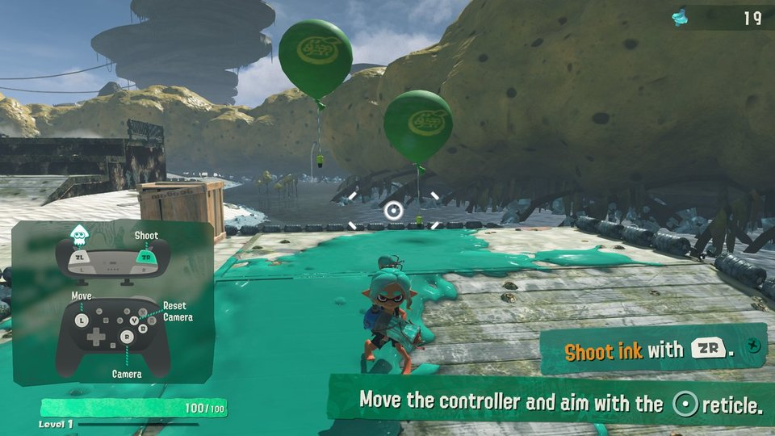<br><small><b><a href="dm/games/0400380020056000/README.md">Splatoon Raiders</a></b><br>Switch 2, Mac only, from a dump</small></td>
<td align="center" valign="top" width="33%">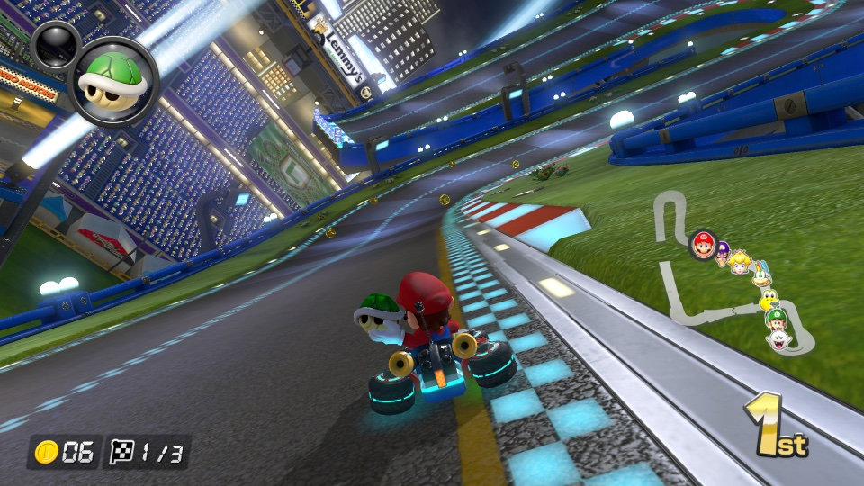<br><small><b><a href="dm/games/0100152000022000/README.md">Mario Kart 8 Deluxe</a></b><br>no Mii heads</small></td>
</tr>
<tr>
<td align="center" valign="top" width="33%"><br><small><b><a href="dm/games/0100B99019412000/README.md">Mario vs. Donkey Kong</a></b></small></td>
<td align="center" valign="top" width="33%">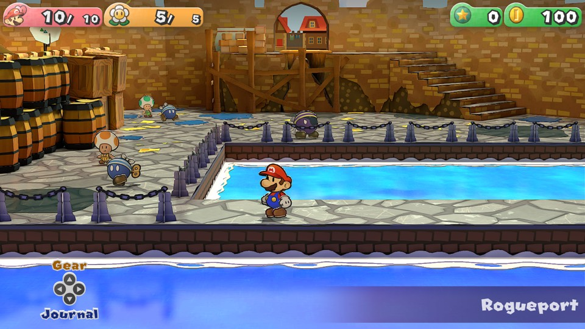<br><small><b><a href="dm/games/0100ECD018EBE000/README.md">Paper Mario: The Thousand-Year Door</a></b><br>60 fps with 1.0.1</small></td>
<td align="center" valign="top" width="33%">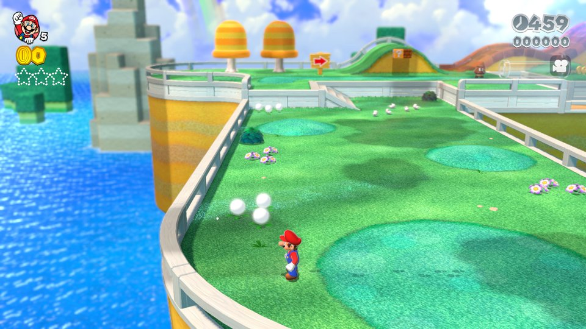<br><small><b><a href="dm/games/010028600EBDA000/README.md">Super Mario 3D World + Bowser's Fury</a></b></small></td>
</tr>
<tr>
<td align="center" valign="top" width="33%">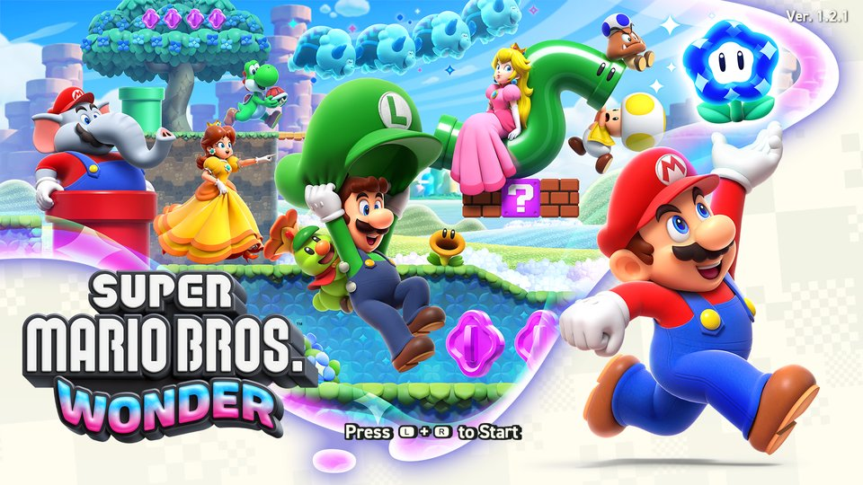<br><small><b><a href="dm/games/010015100B514000/README.md">Super Mario Bros. Wonder</a></b></small></td>
<td align="center" valign="top" width="33%">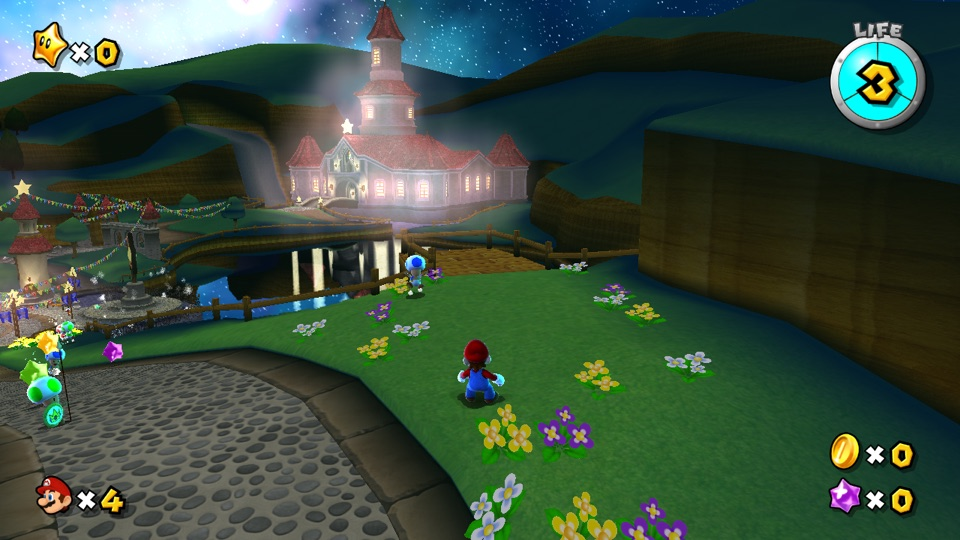<br><small><b><a href="dm/games/010099C022B96000/README.md">Super Mario Galaxy</a></b></small></td>
<td align="center" valign="top" width="33%">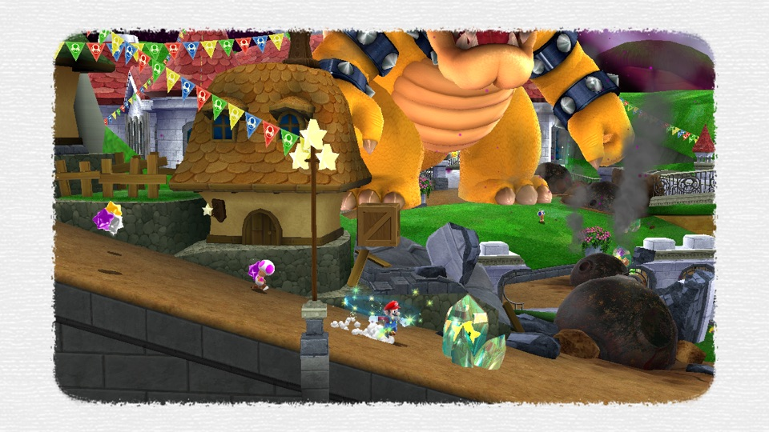<br><small><b><a href="dm/games/0100FD8022DAA000/README.md">Super Mario Galaxy 2</a></b></small></td>
</tr>
<tr>
<td align="center" valign="top" width="33%">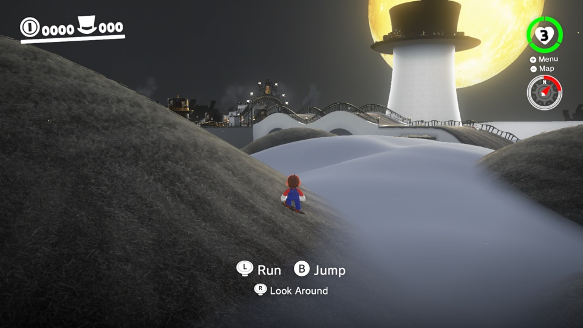<br><small><b><a href="dm/games/0100000000010000/README.md">Super Mario Odyssey</a></b></small></td>
<td align="center" valign="top" width="33%">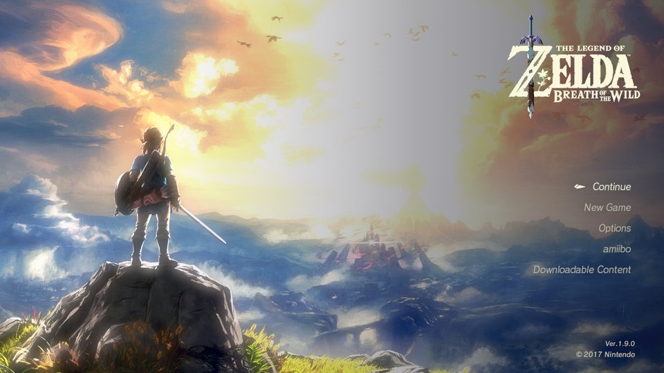<br><small><b><a href="dm/games/01007EF00011E000/README.md">The Legend of Zelda: Breath of the Wild</a></b><br>60 fps with 1.9.0</small></td>
<td align="center" valign="top" width="33%">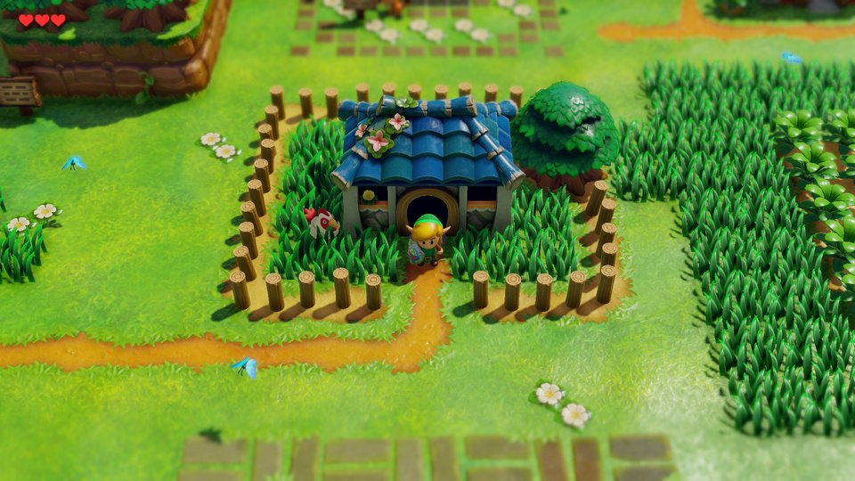<br><small><b><a href="dm/games/01006BB00C6F0000/README.md">The Legend of Zelda: Link's Awakening</a></b></small></td>
</tr>
<tr>
<td align="center" valign="top" width="33%">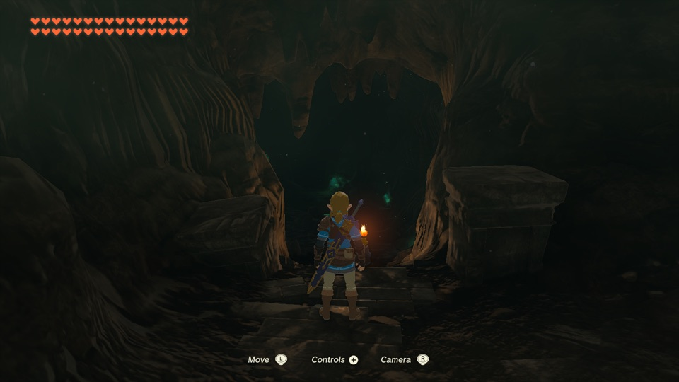<br><small><b><a href="dm/games/0100F2C0115B6000/README.md">The Legend of Zelda: Tears of the Kingdom</a></b><br>60 fps with 1.4.3</small></td>
<td align="center" valign="top" width="33%">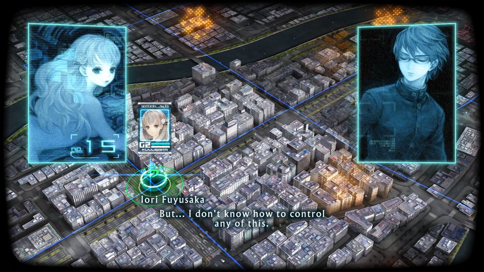<br><small><b><a href="dm/games/01003FC01670C000/README.md">13 Sentinels: Aegis Rim</a></b></small></td>
<td align="center" valign="top" width="33%">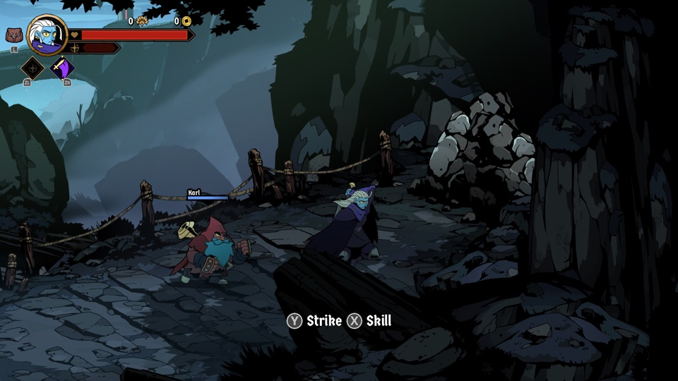<br><small><b><a href="dm/games/0100A83022A22000/README.md">Absolum</a></b></small></td>
</tr>
<tr>
<td align="center" valign="top" width="33%"><br><small><b><a href="dm/games/010005501E68C000/README.md">Ace Attorney Investigations Collection</a></b></small></td>
<td align="center" valign="top" width="33%">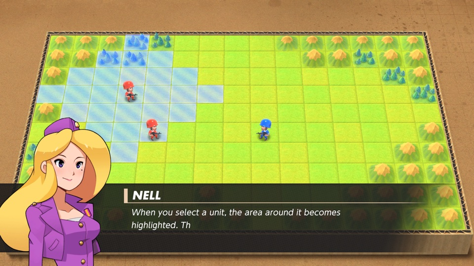<br><small><b><a href="dm/games/0100300012F2A000/README.md">Advance Wars 1+2: Re-Boot Camp</a></b></small></td>
<td align="center" valign="top" width="33%"><br><small><b><a href="dm/games/010089B00D09C000/README.md">AI: THE SOMNIUM FILES</a></b></small></td>
</tr>
<tr>
<td align="center" valign="top" width="33%">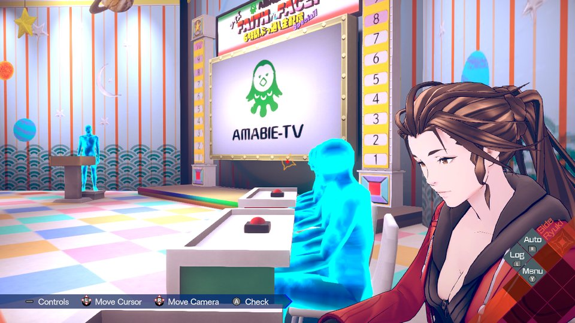<br><small><b><a href="dm/games/0100713016CCC000/README.md">AI: THE SOMNIUM FILES - nirvanA Initiative</a></b></small></td>
<td align="center" valign="top" width="33%">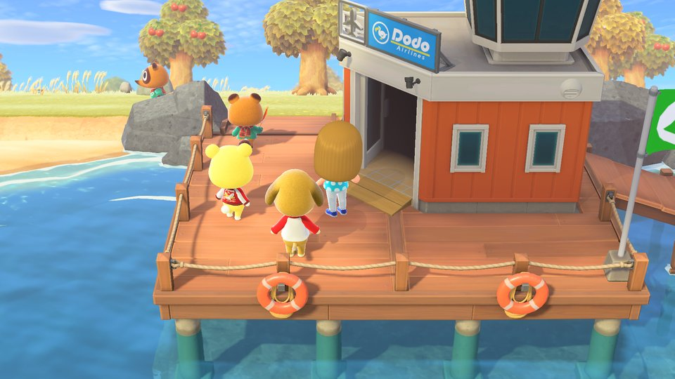<br><small><b><a href="dm/games/01006F8002326000/README.md">Animal Crossing: New Horizons</a></b></small></td>
<td align="center" valign="top" width="33%">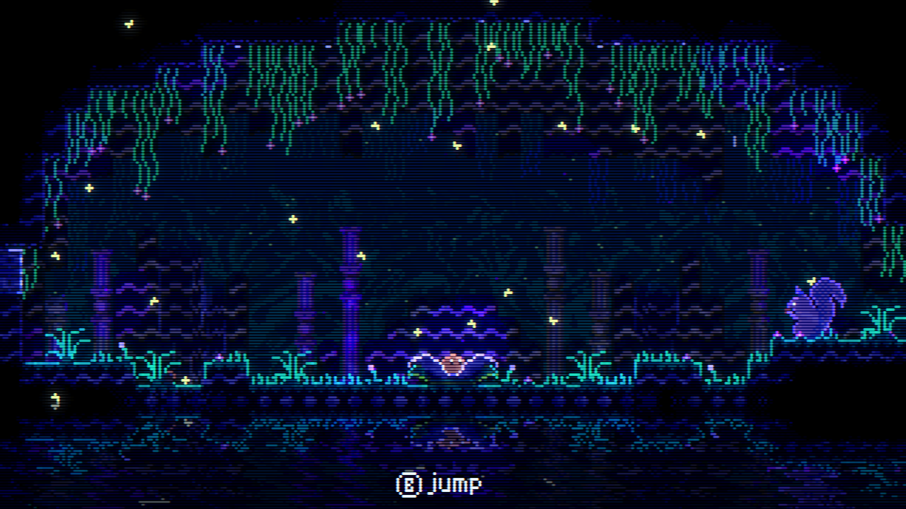<br><small><b><a href="dm/games/010020D01AD24000/README.md">ANIMAL WELL</a></b></small></td>
</tr>
<tr>
<td align="center" valign="top" width="33%"><br><small><b><a href="dm/games/01007300020FA000/README.md">ASTRAL CHAIN</a></b><br>60 fps target with 1.0.1</small></td>
<td align="center" valign="top" width="33%">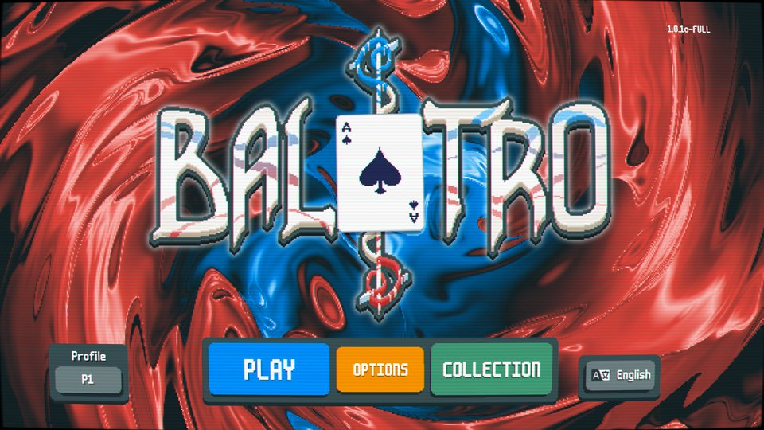<br><small><b><a href="dm/games/0100CD801CE5E000/README.md">Balatro</a></b><br>played by touch</small></td>
<td align="center" valign="top" width="33%"><br><small><b><a href="dm/games/010086A022444000/README.md">BALL x PIT</a></b></small></td>
</tr>
<tr>
<td align="center" valign="top" width="33%">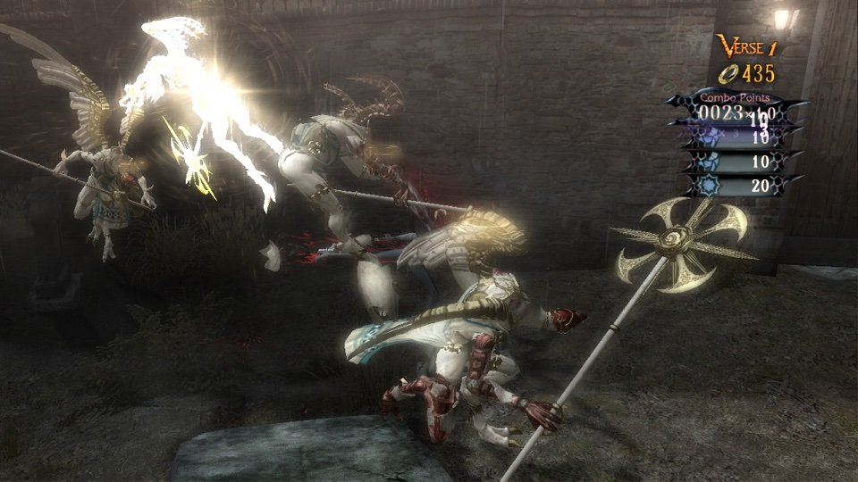<br><small><b><a href="dm/games/010076F0049A2000/README.md">Bayonetta</a></b></small></td>
<td align="center" valign="top" width="33%">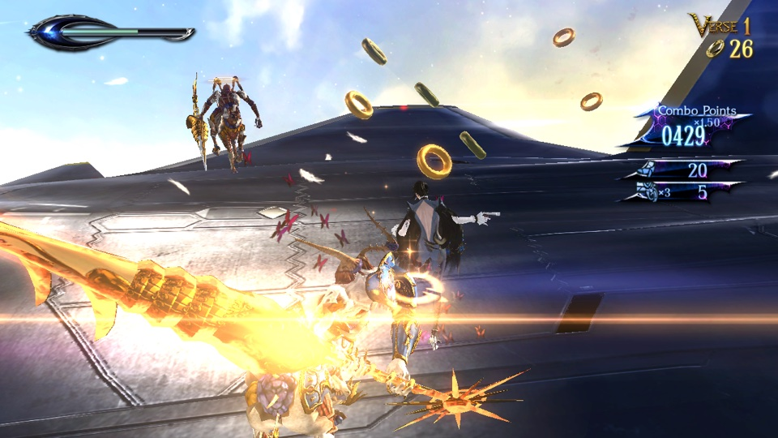<br><small><b><a href="dm/games/01007960049A0000/README.md">Bayonetta 2</a></b></small></td>
<td align="center" valign="top" width="33%"><br><small><b><a href="dm/games/01004A4010FEA000/README.md">Bayonetta 3</a></b></small></td>
</tr>
<tr>
<td align="center" valign="top" width="33%">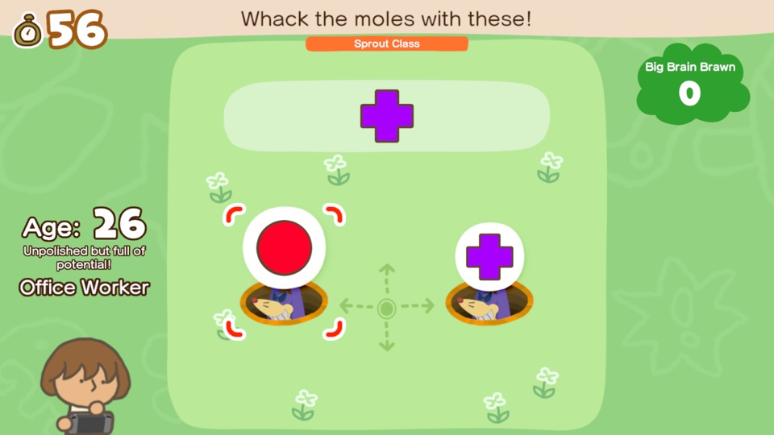<br><small><b><a href="dm/games/0100620012D6E000/README.md">Big Brain Academy: Brain vs. Brain</a></b></small></td>
<td align="center" valign="top" width="33%"><br><small><b><a href="dm/games/0100F5D01DA3A000/README.md">Brain Memory Training Academy</a></b></small></td>
<td align="center" valign="top" width="33%"><br><small><b><a href="dm/games/01009BF0072D4000/README.md">Captain Toad: Treasure Tracker</a></b></small></td>
</tr>
<tr>
<td align="center" valign="top" width="33%">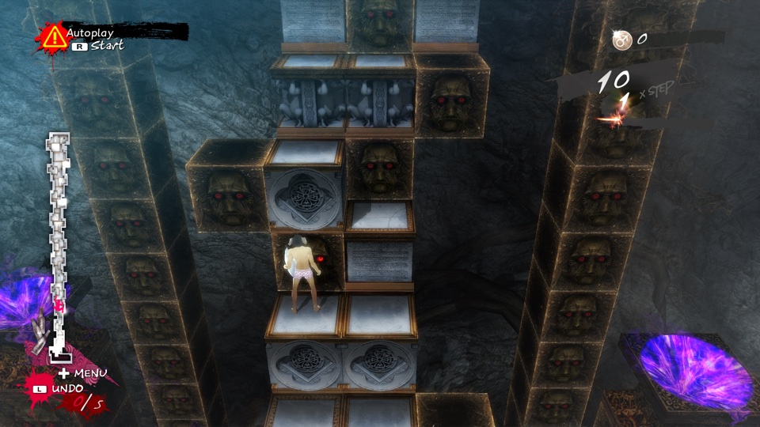<br><small><b><a href="dm/games/0100BF00112C0000/README.md">Catherine: Full Body</a></b></small></td>
<td align="center" valign="top" width="33%">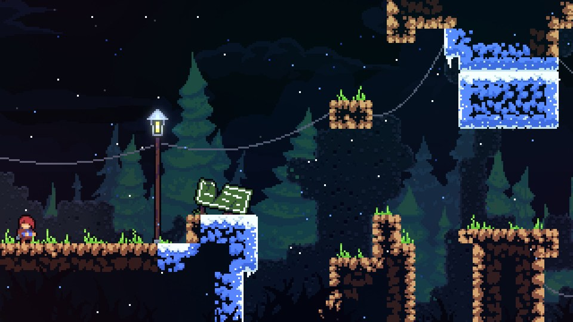<br><small><b><a href="dm/games/01002B30028F6000/README.md">Celeste</a></b></small></td>
<td align="center" valign="top" width="33%">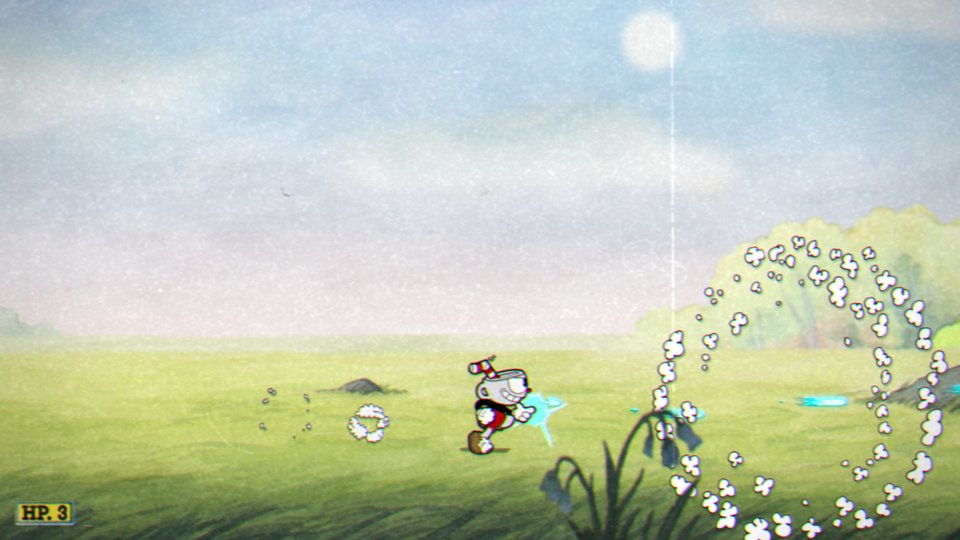<br><small><b><a href="dm/games/0100A5C00D162000/README.md">Cuphead</a></b></small></td>
</tr>
<tr>
<td align="center" valign="top" width="33%">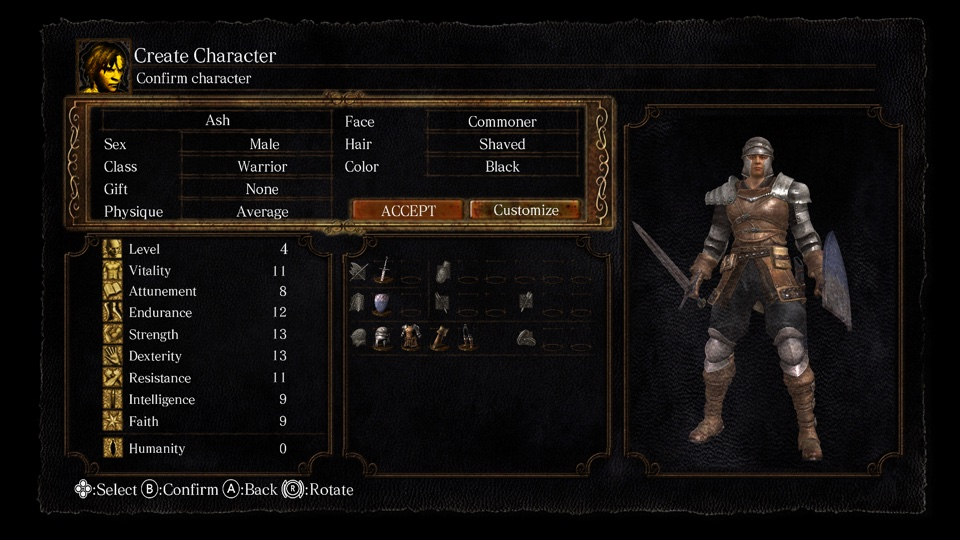<br><small><b><a href="dm/games/01004AB00A260000/README.md">DARK SOULS: REMASTERED</a></b><br>60 fps with 1.0.3</small></td>
<td align="center" valign="top" width="33%">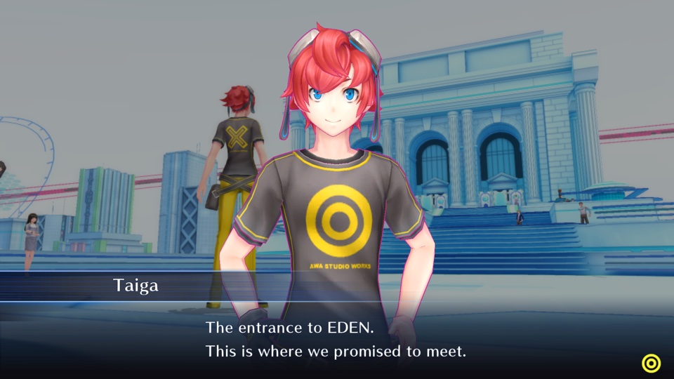<br><small><b><a href="dm/games/010014E00DB56000/README.md">Digimon Story Cyber Sleuth: Complete Edition</a></b></small></td>
<td align="center" valign="top" width="33%"><br><small><b><a href="dm/games/0100C1F0051B6000/README.md">Donkey Kong Country: Tropical Freeze</a></b></small></td>
</tr>
<tr>
<td align="center" valign="top" width="33%"><br><small><b><a href="dm/games/0100A9D01C446000/README.md">DRAGON QUEST VII Reimagined</a></b></small></td>
<td align="center" valign="top" width="33%"><br><small><b><a href="dm/games/01006C300E9F0000/README.md">DRAGON QUEST XI S: Echoes of an Elusive Age – Definitive Edition</a></b><br>60 fps with 1.0.4</small></td>
<td align="center" valign="top" width="33%"><br><small><b><a href="dm/games/0100606026F12000/README.md">FINAL FANTASY RESONANCE</a></b><br>60 fps with 1.0.1</small></td>
</tr>
<tr>
<td align="center" valign="top" width="33%">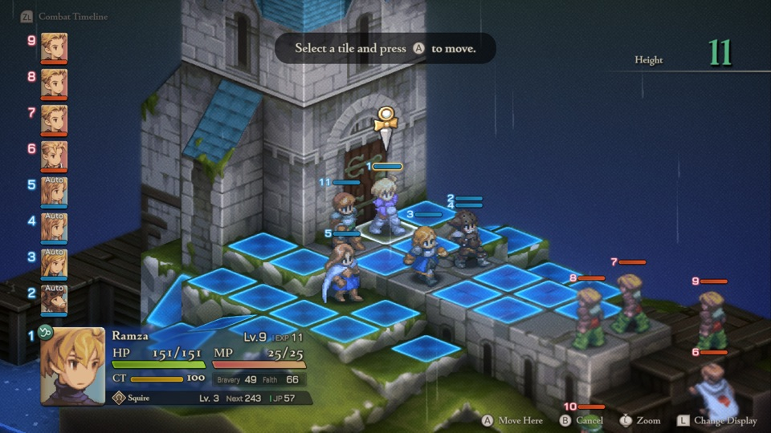<br><small><b><a href="dm/games/010038B015560000/README.md">FINAL FANTASY TACTICS - The Ivalice Chronicles</a></b></small></td>
<td align="center" valign="top" width="33%">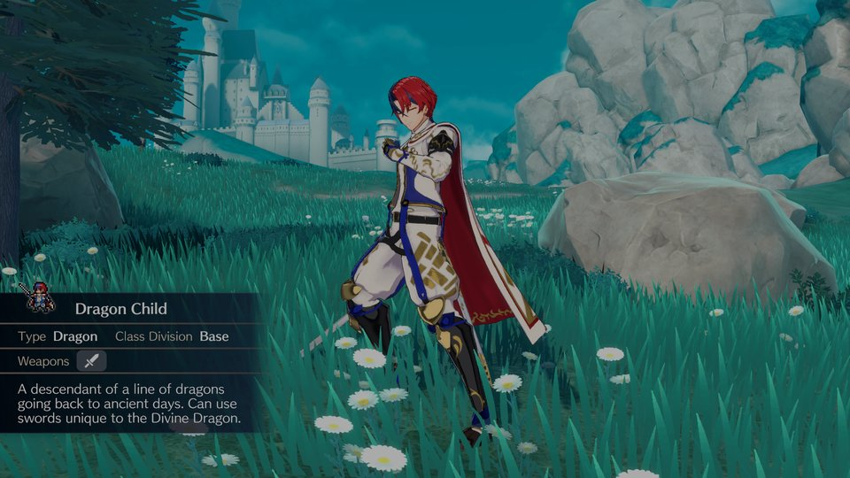<br><small><b><a href="dm/games/0100A6301214E000/README.md">Fire Emblem Engage</a></b><br>60 fps with 2.0.0</small></td>
<td align="center" valign="top" width="33%"><br><small><b><a href="dm/games/010055D009F78000/README.md">Fire Emblem: Three Houses</a></b><br>60 fps with 1.2.0</small></td>
</tr>
<tr>
<td align="center" valign="top" width="33%">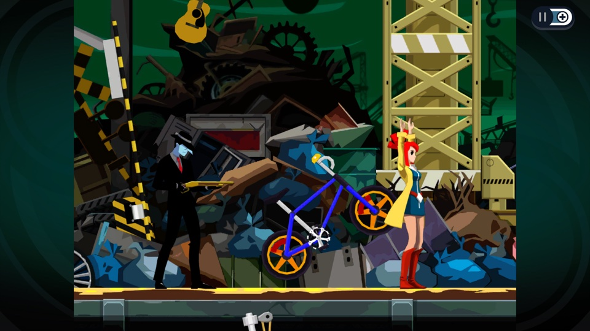<br><small><b><a href="dm/games/010029B018432000/README.md">Ghost Trick: Phantom Detective</a></b></small></td>
<td align="center" valign="top" width="33%"><br><small><b><a href="dm/games/010036E00FB20000/README.md">The Great Ace Attorney Chronicles</a></b></small></td>
<td align="center" valign="top" width="33%">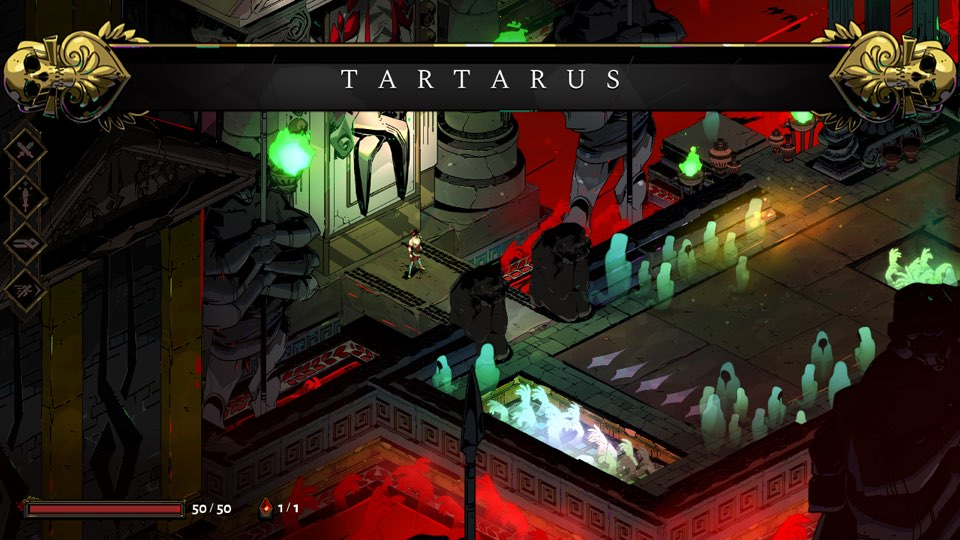<br><small><b><a href="dm/games/0100535012974000/README.md">Hades</a></b></small></td>
</tr>
<tr>
<td align="center" valign="top" width="33%">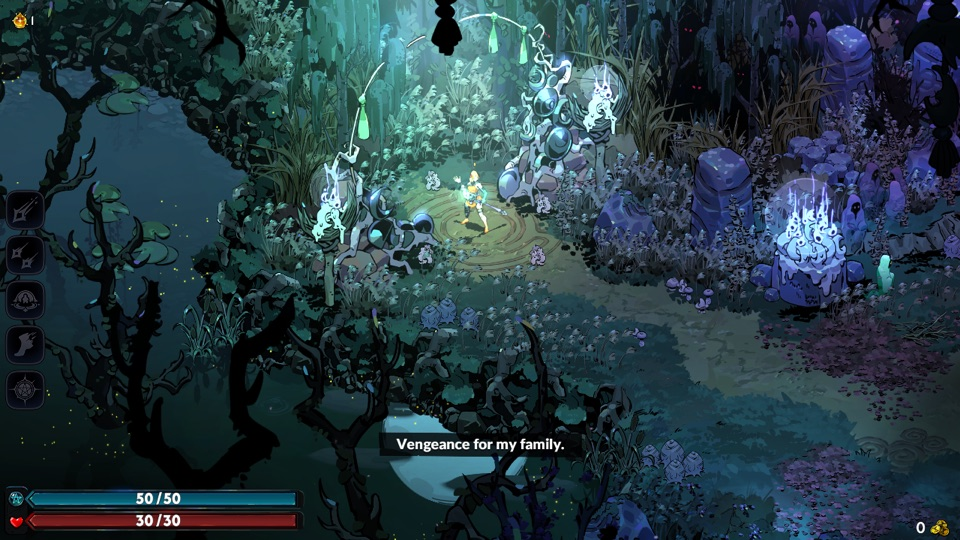<br><small><b><a href="dm/games/0100A00019DE0000/README.md">Hades II</a></b></small></td>
<td align="center" valign="top" width="33%">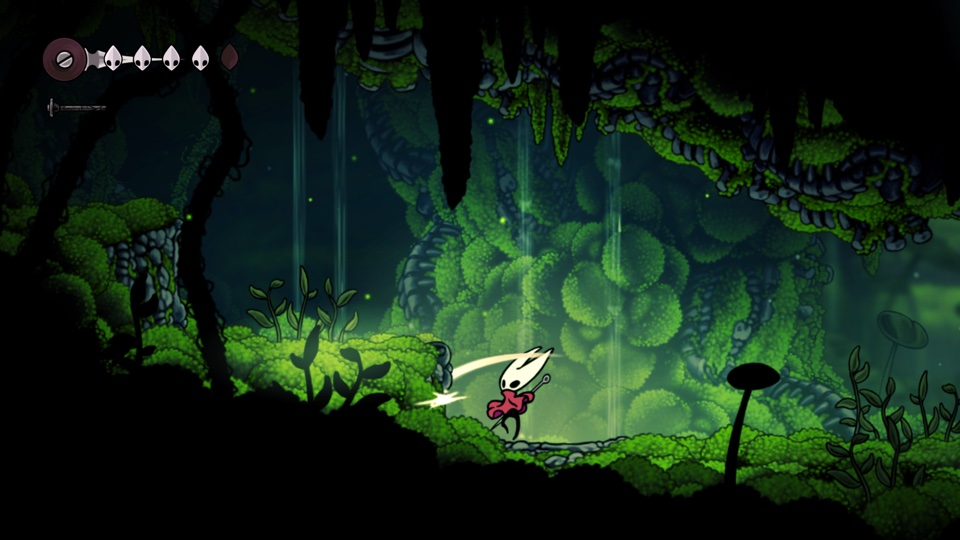<br><small><b><a href="dm/games/010013C00E930000/README.md">Hollow Knight: Silksong</a></b></small></td>
<td align="center" valign="top" width="33%"><br><small><b><a href="dm/games/01002B00111A2000/README.md">Hyrule Warriors: Age of Calamity</a></b><br>60 fps with 1.3.0</small></td>
</tr>
<tr>
<td align="center" valign="top" width="33%">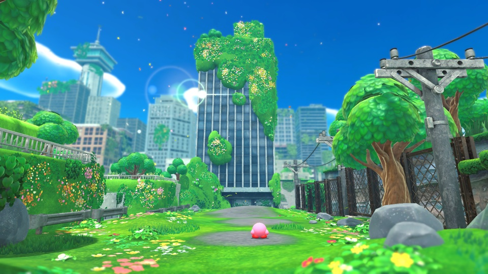<br><small><b><a href="dm/games/01004D300C5AE000/README.md">Kirby and the Forgotten Land</a></b></small></td>
<td align="center" valign="top" width="33%">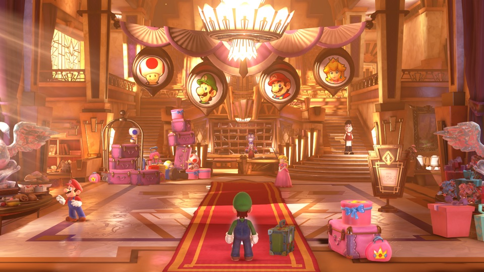<br><small><b><a href="dm/games/0100DCA0064A6000/README.md">Luigi's Mansion 3</a></b><br>60 fps with 1.4.0</small></td>
<td align="center" valign="top" width="33%">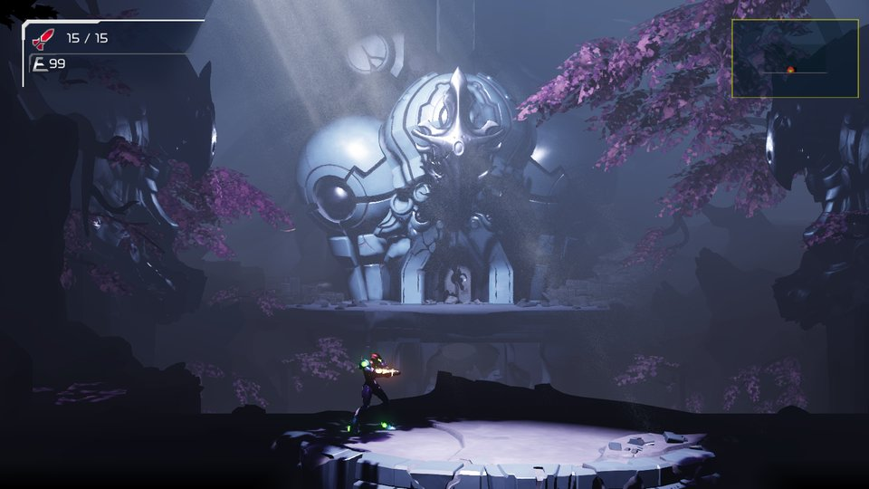<br><small><b><a href="dm/games/010093801237C000/README.md">Metroid Dread</a></b></small></td>
</tr>
<tr>
<td align="center" valign="top" width="33%"><br><small><b><a href="dm/games/0100B04011742000/README.md">Monster Hunter Rise</a></b><br>60 fps with 16.0.2</small></td>
<td align="center" valign="top" width="33%"><br><small><b><a href="dm/games/010051701FB46000/README.md">Monster Train 2</a></b><br>60 fps with 1.1.1</small></td>
<td align="center" valign="top" width="33%">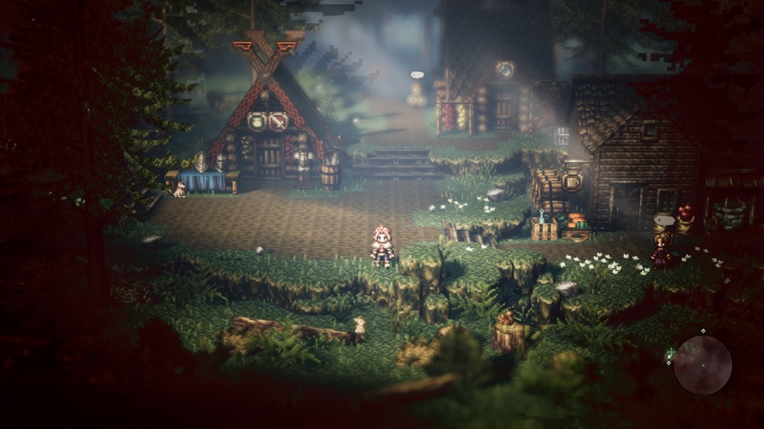<br><small><b><a href="dm/games/010057D006492000/README.md">OCTOPATH TRAVELER</a></b></small></td>
</tr>
<tr>
<td align="center" valign="top" width="33%"><br><small><b><a href="dm/games/01005270232F2000/README.md">Octopath Traveler 0</a></b><br>60 fps with 1.0.5</small></td>
<td align="center" valign="top" width="33%">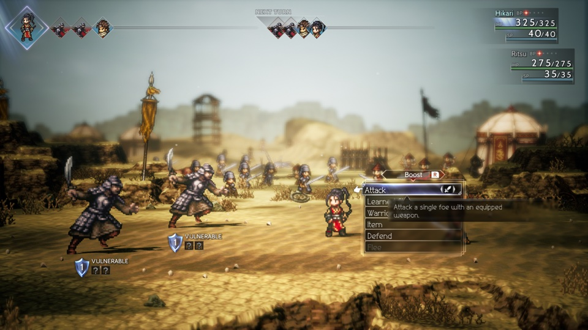<br><small><b><a href="dm/games/0100A3501946E000/README.md">Octopath Traveler II</a></b><br>60 fps with 1.1.1</small></td>
<td align="center" valign="top" width="33%">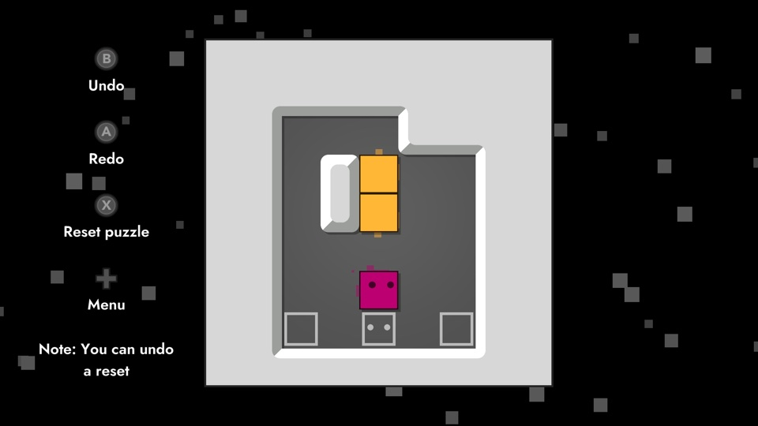<br><small><b><a href="dm/games/0100E44016C22000/README.md">Patrick's Parabox</a></b></small></td>
</tr>
<tr>
<td align="center" valign="top" width="33%">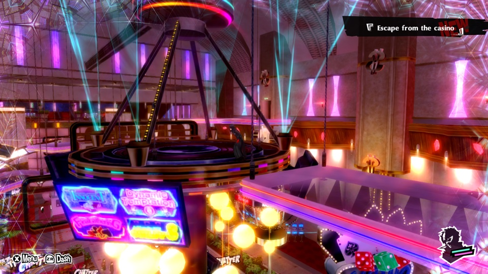<br><small><b><a href="dm/games/01005CA01580E000/README.md">Persona 5 Royal</a></b></small></td>
<td align="center" valign="top" width="33%">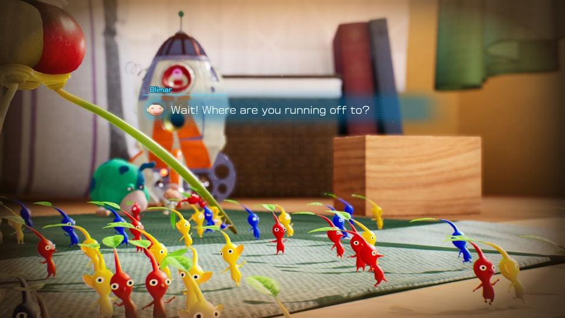<br><small><b><a href="dm/games/0100B7C00933A000/README.md">Pikmin 4</a></b></small></td>
<td align="center" valign="top" width="33%">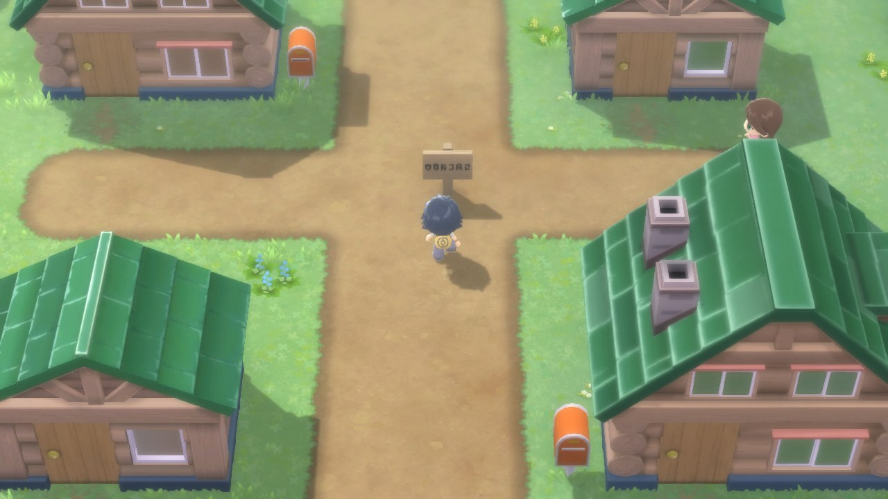<br><small><b><a href="dm/games/0100000011D90000/README.md">Pokémon Brilliant Diamond</a></b><br>60 fps with 1.3.0</small></td>
</tr>
<tr>
<td align="center" valign="top" width="33%"><br><small><b><a href="dm/games/0100F43008C44000/README.md">Pokémon Legends: Z-A</a></b></small></td>
<td align="center" valign="top" width="33%">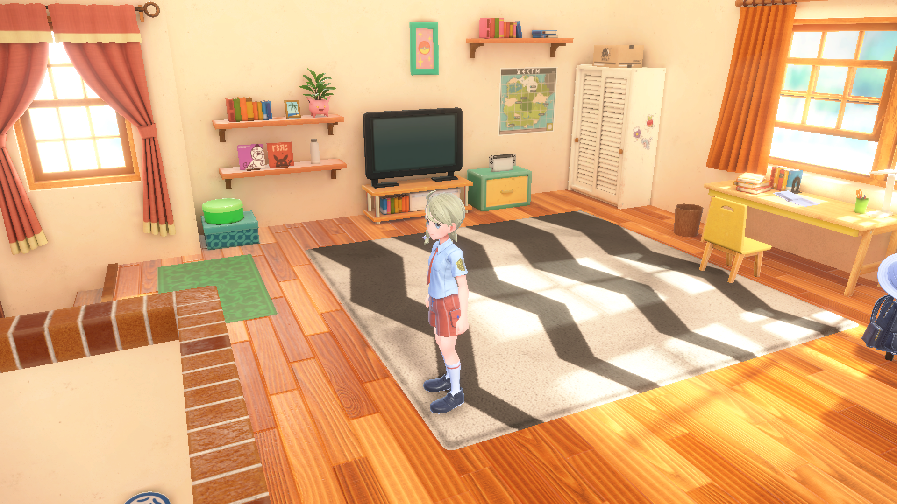<br><small><b><a href="dm/games/0100A3D008C5C000/README.md">Pokémon Scarlet</a></b></small></td>
<td align="center" valign="top" width="33%">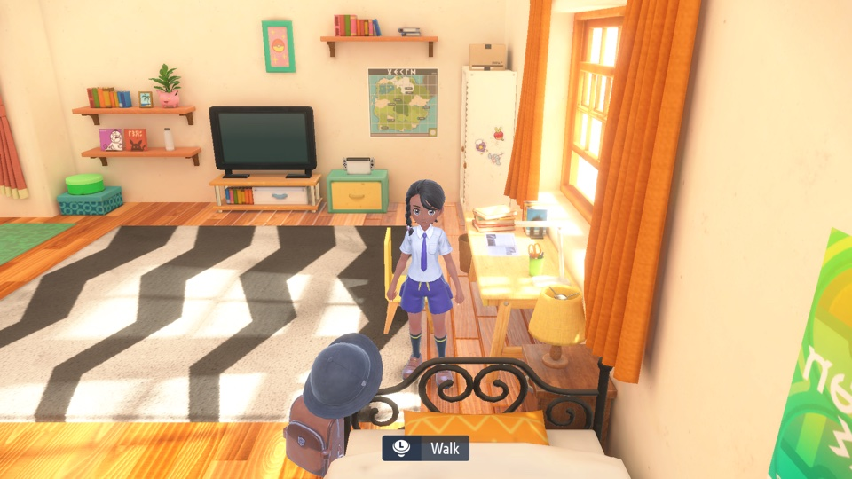<br><small><b><a href="dm/games/01008F6008C5E000/README.md">Pokémon Violet</a></b></small></td>
</tr>
<tr>
<td align="center" valign="top" width="33%"><br><small><b><a href="dm/games/0100ABF008968000/README.md">Pokémon Sword</a></b></small></td>
<td align="center" valign="top" width="33%">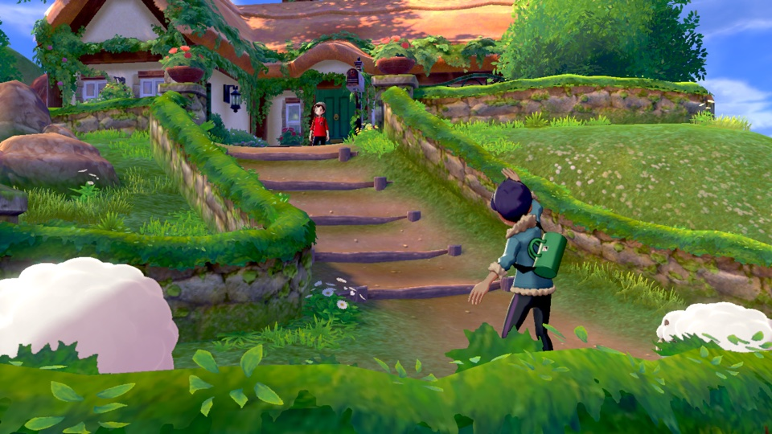<br><small><b><a href="dm/games/01008DB008C2C000/README.md">Pokémon Shield</a></b></small></td>
<td align="center" valign="top" width="33%">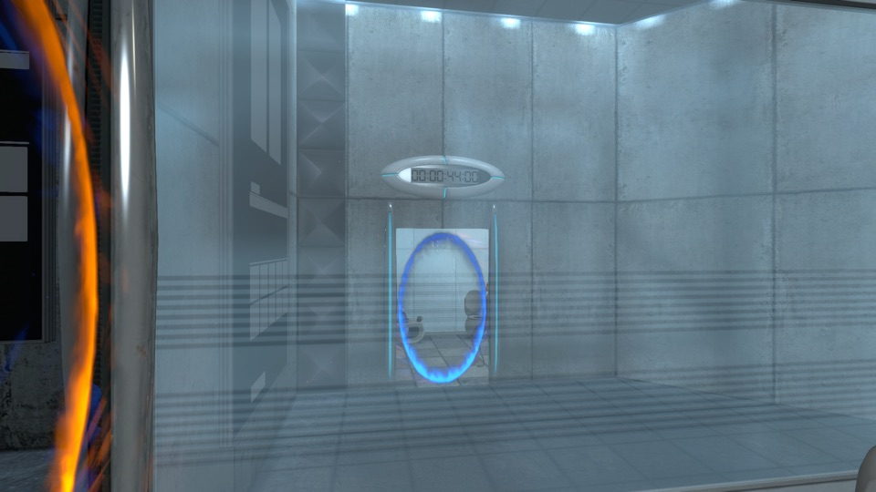<br><small><b><a href="dm/games/01007BB017812000/README.md">Portal</a></b></small></td>
</tr>
<tr>
<td align="center" valign="top" width="33%"><br><small><b><a href="dm/games/010020400E1C2000/README.md">Raging Loop</a></b></small></td>
<td align="center" valign="top" width="33%">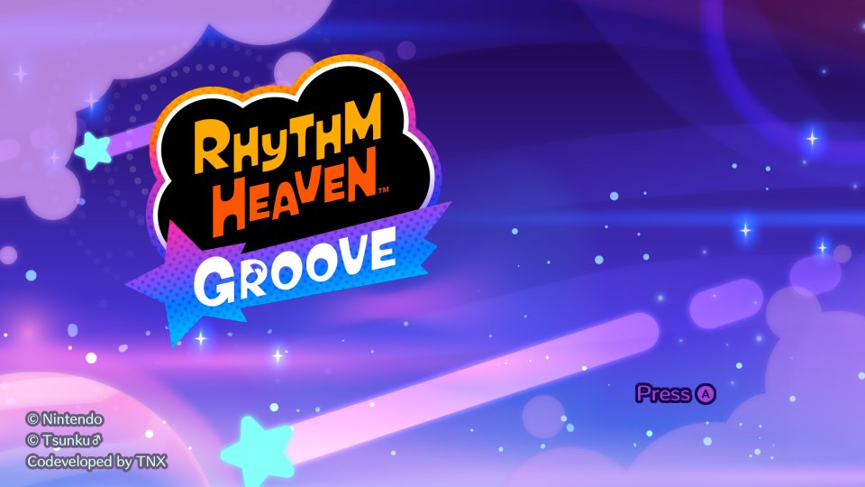<br><small><b><a href="dm/games/0100D9F01D474000/README.md">Rhythm Heaven Groove</a></b></small></td>
<td align="center" valign="top" width="33%">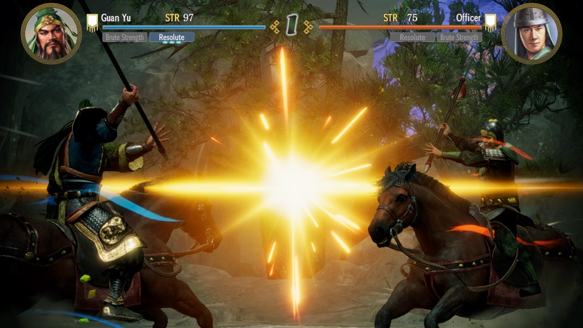<br><small><b><a href="dm/games/0100C2A01A730000/README.md">ROMANCE OF THE THREE KINGDOMS 8 REMAKE</a></b><br>controller only</small></td>
</tr>
<tr>
<td align="center" valign="top" width="33%">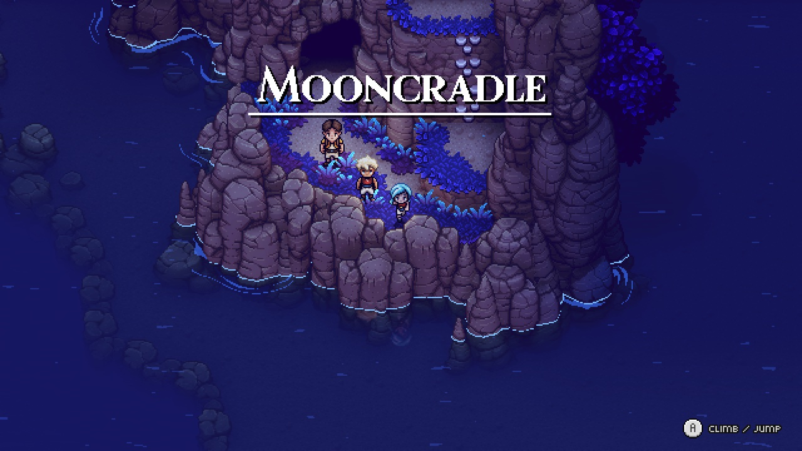<br><small><b><a href="dm/games/01008C0016544000/README.md">Sea of Stars</a></b></small></td>
<td align="center" valign="top" width="33%">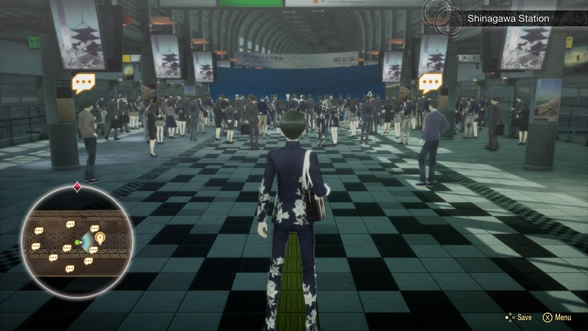<br><small><b><a href="dm/games/010069C01AB82000/README.md">SHIN MEGAMI TENSEI V: Vengeance</a></b><br>60 fps with 1.0.3</small></td>
<td align="center" valign="top" width="33%"><br><small><b><a href="dm/games/0100E65002BB8000/README.md">Stardew Valley</a></b></small></td>
</tr>
<tr>
<td align="center" valign="top" width="33%"><br><small><b><a href="dm/games/01008BC024FDE000/README.md">STEINS;GATE RE:BOOT</a></b></small></td>
<td align="center" valign="top" width="33%"><br><small><b><a href="dm/games/01006A800016E000/README.md">Super Smash Bros. Ultimate</a></b><br>offline</small></td>
<td align="center" valign="top" width="33%"><br><small><b><a href="dm/games/0100346017304000/README.md">Taiko Risshiden V DX</a></b><br>Japanese · played by touch</small></td>
</tr>
<tr>
<td align="center" valign="top" width="33%"><br><small><b><a href="dm/games/010069401ADB8000/README.md">Unicorn Overlord</a></b></small></td>
<td align="center" valign="top" width="33%"><br><small><b><a href="dm/games/01006000040C2000/README.md">Yoshi's Crafted World</a></b></small></td>
<td align="center" valign="top" width="33%"><br><small><b><a href="dm/games/010056B015FE8000/README.md">NieR:Automata The End of YoRHa Edition</a></b><br>60 fps with 1.0.3</small></td>
</tr>
<tr>
<td align="center" valign="top" width="33%"><br><small><b><a href="dm/games/01008CF01BAAC000/README.md">The Legend of Zelda: Echoes of Wisdom</a></b></small></td>
<td align="center" valign="top" width="33%"><br><small><b><a href="dm/games/01009D901BC56000/README.md">Donkey Kong Country Returns HD</a></b></small></td>
<td align="center" valign="top" width="33%"><br><small><b><a href="dm/games/0100317013770000/README.md">Mario + Rabbids Sparks of Hope</a></b></small></td>
</tr>
<tr>
<td align="center" valign="top" width="33%"><br><small><b><a href="dm/games/0100E95004038000/README.md">Xenoblade Chronicles 2</a></b></small></td>
<td align="center" valign="top" width="33%"><br><small><b><a href="dm/games/010074F013262000/README.md">Xenoblade Chronicles 3</a></b></small></td>
<td align="center" valign="top" width="33%"><br><small><b><a href="dm/games/0100CE4010AAC000/README.md">FINAL FANTASY CRYSTAL CHRONICLES Remastered Edition</a></b></small></td>
</tr>
<tr>
<td align="center" valign="top" width="33%"><br><small><b><a href="dm/games/010032E00E6E2000/README.md">Return of the Obra Dinn</a></b></small></td>
<td align="center" valign="top" width="33%"><br><small><b><a href="dm/games/010040801A4C8000/README.md">Blasphemous 2</a></b></small></td>
<td align="center" valign="top" width="33%"><br><small><b><a href="dm/games/0100D5B026844000/README.md">Silver Pines</a></b></small></td>
</tr>
<tr>
<td align="center" valign="top" width="33%"><br><small><b><a href="dm/games/0100698009C6E000/README.md">Blasphemous</a></b></small></td>
<td align="center" valign="top" width="33%"><br><small><b><a href="dm/games/0100BC300CB48000/README.md">FINAL FANTASY X/X-2 HD Remaster</a></b></small></td>
<td align="center" valign="top" width="33%"><br><small><b><a href="dm/games/010067300059A000/README.md">Mario + Rabbids Kingdom Battle</a></b></small></td>
</tr>
<tr>
<td align="center" valign="top" width="33%"><br><small><b><a href="dm/games/010062B01525C000/README.md">Persona 4 Golden</a></b></small></td>
<td align="center" valign="top" width="33%"><br><small><b><a href="dm/games/0100FF500E34A000/README.md">Xenoblade Chronicles: Definitive Edition</a></b></small></td>
<td align="center" valign="top" width="33%"><br><small><b><a href="dm/games/01001F5010DFA000/README.md">Pokémon Legends: Arceus</a></b></small></td>
</tr>
<tr>
<td align="center" valign="top" width="33%"><br><small><b><a href="dm/games/0100965017338000/README.md">Super Mario Party Jamboree</a></b></small></td>
<td align="center" valign="top" width="33%"><br><small><b><a href="dm/games/01002E7016C46000/README.md">Cult of the Lamb</a></b></small></td>
<td align="center" valign="top" width="33%"><br><small><b><a href="dm/games/0100A3900C3E2000/README.md">Paper Mario: The Origami King</a></b></small></td>
</tr>
<tr>
<td align="center" valign="top" width="33%"><br><small><b><a href="dm/games/0100ACD0163D0000/README.md">Batman: Arkham Knight</a></b></small></td>
<td align="center" valign="top" width="33%"><br><small><b><a href="dm/games/010038600B27E000/README.md">Bastion</a></b></small></td>
<td align="center" valign="top" width="33%"><br><small><b><a href="dm/games/01002CD00A51C000/README.md">Baba Is You</a></b></small></td>
</tr>
<tr>
<td align="center" valign="top" width="33%"><br><small><b><a href="dm/games/010089C01E9CA000/README.md">SteamWorld Heist II</a></b></small></td>
<td align="center" valign="top" width="33%"><br><small><b><a href="dm/games/010016100A186000/README.md">SteamWorld Heist: Ultimate Edition</a></b></small></td>
<td align="center" valign="top" width="33%"><br><small><b><a href="dm/games/010014C011146000/README.md">Subnautica: Below Zero</a></b></small></td>
</tr>
<tr>
<td align="center" valign="top" width="33%"><br><small><b><a href="dm/games/0100CA9002322000/README.md">SteamWorld Dig 2</a></b></small></td>
<td align="center" valign="top" width="33%"><br><small><b><a href="dm/games/0100EC9010258000/README.md">Streets of Rage 4</a></b></small></td>
<td align="center" valign="top" width="33%"><br><small><b><a href="dm/games/01006FE013472000/README.md">Mario Party Superstars</a></b></small></td>
</tr>
<tr>
<td align="center" valign="top" width="33%"><br><small><b><a href="dm/games/0100429011144000/README.md">Subnautica</a></b></small></td>
<td align="center" valign="top" width="33%"><br><small><b><a href="dm/games/01009320084A4000/README.md">SteamWorld Dig</a></b></small></td>
<td align="center" valign="top" width="33%"><br><small><b><a href="dm/games/010092B0091D0000/README.md">Team Sonic Racing</a></b></small></td>
</tr>
<tr>
<td align="center" valign="top" width="33%"><br><small><b><a href="dm/games/0100217023F6C000/README.md">Well Dweller</a></b></small></td>
<td align="center" valign="top" width="33%"><br><small><b><a href="dm/games/010029B0118E8000/README.md">Need for Speed: Hot Pursuit Remastered</a></b></small></td>
<td align="center" valign="top" width="33%"><br><small><b><a href="dm/games/0100C49025D3E000/README.md">EA SPORTS FC 27</a></b><br>60 fps with 1.8d.310c</small></td>
</tr>
<tr>
<td align="center" valign="top" width="33%"><br><small><b><a href="dm/games/0100ABD01785C000/README.md">Portal 2</a></b></small></td>
<td align="center" valign="top" width="33%"><br><small><b><a href="dm/games/010031F019294000/README.md">Super Monkey Ball Banana Rumble</a></b></small></td>
<td align="center" valign="top" width="33%"><br><small><b><a href="dm/games/0100199023B2E000/README.md">Atelier Ryza: Ever Darkness &amp; the Secret Hideout DX</a></b></small></td>
</tr>
<tr>
<td align="center" valign="top" width="33%"><br><small><b><a href="dm/games/01003E601E324000/README.md">DRAGON QUEST III HD-2D Remake</a></b></small></td>
<td align="center" valign="top" width="33%"><br><small><b><a href="dm/games/0100AE00096EA000/README.md">Hyrule Warriors: Definitive Edition</a></b></small></td>
<td align="center" valign="top" width="33%"><br><small><b><a href="dm/games/010012101468C000/README.md">Metroid Prime Remastered</a></b></small></td>
</tr>
<tr>
<td align="center" valign="top" width="33%"><br><small><b><a href="dm/games/0100D7C01F254000/README.md">DRAGON QUEST I &amp; II HD-2D Remake</a></b></small></td>
<td align="center" valign="top" width="33%"><br><small><b><a href="dm/games/0100646009FBE000/README.md">Dead Cells</a></b></small></td>
<td align="center" valign="top" width="33%"><br><small><b><a href="dm/games/0100633007D48000/README.md">Hollow Knight</a></b></small></td>
</tr>
<tr>
<td align="center" valign="top" width="33%"><br><small><b><a href="dm/games/0100CC80140F8000/README.md">TRIANGLE STRATEGY</a></b></small></td>
<td align="center" valign="top" width="33%"><br><small><b><a href="dm/games/0100BA4026E94000/README.md">Castlevania: Belmont's Curse</a></b></small></td>
<td align="center" valign="top" width="33%"><br><small><b><a href="dm/games/010063301BD50000/README.md">SUPER ROBOT WARS Y</a></b></small></td>
</tr>
<tr>
<td align="center" valign="top" width="33%"><br><small><b><a href="dm/games/0100BC0018138000/README.md">Super Mario RPG</a></b></small></td>
<td></td>
<td></td>
</tr>
</table>
<!-- end of gallery -->
</details>

Switch 2 games build from a folder of their files instead of packages, on the Mac only: see [the packing script](docs/development.md#the-packing-script-in-detail) and `scripts/pack_dump.py`.

## Developer tools

For reverse engineering and decompilation work on your own copy. Both read the files a build extracted (keep them: Settings → Building → Keep extracted game files), and write into the game's build folder. Keep what they produce private: it describes the game's code.

- `./aethernx decomp-init <game folder>`: every module's functions (from its unwind tables and exports) and dynamic symbols, demangled, as TSV files, plus a C++ project with the Nintendo SDK and sead headers on its include path.
- `./aethernx lift <game folder>`: the `main` module translated to C by nxrt's static recompiler. Needs `./aethernx setup --tools`.

Related projects are in `vendor/` as Git submodules, each with its own license and history: static recompilers (nxrt, SwitchRecomp, mush8 and per-game recomp tools), decompilation headers and tools (nnheaders, sead, dread-decomp), other front ends and reverse-engineering guides. The engine does not need them; fetch the ones you want:

```bash
git submodule update --init --depth 1 vendor/nxrt vendor/nnheaders vendor/sead
```

More: [How the engine works](docs/development.md#how-it-works) · [Game notes](dm/games/README.md#games) · [Bring-up and debugging](docs/agents/README.md) · [Front-end contract](docs/frontends.md) · [Contributing](CONTRIBUTING.md)

## Credits and legal

**Engine.** HorizonNative is iCosiSenpai's fork of [nxnative](https://github.com/seedds/nxnative) by **seedds** and its contributors (MIT). nxnative traces back to [d2r-mobile](https://github.com/jhaizhou-ops/d2r-mobile) (MIT), which developed the approach for Diablo II: Resurrected: the NSO rewriter, the Horizon host, NVN on Metal and the iOS app shell. It builds on **Ryujinx** (MIT; its shader translator, in `dm/third_party/ryujinx`), **[Atmosphère](https://github.com/Atmosphere-NX/Atmosphere)**, **yuzu**, **[LibHac](https://github.com/Thealexbarney/LibHac)**, **hactool**, **[SPIRV-Cross](https://github.com/KhronosGroup/SPIRV-Cross)**, **[glslang](https://github.com/KhronosGroup/glslang)**, **deko3d**, **libvpx**, **stb_vorbis**, the **Vulkan headers** and **NVIDIA FLIP** ([licenses](dm/third_party/README.md)), and on **Capstone**, **lz4**, **fontTools** and **XcodeGen** in the build.

**AetherNX** (the Studio app, the `aethernx` tool and this packaging) is by [iCosiSenpai](https://github.com/iCosiSenpai). Every project in `vendor/`, with its authors and license, is listed in [CREDITS.md](CREDITS.md).

**Legal.** AetherNX is not affiliated with, endorsed or sponsored by Nintendo or any game publisher. Nintendo Switch is a trademark of Nintendo; game names and images belong to their owners and appear only to identify the games. The repository contains no game, no game data, no keys and no system firmware, and it does not tell you where to find them: use games you own and keys dumped from your own console, as the law where you live allows. You are responsible for how you use it.

**License.** MIT ([LICENSE](LICENSE)), © Alessio Cosi (iCosiSenpai) and seedds. Code in `dm/third_party/` and in each `vendor/` submodule keeps its own license. Contributions are welcome under the same terms ([Contributing](CONTRIBUTING.md)).

**Support.** AetherNX is free. If it lets you play your games, you can support it on [PayPal](https://paypal.me/AlessioCosi) or [Buy Me a Coffee](https://buymeacoffee.com/icosisenpai).
