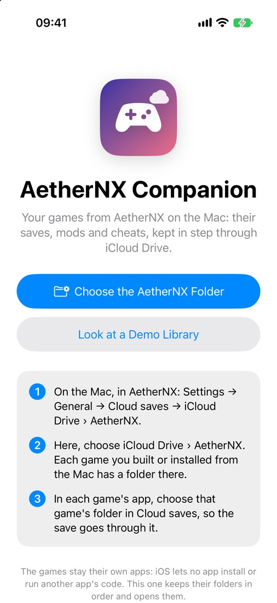
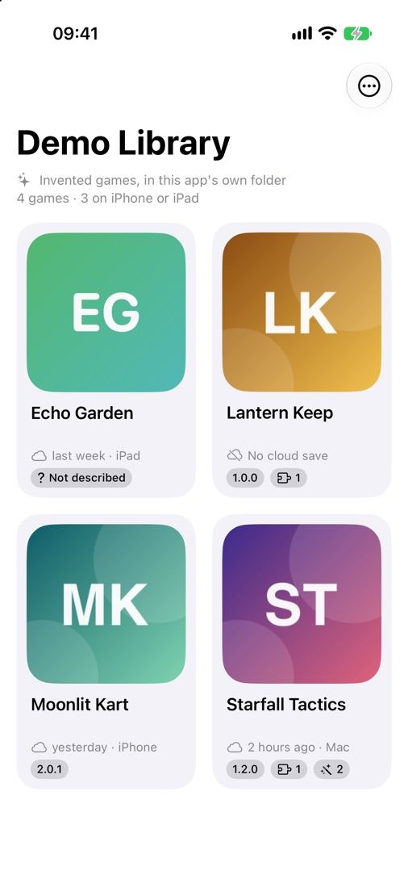
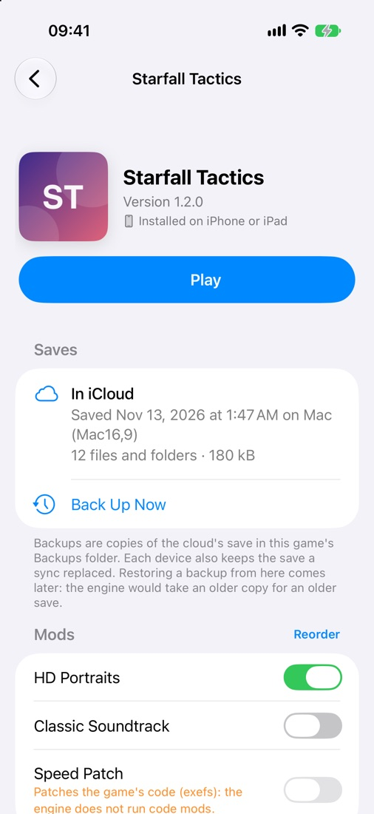
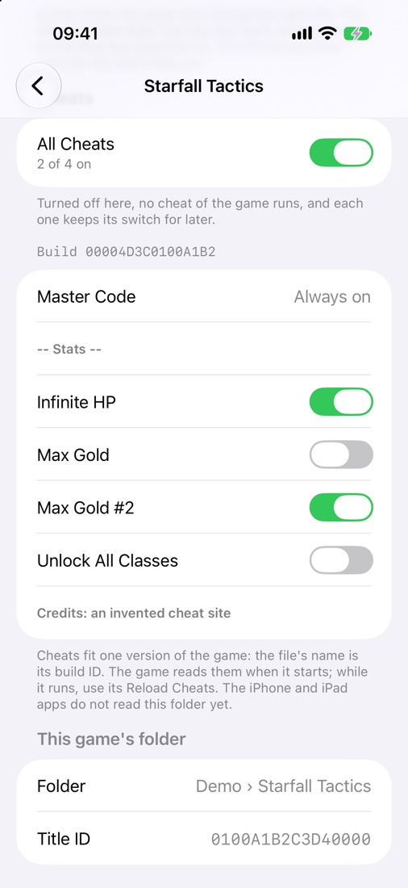
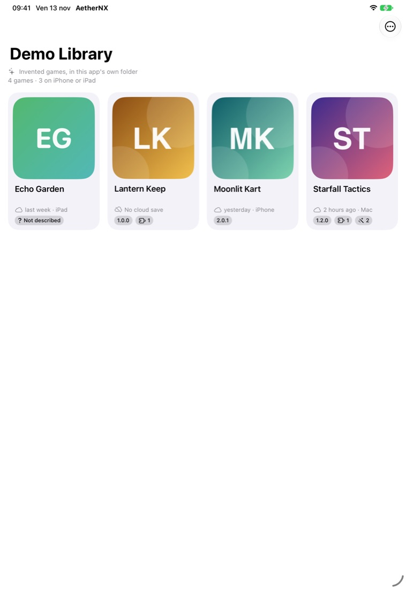

# The iPhone and iPad companion

AetherNX Companion is an iPhone and iPad app that shows the games you installed from your Macs. From it you manage their saves, mods and cheats, and you open each game. It is a library and a control centre, not a player: the engine stays in each game's own app. This page covers what iOS allows, what the companion does, the files it shares with Studio and the game apps, and what it needs to be signed. The prototype is in [`companion/`](../companion): phase 1, and a first version of phase 2's live link. Nothing in it is signed or installed on a device.

- [What iOS allows](#what-ios-allows)
- [What the companion does](#what-the-companion-does)
- [The game folder](#the-game-folder)
- [How it talks to the Mac](#how-it-talks-to-the-mac)
- [Signing, entitlements and containers](#signing-entitlements-and-containers)
- [What the game apps read](#what-the-game-apps-read)
- [The prototype](#the-prototype)

## What iOS allows

- **An app cannot install apps and cannot load code that is not signed into it.** Every game stays its own signed app, built and installed from the Mac with `./aethernx install` or Studio's Install ([Installing on a device](frontends.md#installing-on-a-device)), or sideloaded as an IPA. The companion never contains the engine, never downloads a game and never starts one inside itself.
- **Apps share files only in three ways:** a folder the person picks in the Files picker, an iCloud container both apps are signed with, or an App Group of the same team on the same device. Each app otherwise sees only its own sandbox.
- **One app opens another only through a URL scheme or a universal link that the other declares.** No public API opens an app by its bundle ID or lists the apps installed.
- **No daemon.** The companion reads the folders while it runs and when it comes to the front. It cannot watch them in the background or start work on the Mac by itself.

## What the companion does

Phase 1 works through the shared iCloud folder alone:

1. **Library.** It shows one card per game folder of iCloud Drive › AetherNX that has a `game.json`. The card shows the game's name, its icon and version, and when it was last saved and on which device. A folder without `game.json` is listed by its folder name, never by title ID alone, and is marked as not described yet.
2. **Open the game.** Play opens the game's app with `aethernx-<title ID in lower case>://play`, and the app presses its own Play ([below](#what-the-game-apps-read)). A game app built before it declared the scheme does not answer; the companion then says to open the game from the Home Screen.
3. **Saves.** It reads the header of the cloud copy, `<title ID>/save.dmsync` ([the format](../dm/host/save_sync.c)), and shows when it was saved, from which device and how many files it holds. Back Up Now copies it into the game's `Backups` folder in iCloud. The companion lists those copies and can share them. It does not restore one yet: the engine would take a restored copy for an older save and could keep the device's own instead. Restoring waits for an engine rule for a restore ([Saves in the cloud](frontends.md#the-cloud-saves-folder)).
4. **Mods.** It lists the mods in `Mods/` by Studio's rules (a folder with a `romfs` folder inside, or Atmosphère's layout). It turns them on and off and orders them. The choice goes into `Mods/mods.json`, which Studio reads as well.
5. **Cheats.** It lists each cheat file's cheats and turns single cheats on and off by writing `<build ID>.enabled` in `Cheats/`, the file the host reads at every start ([Cheats](frontends.md#cheats)). The switch for all of a game's cheats is the same flag file the host reads, `.cheats-off-<title ID>`.

Phase 2 adds the live link with the Mac ([below](#how-it-talks-to-the-mac)). Its first version:

6. **The Mac.** The Mac page, from the library's toolbar, lists the Macs whose AetherNX is on this network and pairs with one by the six digits that Mac shows. Once paired, the companion connects by itself whenever it is at the front.
7. **Builds and installs as they run.** A build or an install the Mac runs shows above the library and on the Mac page: the game, "Step 3 of 7: Signing for your device", how far it is, and how it ended. A job that ends while the app is away from the front gives a notification, for as long as iOS lets the app run there.
8. **Install from the Mac.** A game's page asks the connected Mac to install that game on this device. The Mac shows the request, and the page says what became of it.

## The game folder

Studio's library folder iCloud Drive › AetherNX (Settings → General → Cloud saves) holds one folder per game, named after the game ([CloudSaves.swift](../studio/Sources/CloudSaves.swift), [Mods.swift](../studio/Sources/Mods.swift)):

```
iCloud Drive › AetherNX › <game name>/
  game.json                 Studio: what the game is (below)
  icon.jpg | icon.png       Studio: the picture game.json names
  <title ID>/save.dmsync    the engine (Mac app; iPhone app when this folder is its Cloud saves folder)
  Mods/<mod>/romfs/…        the player (Studio's Add…, the Files app)
  Mods/mods.json            Studio and the companion: mods on and their order
  Cheats/<build ID>.txt     the player
  Cheats/<build ID>.enabled the host and the companion: cheats on
  Cheats/.cheats-off-<title ID>   the host's master switch: no cheat runs while it exists
  Backups/<time> <device>.dmsync  the companion: copies of the cloud save
  Read me.txt               Studio
```

Every file is written whole, to a temporary file that is then renamed over the old one. The companion reads and writes through `NSFileCoordinator`, so iCloud Drive never syncs a half-written file. iCloud resolves two devices' writes to the same file by keeping the newer one. Studio writes `game.json` and nothing else writes it. `mods.json` and `<build ID>.enabled` change only when the player acts, so a lost write costs one toggle.

### game.json

```json
{
  "bundleId" : "io.github.icosisenpai.horizonnative.0100abcd12340000",
  "format" : 1,
  "icon" : "icon.jpg",
  "name" : "Starfall Tactics",
  "titleId" : "0100ABCD12340000",
  "version" : "1.2.0"
}
```

| Key | Meaning |
|---|---|
| `format` | `1`. A reader skips a file with a larger number it does not know. |
| `name` | The game's name, as Studio shows it. |
| `titleId` | The base title ID, 16 hex digits in upper case: the folder its save is in. |
| `version` | The game's display version (that of the newest update packed), or absent. |
| `icon` | The picture's file name in the same folder, or absent. Studio copies the icon it shows: the online icon when online art is on, else the one in the game's files. |
| `bundleId` | The iPhone or iPad app's bundle ID from the last install from this Mac (`install.json`), or absent when the game was never installed on a device. |

Studio writes the file after every library scan, and when a game's cloud folder is chosen on its page. It writes only when the content changed, so iCloud carries nothing new while the library stays the same. A game gets one when it has a title ID, it was built or installed from this Mac, and its folder is in iCloud Drive › AetherNX. That is the folder its Mac app's cloud saves use. A game with no Mac app gets the folder the library's setting gives it, made the first time with its Mods and Cheats folders. With several Macs, the last one to write wins. The keys are sorted, so two Macs with the same library write the same bytes.

### Mods/mods.json

```json
{ "format" : 1, "off" : ["Big Head Mode"], "order" : ["HD Textures", "Big Head Mode"] }
```

`order` lists mod folder names, highest priority first. Mods not listed come after it, sorted by name. `off` lists the mods turned off. Studio uses this file when it is present, instead of its preference keys `mods.order` and `mods.off`. When the player changes the list on the Mac, Studio writes both. Studio then writes `mods.folders` for the Mac app ([Mods and cheats from a front end](frontends.md#mods-and-cheats-from-a-front-end-mac)). It does that at its next scan, or when the game's page opens. The Mac app's launcher also reads the file itself at every start, before `mods.folders`, so a change made on the phone applies at its next start even when Studio is not opened. The iPhone app reads it at Play ([below](#what-the-game-apps-read)).

## How it talks to the Mac

**Phase 1: the shared iCloud folder.** Studio writes `game.json`, the icon and the Mods and Cheats folders. The engine writes the save. The companion reads them all and writes the player's choices. Nothing needs the Mac to be on, or on the same network. The cost is iCloud Drive's latency, from seconds to minutes. A file iCloud has not brought to the phone yet is listed by its name. The companion asks for it (`startDownloadingUbiquitousItem`) when it reads the library, and finds it at the next read: when the app comes to the front, or on a pull to refresh.

**Phase 2: the live link.** Studio advertises a Bonjour service `_aethernx._tcp` on the local network with Network.framework (`NWListener`), and the companion finds it with `NWBrowser`. Pairing shows a six-digit code on the Mac. The code seeds a TLS pre-shared key (`NWProtocolTLS`), so only a paired phone connects. The messages are JSON lines:

- **From the Mac:** the events `./aethernx install --progress json` and the packing script already write ([Building: the NSP script](frontends.md#building-the-nsp-script)): `stage`, `step`, `progress`, `stage_end`, `say`. The companion shows "Step 3 of 7: Signing for your device" while a build runs, and a notification when it ends.
- **From the phone:** a request, `{"do": "install", "titleId": …, "device": <this device's name>}`. Studio shows the request and starts the same install as its own Install button. A request never runs without the Mac's own confirmation the first time a phone pairs.

The phone needs `NSLocalNetworkUsageDescription` and `NSBonjourServices = [_aethernx._tcp]` in its Info.plist. Studio needs no new entitlement: it is not sandboxed. Its Info.plist has the same two keys, because macOS asks for the local network too. Away from home, CloudKit (records in the private database of the container below, with a subscription) could carry build results and install requests. That needs the container's CloudKit service and is left for later.

### The link's first version

The first version is in the tree: [`LinkWire.swift`](../companion/Sources/Core/LinkWire.swift) (the lines and the keys) and [`LinkTransport.swift`](../companion/Sources/Core/LinkTransport.swift) (the connections), which Studio compiles too; [`MacLink.swift`](../companion/Sources/Core/MacLink.swift), the phone's end; [`CompanionServer.swift`](../studio/Sources/CompanionServer.swift) and [`CompanionLink.swift`](../studio/Sources/CompanionLink.swift), the Mac's. What has run and what has not is under [The prototype](#the-prototype).

- **Off until turned on.** Studio listens only once the person turns on AetherNX Companion on its Devices page (the preference `companionLink`). The service is named as the Mac. Its TXT record has the format (`v`), the Mac's own ID (`id`, so a renamed Mac is still the paired one) and `pair=1` while a code shows. A companion that never paired looks for Macs only while its Mac page is open, so iOS asks for the local network there and not at the first launch. One that paired looks whenever it is at the front.
- **Connections.** TCP under TLS 1.2 with a pre-shared key (`TLS_PSK_WITH_AES_128_GCM_SHA256`), one JSON object per line, 64 KB a line at most. Sessions are not resumed (`sec_protocol_options_set_tls_resumption_enabled`, off at both ends): a resumed handshake proves the earlier session and not the key, and Network.framework resumes by default, so an end that had connected to a listener once got in again with any key. The phone does not connect to the service `NWBrowser` finds: it asks Bonjour for the service's host and port (`DNSServiceResolve`) and connects there. A connection made to a service itself never says that its handshake failed (Network.framework keeps it preparing), so a wrong code read as a Mac that does not answer; one made to a host and a port fails at once. A reader skips a key or a line it does not know, so format 1 can grow. A `hello` or `pair` of another format is refused (`{"link": "refused", "why": "format"}`).
- **Pairing.** *Pair an iPhone or iPad…* shows six digits, good for one phone and for two minutes. While they show, the listener takes a key made from them (HMAC-SHA256) in place of the link's, so only a phone that typed them completes the handshake. Five failed handshakes end the code. The phone sends `{"do": "pair", "format", "phone", "name", "pub"}`. The Mac answers `{"link": "paired", "mac", "name", "pub", "box"}`. `box` holds the Mac's link key (32 random bytes) and a token for this phone, sealed with ChaCha20-Poly1305 under a key the two ends derive from an X25519 exchange and the code. So someone who recorded the pairing and then tries all million codes still cannot read the link key.
- **After pairing.** Every connection uses the link key. The phone's `{"do": "hello", "format", "phone", "name", "token"}` says which phone it is, and the Mac answers `{"link": "hello", "format", "mac", "name", "app"}`. An unknown phone or token is refused (`why: unpaired`), and the phone then forgets that Mac. The Mac keeps its ID, its key and its phones in `~/Library/Application Support/io.github.icosisenpai.aethernx/companion-link.json`, readable by its owner alone. The phone keeps its pairings in the Keychain, on that device only.
- **From the Mac.** `{"link": "job", "id", "state", "kind", "target", "titleId", "game", "title", "message"}` when a build or an install starts (`running`) and when it ends (`succeeded`, `failed`, `cancelled`). Between the two, every event the script writes goes to the phones as the script wrote it. A phone that connects during a job gets the job, its ended stages, and its current stage and progress. A job that ended is told for ten minutes. Studio's other commands (an unpack, a setup step) are not told.
- **From the phone.** `{"do": "install", "id", "titleId", "device", "deviceKind"}`. Studio answers `{"link": "answer", "to": "install", "id", "state", "why"}`: `asked` (its alert shows), `started`, `queued` (behind the running job), `declined`, or `refused` with `why` (`no-game`, `no-device`, `no-engine`, `busy`, `mac`). The alert has Install, Always Allow and Don't Install. Until Always Allow is chosen for a phone, each of its requests waits for the alert. The Devices page lists the paired phones, with that switch and Forget. The install is `AppModel.build(_:target:onDevice:)`, the Install button's own, with the same checks and the same queue.
- **Which device.** iOS gives an app the name "iPhone" for every iPhone, unless the app has an entitlement for the person's own name for it. So Studio takes the reachable device with the name the phone sent; else the only reachable device of the phone's kind (iPhone or iPad); else the device chosen in Settings → iPhone & iPad. An install never lands on another device than the one the alert named.

**Decisions and guesses of this version**, to confirm or change:

- *One key at a time.* A Network.framework listener is given one pre-shared key, as in Apple's sample. So while a code shows, a paired phone that is not connected yet cannot connect, and each change of key starts a new listener on a new port. Connections already made stay. The new listener, started once the old one is gone, keeps the Mac's name on the network without a "(2)": seen on one Mac (macOS 27.2), with a browser in the same process, across four changes of key. Not seen from a device yet.
- *"Never without the Mac's own confirmation the first time a phone pairs"* is read as: every request of a phone asks on the Mac, until the person chooses Always Allow for that phone there.
- *All paired phones share the link key*, and each has its own token. Forget removes a phone's token, so its `hello` is refused. It still holds the key, so it could still complete a handshake. `CompanionServer.reset()` makes a new key and unpairs every phone; no button calls it yet.
- *The Mac's file, not its Keychain.* Studio is signed ad hoc on the Mac that builds it, and a Keychain item is tied to a signature that changes at each build.
- *Six digits against someone on the network.* The sealed hand-over stops a recording from being read later. It does not stop someone who is on the network during the two minutes, guesses the code within five tries, and answers in the Mac's place. TLS with a pre-shared key has no forward secrecy: someone who later gets the link key reads recorded sessions, which carry build events and install requests and no game data.
- *The stage names* on the phone are Studio's (`StageGuide`), copied into the companion's `LinkText.stage`. A stage added to one list has to be added to the other.

**Limits.** No daemon: the companion follows a job only while it runs. When it leaves the front with a job running, it keeps the link for the short time iOS gives (about half a minute), so a job that ends then gives its notification. A longer one is learned of when the app comes back, for ten minutes after its end. A notification at the end of a long build with the app away needs a push from a server (APNs), or CloudKit, and is left for later. The link carries no game file, key or save.

## Signing, entitlements and containers

| Need | What it takes | Phase |
|---|---|---|
| Read and write iCloud Drive › AetherNX | **Nothing.** The person picks the folder once in the Files picker. The app keeps a security-scoped bookmark, as the game apps' Cloud saves do ([CloudSaves.h](../dm/ios/Sources/CloudSaves.h)). Any team can sign it. | 1 |
| Read the saves of game apps that use automatic iCloud (iCloud Drive › HorizonNative) | The iCloud container `iCloud.io.github.icosisenpai.horizonnative`, owned by the maintainer's team: entitlements `com.apple.developer.icloud-services = [CloudDocuments]`, `com.apple.developer.icloud-container-identifiers` and `com.apple.developer.ubiquity-container-identifiers` naming it, and the same `NSUbiquitousContainers` entry the game apps have ([project.yml](../dm/ios/project.yml)). Only a build signed by that team gets it. | 1, optional |
| The live link | `NSLocalNetworkUsageDescription`, `NSBonjourServices`, in the companion's Info.plist and in Studio's. No entitlement: browsing Bonjour needs none. The person allows the local network once on each side. | 2 |
| Results and requests away from home | The same container, with `CloudKit` added to `com.apple.developer.icloud-services`. | later |
| A handoff on the device without iCloud | An App Group (`group.io.github.icosisenpai.aethernx`) in the companion and in every game app. `./aethernx install` would have to add it to the entitlements it signs with, under the person's team. Not needed while iCloud carries everything. | later |

The proposed bundle ID is `io.github.icosisenpai.aethernx.companion`, with the same team suffix rule as the game apps (`device_install.team_variant`). The prototype builds for the Simulator without signing. No App ID or container is registered for it.

## What the game apps read

The game apps take the companion's choices from the game folder themselves ([Mods and cheats on the iPhone](frontends.md#mods-and-cheats-on-the-iphone)):

1. **The link.** `build_ipa.sh` names the URL scheme `aethernx-<title ID in lower case>` in the app's `CFBundleURLTypes`. `aethernx-<title ID>://` opens the app. `aethernx-<title ID>://play` also presses Play, with the save check a tap on Play has ([The link](frontends.md#starting-a-game)).
2. **Mods.** When the iPhone app's Cloud saves folder is a game folder, the app lists `Mods/` by Studio's rules at Play and applies `Mods/mods.json`. The `romfs` folders of the mods that are on go into `DM_ROMFS_OVERLAY`. iCloud Drive › AetherNX › `<name>` is such a folder, and so is any folder named by the title ID. A folder every game shares has the game's folder inside it, `<title ID>/`. The picked folder's security scope covers the game folder and is held for the session. A mod whose files iCloud has not brought to the phone yet is asked for and left out of that start.
3. **Cheats.** The same folder's `Cheats/` becomes `DM_CHEATS`, so `<build ID>.enabled` and `.cheats-off-<title ID>` decide which cheats run on the phone too. The host reads `DM_CHEATS` once the game's loading has finished, after the settings screen.
4. **The folder to pick.** The Cloud saves picker opens at the game's folder in iCloud Drive › AetherNX, named as Studio names it. A pick of the `<title ID>` folder inside it is noticed: the settings screen says to pick the folder above, so mods and cheats come with the save.
5. **What Play uses.** The settings screen's Mods and Cheats section shows each mod and the cheats on for the build. It changes nothing: the companion and Studio do that.
6. **The Mac launcher** (`dm/mac/launcher.c`, `mods_and_cheats`) reads `Mods/mods.json` itself, before Studio's `mods.folders`, so a change made on the phone applies at the Mac app's next start even when Studio is not opened.

An app built before these changes has none of them: it needs a new build, which `./aethernx install` or Studio's Install makes. Not tested yet on a device: a real iCloud Drive game folder picked in the Files picker, the picker opening at it, and the companion's Play starting a game app. The synthetic tests (`dm/ios/tests/test_game_extras.py`) cover the folder rules, `mods.json`, the cheats folder, the variables at Play, the link, and the scheme in a built app's `Info.plist` (`build_smoke.py`).

## The prototype

`companion/` holds an iOS 26 SwiftUI app, generated with XcodeGen like `dm/ios`:

- `companion/build.sh` generates the project and builds it for the iOS Simulator, unsigned, into `build/companion` (`COMPANION_BUILD` chooses another folder). `companion/build.sh --run ["iPhone 17"]` then installs it in that Simulator and opens it with the demo library.
- `companion/Sources/Core/` contains no SwiftUI: the game folder reader, the `game.json` and `mods.json` formats, the save header, the cheat files, and the changes the app writes. `python3 -m unittest companion/tests/test_companion.py` compiles it for the Mac and checks it against synthetic folders. The same test checks that every string the app shows has its Italian, in `companion/Resources/it.lproj`.
- The first screen offers to choose iCloud Drive › AetherNX, or to look at a demo library. The demo writes four invented games into the app's own `Documents/Demo` folder: one without `game.json`, one with no save yet, mods (one a code mod), cheat files with a master, a label and a duplicate name. It goes through the same reader as the real folder.
- Launch arguments for the Simulator: `-demo` opens the demo library, `-game "<folder name>"` opens that game's page, `-section saves|mods|cheats|folder` scrolls the page there.
- The live link: `Sources/Core/` has its lines, keys, connections and the phone's end (`LinkWire.swift`, `LinkTransport.swift`, `BuildProgress.swift`, `MacLink.swift`), and `Sources/App/` the Mac page, the job's banner and Install from the Mac (`MacView.swift`, `LinkSupport.swift`). With `-demo` the link is a scripted Mac: nothing looks at the network, and the pages show an install at its third step of seven. To try the real link in the Simulator, which shares the Mac's network, open the app without `-demo` and choose the demo library on its first screen. The build `build.sh` makes is unsigned, and the Simulator's Keychain keeps nothing for an unsigned app: there a pairing lasts until the app is closed. A build signed ad hoc, with no team (`CODE_SIGN_IDENTITY=- CODE_SIGNING_ALLOWED=YES` in place of `CODE_SIGNING_ALLOWED=NO`), keeps it.
- `test_companion.py` also runs the link end to end on one Mac (`link_check.swift`): Studio's own server and the companion's own client, compiled into one library and joined over the loopback interface, with no Bonjour and no device. It covers a wrong code, five wrong tries, pairing, the hello, a job's events, a phone that connects during a job, an install request and its answer, a phone with no token, one with another key, a phone removed on the Mac, and a Mac found as a service, with a scripted answer in place of Bonjour's.

Tested in the iOS 27.2 Simulator (iPhone 17, iPad Pro 11-inch) with the demo library: the library, a game's page, and its mods and cheats sections, in English and Italian. Not tested yet: a real iCloud Drive folder picked in the Files picker (the Simulator has no iCloud account here), the toggles and Back Up Now driven by taps (the same code paths run in the test), and Play against a game app on a device.

The live link was written where no Swift compiler is at hand, then compiled and run on a Mac (macOS 27.2, Xcode 27.2): both apps build, and `test_studio.py` and `test_companion.py` pass, `link_check.swift` among them (41 checks, over the loopback interface). It needed three changes: no resumed TLS sessions; `companion_check.swift`'s calls into `MacLink` moved onto the main actor; and the phone connecting to a found Mac's host and port in place of its service (both under Connections, above). The third showed only when the real companion met a real server over Bonjour.

What ran on that Mac, with no device:

- **Studio itself**, started with `companionLink` on. `dns-sd` shows `_aethernx._tcp` under the Mac's name on the loopback and Wi-Fi interfaces, with `v=1` and the Mac's `id` in its TXT record and no `pair`. The identity file is written readable by its owner alone. The companion in the iOS 27.2 Simulator (iPhone 17) finds that Studio on its Mac page, as not paired. Studio was started from a shell and the macOS firewall was off, so this says nothing of the local network prompt macOS shows for an app opened from the Finder, nor of the firewall's.
- **The companion in the Simulator, by taps**, against Studio's own `CompanionServer` with Bonjour on. A scratch program stood in for Studio's window, and an XCUITest in a scratch project did the tapping; neither is in the tree. 48 checks pass, in English and in Italian. The Mac is found. A wrong code is refused and told as one. The right code pairs, iOS asks to allow notifications, and the status says connected. A job's lines show as the banner above the library and on the Mac page, stage by stage, to its end, and Put Away removes the banner. Install from the Mac on a game's page reaches the server with the title ID, the device's name and its kind, and the server's `asked` and `declined` show under the button. A phone removed on the Mac forgets the Mac and says so. The Mac kept its name, with no "(2)", across four changes of key.
- **After a relaunch** the app connects again by itself, in about three seconds, in a build signed ad hoc. In the unsigned build `build.sh` makes, the pairing is gone with the app (above): 46 of the 48 checks pass there.

Not run yet: Studio's own window with the link on, that is the card's switch, the pairing sheet, the request's alert with Install, Always Allow and Don't Install, the paired phone's row and Forget. The Mac's screen was locked during the run, and a locked Mac gives the accessibility API and a screen capture no window. Also not run: Bonjour between a Mac and a device, the local network prompts on both sides (the Simulator shows none), the notification at a job's end, and an install started by a phone's request.

| | | |
|---|---|---|
|  |  |  |
|  |  | |
