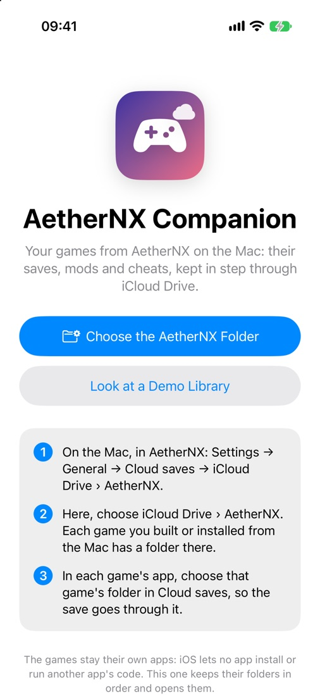
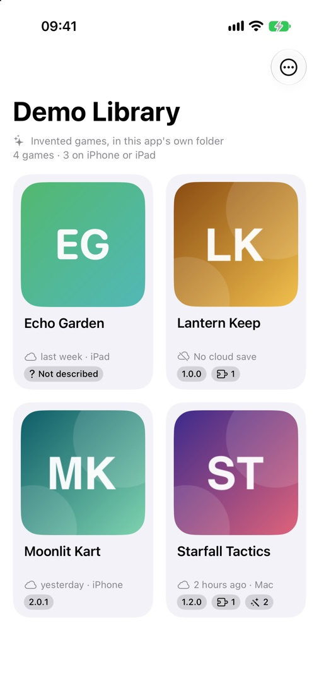
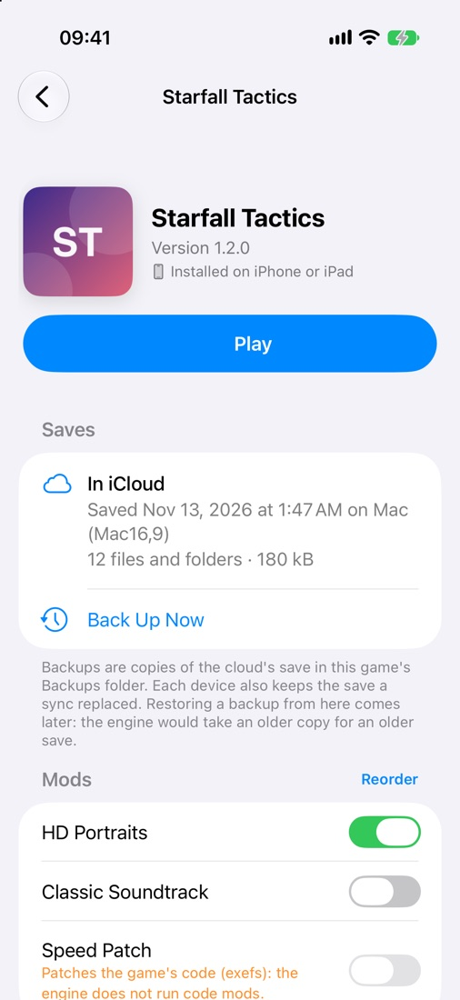
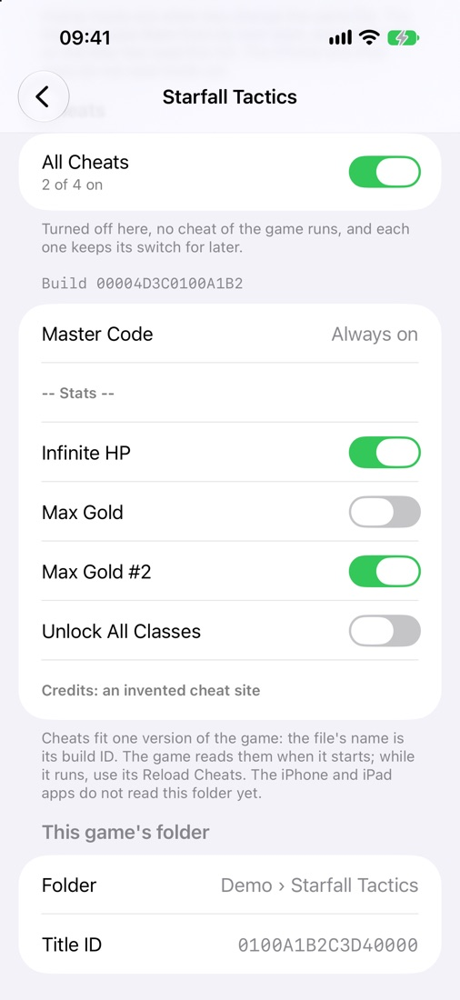
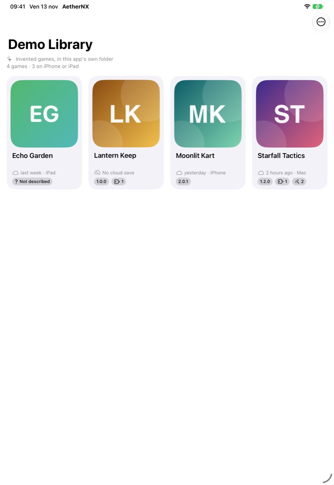

# The iPhone and iPad companion

AetherNX Companion is an iPhone and iPad app that shows the games you installed from your Macs. From it you manage their saves, mods and cheats, and you open each game. It is a library and a control centre, not a player: the engine stays in each game's own app. This page covers what iOS allows, what the companion does, the files it shares with Studio and the game apps, and what it needs to be signed. The prototype is in [`companion/`](../companion) (phase 1). Nothing in it is signed or installed on a device.

- [What iOS allows](#what-ios-allows)
- [What the companion does](#what-the-companion-does)
- [The game folder](#the-game-folder)
- [How it talks to the Mac](#how-it-talks-to-the-mac)
- [Signing, entitlements and containers](#signing-entitlements-and-containers)
- [What the game apps read](#what-the-game-apps-read)
- [The prototype](#the-prototype)

## What iOS allows

- **An app cannot install apps and cannot load code that is not signed into it.** Every game stays its own signed app, built and installed from the Mac with `./aethernx install` or Studio's Install ([Installing on a device](frontends.md#installing-on-a-device)), or sideloaded as an IPA. The companion never contains the engine, never downloads a game and never starts one inside itself.
- **Apps share files only in three ways:** a folder the person picks in the Files picker, an iCloud container both apps are signed with, or an App Group of the same team on the same device. Each app otherwise sees only its own sandbox.
- **One app opens another only through a URL scheme or a universal link that the other declares.** No public API opens an app by its bundle ID or lists the apps installed.
- **No daemon.** The companion reads the folders while it runs and when it comes to the front. It cannot watch them in the background or start work on the Mac by itself.

## What the companion does

Phase 1 works through the shared iCloud folder alone:

1. **Library.** It shows one card per game folder of iCloud Drive › AetherNX that has a `game.json`. The card shows the game's name, its icon and version, and when it was last saved and on which device. A folder without `game.json` is listed by its folder name, never by title ID alone, and is marked as not described yet.
2. **Open the game.** Play opens the game's app with `aethernx-<title ID in lower case>://play`, and the app presses its own Play ([below](#what-the-game-apps-read)). A game app built before it declared the scheme does not answer; the companion then says to open the game from the Home Screen.
3. **Saves.** It reads the header of the cloud copy, `<title ID>/save.dmsync` ([the format](../dm/host/save_sync.c)), and shows when it was saved, from which device and how many files it holds. Back Up Now copies it into the game's `Backups` folder in iCloud. The companion lists those copies and can share them. It does not restore one yet: the engine would take a restored copy for an older save and could keep the device's own instead. Restoring waits for an engine rule for a restore ([Saves in the cloud](frontends.md#the-cloud-saves-folder)).
4. **Mods.** It lists the mods in `Mods/` by Studio's rules (a folder with a `romfs` folder inside, or Atmosphère's layout). It turns them on and off and orders them. The choice goes into `Mods/mods.json`, which Studio reads as well.
5. **Cheats.** It lists each cheat file's cheats and turns single cheats on and off by writing `<build ID>.enabled` in `Cheats/`, the file the host reads at every start ([Cheats](frontends.md#cheats)). The switch for all of a game's cheats is the same flag file the host reads, `.cheats-off-<title ID>`.

Phase 2 adds the live link with the Mac ([below](#how-it-talks-to-the-mac)).

## The game folder

Studio's library folder iCloud Drive › AetherNX (Settings → General → Cloud saves) holds one folder per game, named after the game ([CloudSaves.swift](../studio/Sources/CloudSaves.swift), [Mods.swift](../studio/Sources/Mods.swift)):

```
iCloud Drive › AetherNX › <game name>/
  game.json                 Studio: what the game is (below)
  icon.jpg | icon.png       Studio: the picture game.json names
  <title ID>/save.dmsync    the engine (Mac app; iPhone app when this folder is its Cloud saves folder)
  Mods/<mod>/romfs/…        the player (Studio's Add…, the Files app)
  Mods/mods.json            Studio and the companion: mods on and their order
  Cheats/<build ID>.txt     the player
  Cheats/<build ID>.enabled the host and the companion: cheats on
  Cheats/.cheats-off-<title ID>   the host's master switch: no cheat runs while it exists
  Backups/<time> <device>.dmsync  the companion: copies of the cloud save
  Read me.txt               Studio
```

Every file is written whole, to a temporary file that is then renamed over the old one. The companion reads and writes through `NSFileCoordinator`, so iCloud Drive never syncs a half-written file. iCloud resolves two devices' writes to the same file by keeping the newer one. Studio writes `game.json` and nothing else writes it. `mods.json` and `<build ID>.enabled` change only when the player acts, so a lost write costs one toggle.

### game.json

```json
{
  "bundleId" : "io.github.icosisenpai.horizonnative.0100abcd12340000",
  "format" : 1,
  "icon" : "icon.jpg",
  "name" : "Starfall Tactics",
  "titleId" : "0100ABCD12340000",
  "version" : "1.2.0"
}
```

| Key | Meaning |
|---|---|
| `format` | `1`. A reader skips a file with a larger number it does not know. |
| `name` | The game's name, as Studio shows it. |
| `titleId` | The base title ID, 16 hex digits in upper case: the folder its save is in. |
| `version` | The game's display version (that of the newest update packed), or absent. |
| `icon` | The picture's file name in the same folder, or absent. Studio copies the icon it shows: the online icon when online art is on, else the one in the game's files. |
| `bundleId` | The iPhone or iPad app's bundle ID from the last install from this Mac (`install.json`), or absent when the game was never installed on a device. |

Studio writes the file after every library scan, and when a game's cloud folder is chosen on its page. It writes only when the content changed, so iCloud carries nothing new while the library stays the same. A game gets one when it has a title ID, it was built or installed from this Mac, and its folder is in iCloud Drive › AetherNX. That is the folder its Mac app's cloud saves use. A game with no Mac app gets the folder the library's setting gives it, made the first time with its Mods and Cheats folders. With several Macs, the last one to write wins. The keys are sorted, so two Macs with the same library write the same bytes.

### Mods/mods.json

```json
{ "format" : 1, "off" : ["Big Head Mode"], "order" : ["HD Textures", "Big Head Mode"] }
```

`order` lists mod folder names, highest priority first. Mods not listed come after it, sorted by name. `off` lists the mods turned off. Studio uses this file when it is present, instead of its preference keys `mods.order` and `mods.off`. When the player changes the list on the Mac, Studio writes both. Studio then writes `mods.folders` for the Mac app ([Mods and cheats from a front end](frontends.md#mods-and-cheats-from-a-front-end-mac)). It does that at its next scan, or when the game's page opens. The Mac app's launcher also reads the file itself at every start, before `mods.folders`, so a change made on the phone applies at its next start even when Studio is not opened. The iPhone app reads it at Play ([below](#what-the-game-apps-read)).

## How it talks to the Mac

**Phase 1: the shared iCloud folder.** Studio writes `game.json`, the icon and the Mods and Cheats folders. The engine writes the save. The companion reads them all and writes the player's choices. Nothing needs the Mac to be on, or on the same network. The cost is iCloud Drive's latency, from seconds to minutes. A file iCloud has not brought to the phone yet is listed by its name. The companion asks for it (`startDownloadingUbiquitousItem`) when it reads the library, and finds it at the next read: when the app comes to the front, or on a pull to refresh.

**Phase 2: the live link.** Studio advertises a Bonjour service `_aethernx._tcp` on the local network with Network.framework (`NWListener`), and the companion finds it with `NWBrowser`. Pairing shows a six-digit code on the Mac. The code seeds a TLS pre-shared key (`NWProtocolTLS`), so only a paired phone connects. The messages are JSON lines:

- **From the Mac:** the events `./aethernx install --progress json` and the packing script already write ([Building: the NSP script](frontends.md#building-the-nsp-script)): `stage`, `step`, `progress`, `stage_end`, `say`. The companion shows "Step 3 of 7: signing for the device" while a build runs, and a notification when it ends.
- **From the phone:** a request, `{"do": "install", "titleId": …, "device": <this device's name>}`. Studio shows the request and starts the same install as its own Install button. A request never runs without the Mac's own confirmation the first time a phone pairs.

The phone needs `NSLocalNetworkUsageDescription` and `NSBonjourServices = [_aethernx._tcp]` in its Info.plist. Studio needs no new entitlement: it is not sandboxed. Away from home, CloudKit (records in the private database of the container below, with a subscription) could carry build results and install requests. That needs the container's CloudKit service and is left for later.

## Signing, entitlements and containers

| Need | What it takes | Phase |
|---|---|---|
| Read and write iCloud Drive › AetherNX | **Nothing.** The person picks the folder once in the Files picker. The app keeps a security-scoped bookmark, as the game apps' Cloud saves do ([CloudSaves.h](../dm/ios/Sources/CloudSaves.h)). Any team can sign it. | 1 |
| Read the saves of game apps that use automatic iCloud (iCloud Drive › HorizonNative) | The iCloud container `iCloud.io.github.icosisenpai.horizonnative`, owned by the maintainer's team: entitlements `com.apple.developer.icloud-services = [CloudDocuments]`, `com.apple.developer.icloud-container-identifiers` and `com.apple.developer.ubiquity-container-identifiers` naming it, and the same `NSUbiquitousContainers` entry the game apps have ([project.yml](../dm/ios/project.yml)). Only a build signed by that team gets it. | 1, optional |
| The live link | `NSLocalNetworkUsageDescription`, `NSBonjourServices`. No entitlement: browsing Bonjour needs none. | 2 |
| Results and requests away from home | The same container, with `CloudKit` added to `com.apple.developer.icloud-services`. | later |
| A handoff on the device without iCloud | An App Group (`group.io.github.icosisenpai.aethernx`) in the companion and in every game app. `./aethernx install` would have to add it to the entitlements it signs with, under the person's team. Not needed while iCloud carries everything. | later |

The proposed bundle ID is `io.github.icosisenpai.aethernx.companion`, with the same team suffix rule as the game apps (`device_install.team_variant`). The prototype builds for the Simulator without signing. No App ID or container is registered for it.

## What the game apps read

The game apps take the companion's choices from the game folder themselves ([Mods and cheats on the iPhone](frontends.md#mods-and-cheats-on-the-iphone)):

1. **The link.** `build_ipa.sh` names the URL scheme `aethernx-<title ID in lower case>` in the app's `CFBundleURLTypes`. `aethernx-<title ID>://` opens the app. `aethernx-<title ID>://play` also presses Play, with the save check a tap on Play has ([The link](frontends.md#starting-a-game)).
2. **Mods.** When the iPhone app's Cloud saves folder is a game folder, the app lists `Mods/` by Studio's rules at Play and applies `Mods/mods.json`. The `romfs` folders of the mods that are on go into `DM_ROMFS_OVERLAY`. iCloud Drive › AetherNX › `<name>` is such a folder, and so is any folder named by the title ID. A folder every game shares has the game's folder inside it, `<title ID>/`. The picked folder's security scope covers the game folder and is held for the session. A mod whose files iCloud has not brought to the phone yet is asked for and left out of that start.
3. **Cheats.** The same folder's `Cheats/` becomes `DM_CHEATS`, so `<build ID>.enabled` and `.cheats-off-<title ID>` decide which cheats run on the phone too. The host reads `DM_CHEATS` once the game's loading has finished, after the settings screen.
4. **The folder to pick.** The Cloud saves picker opens at the game's folder in iCloud Drive › AetherNX, named as Studio names it. A pick of the `<title ID>` folder inside it is noticed: the settings screen says to pick the folder above, so mods and cheats come with the save.
5. **What Play uses.** The settings screen's Mods and Cheats section shows each mod and the cheats on for the build. It changes nothing: the companion and Studio do that.
6. **The Mac launcher** (`dm/mac/launcher.c`, `mods_and_cheats`) reads `Mods/mods.json` itself, before Studio's `mods.folders`, so a change made on the phone applies at the Mac app's next start even when Studio is not opened.

An app built before these changes has none of them: it needs a new build, which `./aethernx install` or Studio's Install makes. Not tested yet on a device: a real iCloud Drive game folder picked in the Files picker, the picker opening at it, and the companion's Play starting a game app. The synthetic tests (`dm/ios/tests/test_game_extras.py`) cover the folder rules, `mods.json`, the cheats folder, the variables at Play, the link, and the scheme in a built app's `Info.plist` (`build_smoke.py`).

## The prototype

`companion/` holds an iOS 26 SwiftUI app, generated with XcodeGen like `dm/ios`:

- `companion/build.sh` generates the project and builds it for the iOS Simulator, unsigned, into `build/companion` (`COMPANION_BUILD` chooses another folder). `companion/build.sh --run ["iPhone 17"]` then installs it in that Simulator and opens it with the demo library.
- `companion/Sources/Core/` contains no SwiftUI: the game folder reader, the `game.json` and `mods.json` formats, the save header, the cheat files, and the changes the app writes. `python3 -m unittest companion/tests/test_companion.py` compiles it for the Mac and checks it against synthetic folders. The same test checks that every string the app shows has its Italian, in `companion/Resources/it.lproj`.
- The first screen offers to choose iCloud Drive › AetherNX, or to look at a demo library. The demo writes four invented games into the app's own `Documents/Demo` folder: one without `game.json`, one with no save yet, mods (one a code mod), cheat files with a master, a label and a duplicate name. It goes through the same reader as the real folder.
- Launch arguments for the Simulator: `-demo` opens the demo library, `-game "<folder name>"` opens that game's page, `-section saves|mods|cheats|folder` scrolls the page there.

Tested in the iOS 27.2 Simulator (iPhone 17, iPad Pro 11-inch) with the demo library: the library, a game's page, and its mods and cheats sections, in English and Italian. Not tested yet: a real iCloud Drive folder picked in the Files picker (the Simulator has no iCloud account here), the toggles and Back Up Now driven by taps (the same code paths run in the test), and Play against a game app on a device.

| | | |
|---|---|---|
|  |  |  |
|  |  | |
