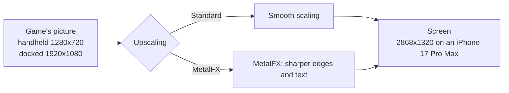
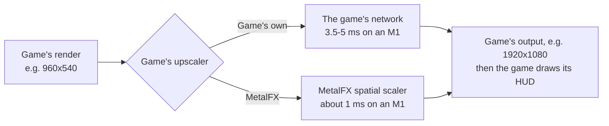
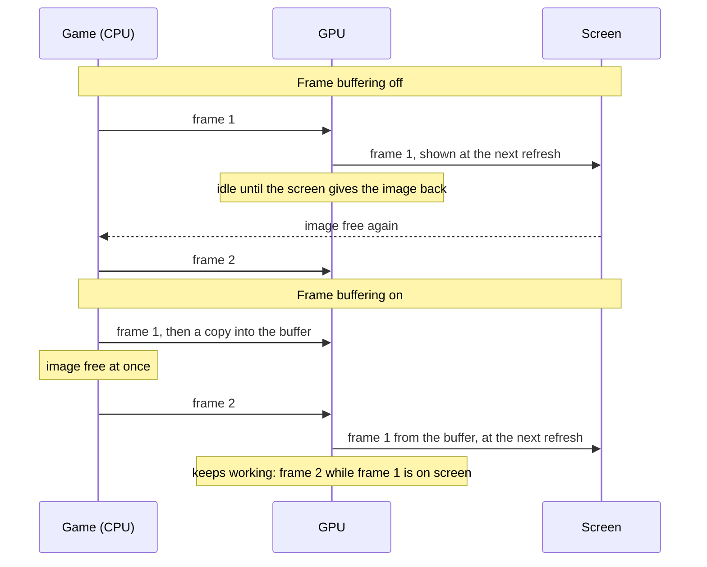
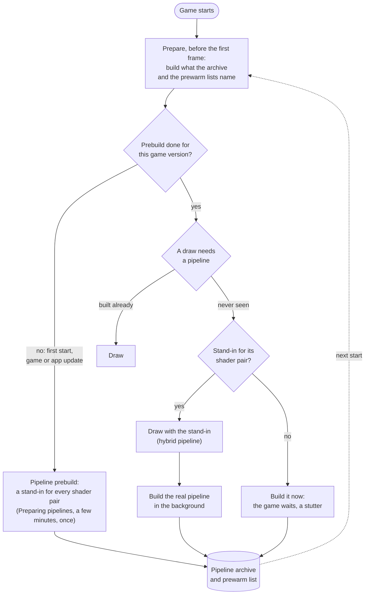
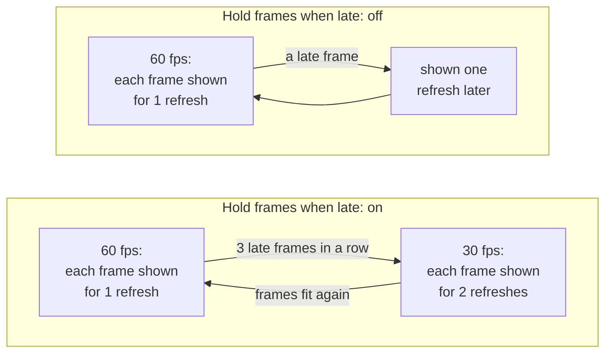

# Settings

The screen before the game starts shows the game, **Play**, and what Play starts it with. At the top are the game's icon, name and version, with **Play** beside them. Under them a row states the most used settings (Frame rate, Render scale, Console mode, Game language, Button layout, Game rumble, when the game has them) and **Cloud saves**; tap one to go to its setting. The memory the system leaves the game is shown under **Reset to tested defaults**. Below, every setting the game supports is on one scrollable screen, under **Game**, **Controls** and **Performance**: tap a menu or move a slider there, no settings page needs opening. When you scroll down, the bar at the top keeps the game's name and a **Play** button. A setting that only matters while another is on appears under it and disappears when that one is turned off. **Upscaling** is in **Game**, beside **Console mode**. The app remembers your choices for the next start. A Mac app shows the same settings in a [window of its own](#the-mac-settings-window).

A dot beside a setting means it differs from the game's tested default; touch and hold it (right-click on the Mac) for **Use tested default**. A lock means a file or the program that started the app sets it ([Settings in a file](#settings-in-a-file)); a value there that the setting does not offer is shown as it is, with a warning, and the game gets it as the file says. The buttons and the summary row take the game icon's colour.

**With a game controller**: up and down move through the screen, left and right change the setting that is selected (or move along the summary row), A chooses (opens a menu's next value, turns a switch on or off, follows a summary entry to its setting), B goes back to **Play**, and + (Menu) starts the game from anywhere. The selected item has a coloured ring, and a line under the summary row shows the buttons in your controller's own symbols. The same works in the Mac window, where the controller also reaches **Show this window at launch** and **Quit**.

- [Tested defaults](#tested-defaults)
- [Game](#game): [Frame rate](#frame-rate), [Render scale](#render-scale), [Console mode](#console-mode), [Upscaling](#upscaling), [Game's upscaler](#games-upscaler), [Sharpness](#sharpness), [Pixels](#pixels), [Screen](#screen), [Game language](#game-language), [Picture](#picture), [Frame-rate counter](#frame-rate-counter), [Texture filtering](#texture-filtering)
- [Controls](#controls): [Controllers](#controllers), [Button layout](#button-layout), [Stick dead zone](#stick-dead-zone), [All controllers are player 1](#all-controllers-are-player-1), [Motion controls](#motion-controls), [Touch feedback](#touch-feedback), [Game rumble](#game-rumble), [Rumble strength](#rumble-strength), [Rumble cutoff](#rumble-cutoff), [Press a button to join](#press-a-button-to-join)
- [Performance](#performance): [Frame buffering](#frame-buffering), [Metal 4 pipelines](#metal-4-pipelines), [Pipeline prebuild](#pipeline-prebuild), [Encode thread](#encode-thread), [Hold frames when late](#hold-frames-when-late), [Performance HUD](#performance-hud), [Reset to tested defaults](#reset-to-tested-defaults)
- [The in-game menu](#the-in-game-menu): [Controllers during play](#controllers-during-play), [Touch controls](#touch-controls)
- [The Mac settings window](#the-mac-settings-window): [Display mode](#display-mode), [The Mac Controllers menu](#the-mac-controllers-menu)
- [TV](#tv)
- [Cloud saves](#cloud-saves), [Add-on content bought later](#add-on-content-bought-later), [Support the project](#support-the-project)
- [Settings in a file](#settings-in-a-file)

## Tested defaults

Each game comes with the settings it was tested with: its profile in this repository says, for example, that Breath of the Wild runs with Frame buffering and Metal 4 pipelines on, because that combination held a steady 60 fps on an iPhone 17 Pro Max. Those are the defaults the settings screen shows the first time.

When you change a setting and tap **Play**, the app keeps your choice, also when a later build of the app ships other defaults. A setting you leave at its default is not stored: it follows the defaults of the build you have, so a newer build's tested settings reach you without doing anything. **Reset to tested defaults** at the bottom sets every setting back to its default, and **Play** then forgets your choices, so the game's defaults apply again. For testing, a line in `Documents/env.txt` overrides any setting ([Settings in a file](#settings-in-a-file)).

A Mac app carries the same list (`Contents/Resources/dm/launcher.json`), without the iPhone's own Frame-rate counter and Touch feedback, for a front end that starts the app with the chosen values ([Front ends](frontends.md)).

## Game

### Frame rate

Games whose speed the app controls (Breath of the Wild, Tears of the Kingdom and a few others) offer **30 fps** or **60 fps**. 60 is smoother; 30 is what the Switch ran and uses less power, so the phone stays cooler and the battery lasts longer. The game runs at real speed either way.

On a Mac, a game checked at that speed (Fire Emblem Fortune's Weave, Mario & Luigi: Brothership) also offers **120 fps**. It needs a screen that shows 120 Hz, and uses more GPU and power. When frames do not fit, during movies, or on a slower screen, the game drops to 60 for a while, so it keeps its real speed. If you see the frame rate move between 60 and 120 and would rather it stayed still, choose 60.

### Dynamic resolution

Off, the default, keeps the 3D picture at full size. On lets the game lower its resolution when frames run heavy and raise it again when they fit, as on the Switch: steadier frame rate, at times a softer picture. Only games whose resolution control the app can hold offer it (NieR:Automata, Ocarina of Time).

### Render scale

The size of the 3D picture, from 50 to 100 %. Below 100 % the size is fixed there and the game's own dynamic resolution is off; 100 % keeps the game's own. Lower can be lighter on the GPU but is blurrier; the HUD and text keep their sharpness. Only games the app can scale offer it.

### Console mode

**Docked** renders at the Switch's TV resolution, **Handheld** at its lower handheld resolution, which is lighter on the phone and can give a higher frame rate.

### Upscaling

A game that renders below the screen's resolution is scaled up to the screen. **Standard**, the default, scales smoothly; **MetalFX** uses Apple's MetalFX upscaler, which sharpens edges and text as it scales.

Breath of the Wild renders 1280x720 in handheld mode. Docked it renders its world at 900p and scales that to 1080p itself, before the app sees the picture. MetalFX works in either mode: handheld saves the most GPU time and heat, docked looks sharper than smooth scaling. Rendering at the screen's resolution stays the sharpest picture, where the GPU can afford it.

- **When to change it:** turn it on if the picture looks soft and the device has GPU time to spare: on a Mac, or on an iPhone in handheld mode at 30 fps. For long sessions at 60 fps on an iPhone leave it at Standard.
- **Cost:** more GPU time each frame, which can increase heat on an iPhone. [Breath of the Wild's measurements](../dm/games/01007EF00011E000/README.md#upscaling-current) cover Mac and iPhone; the matching iPhone Standard run and MetalFX's share of the thermal cost remain unmeasured. Nothing changes while the game's picture is as large as the screen. Unsupported devices and sizes use Standard scaling.
- **On the Mac:** choose **MetalFX** under **Upscaling** in the [settings window](#the-mac-settings-window)'s Advanced settings, or set `DM_PRESENT_UPSCALE=metalfx` in its `env.txt` (off by default). It helps in a large window or on a 4K screen.

### Sharpness

Sharpens the picture as it goes to the screen, after the upscaling: edges and small text get crisper, flat areas stay as they are (the sharpening adapts to the contrast around each pixel, so edges do not get halos). **0 %**, the default, is off. 30–50 % suits most games; more can look grainy. It also works with Standard upscaling, where it sharpens the game's own pixels before they are scaled.

- **Cost:** a little GPU time each frame. Change it during the game in the [in-game menu](#the-in-game-menu) to see the difference at once.

### Pixels

**Smooth**, the default, filters the picture as it is scaled. **Sharp pixels** shows each pixel of the game as a block, for pixel-art games that look blurred when smoothed; MetalFX is not used while it is on.

### Screen

**Game's shape**, the default, keeps the game's 16:9 picture with black bars at the sides of a wider screen. **Fill the screen** stretches it over the whole screen (on an iPhone about 22 % wider than the game drew it).

### Game's upscaler

Shown only for games that upscale their own picture with a network of their own before the app sees it: agl's NDSR network, in Donkey Kong Bananza and Splatoon Raiders. **Game's own**, the default, keeps the game's upscaler. **MetalFX** replaces it with Apple's MetalFX spatial scaler: the same input and output sizes, at a fraction of the GPU time, but Apple's scaler's picture rather than the game's.

- **When to change it:** when the game falls short of its frame rate in busy scenes because of GPU time: Donkey Kong Bananza's upscaler is the largest single piece of a heavy frame on an M1 (3.5-5 ms of about 24 in handheld mode). Compare the look side by side before keeping it.
- **Cost:** none in GPU time (it saves 2.5-4 ms a frame in that case); the picture is Apple's scaler's rather than the game's. Frames where the game renders at its output size are not upscaled and keep the game's shader either way. Devices without MetalFX keep the game's upscaler.
- **Not the same as [Upscaling](#upscaling):** that one scales the finished picture, HUD included, to the screen; this one replaces the game's own step inside the frame. Both can be on.

### Game language

The game's own languages. The app was packed with one of them; pick another here without repacking. A game packed from a dump or a NUP may come without its list: every language is offered then, with a note, and a game that lacks the one you pick may show another.

### Picture

iPhone and iPad. **Fit**, the default, shows the game's picture (16:9, or the taller one of [Picture shape](#picture-shape)) as large as it fits, with black bars where the screen has another shape. **Fill** enlarges it until it covers the whole screen and crops what lies outside; nothing is stretched. An iPhone loses some of the top and bottom, an iPad some of each side, so health bars, subtitles or maps near the edges can be cut off. A picture that fills the screen without cropping needs a patch for each game that renders a wider view. Fill applies in landscape; in portrait the picture stays fitted above the controls, and on a TV it is always fitted.

### Picture shape

Games whose profile supports it (Breath of the Wild, Animal Crossing: New Horizons). **iPhone Duo screen (1.43:1)** renders a taller picture of the Duo's own shape: the sides of 16:9 with more above and below, and the HUD at the screen's edges. **16:9** is the Switch's picture. The taller picture has about a quarter more pixels, so it runs a little slower and warmer.

### Frame-rate counter

Shows the frames per second at the top left.

### Texture filtering

Textures seen at a slant (floors, roads, walls along the view) keep their detail further away instead of blurring. **Game**, the default, keeps the game's own filtering; **2×** to **16×** raise it to at least that. It applies at the next start. Textures the game draws without filtering (pixel art, lookup tables) and depth comparisons are left as they are.

- **Cost:** a little GPU time; 16× on an iPhone in long sessions may add heat.

## Controls

### Controllers

Any controller Apple's GameController framework supports can supply input through Bluetooth or a USB cable where the device supports it: Xbox Wireless / Series, DualSense, DualShock 4, Switch Pro Controller, Joy-Con and MFi controllers. Pair one in the system's Bluetooth settings, or plug it in. The app does not report which transport a controller uses.

The Controls section in both launchers and the iPhone's in-game menu lists each connected controller's name, kind, battery level and charging state when available, and player. Each controller with an extended gamepad profile gets its own player, up to eight: player 1 first, then the next unused player. A reconnect matches its previous name; identical models can trade places because GameController supplies no identity across reconnects. Choose another player on a row to move it there, swapping with the controller already there. Launcher assignments apply to that start. A controller's player LEDs and, when available, light colour follow its player; nothing is restored on disconnect. The keyboard on Mac or touch controls on iPhone also play as player 1. Games that accept only player 1 receive the other controllers there too.

### Button layout

**Switch: A on the right**, the default (`DM_PAD_BUTTONS=position`), uses Switch positions on every controller: right A, bottom B, top X, left Y. **Xbox / PlayStation: A at the bottom** (`label`) follows the letters printed on an Xbox controller: bottom A, right B, left X, top Y; on PlayStation, cross is A, circle B, square X and triangle Y. Nintendo controllers keep Switch positions in either mode. Change it before starting or live in the iPhone's in-game menu or the Mac's Controllers menu.

### Stick dead zone

Ignores a circle around the centre of both physical sticks, from **0 to 30 %** (`DM_PAD_DEADZONE=0..0.3`), in 1 % steps; **0 %** is the default. Beyond the circle, travel is rescaled so its edge reads zero and full tilt still reads full. The touch stick is unaffected. Changes apply live in the in-game menus too.

### All controllers are player 1

Off by default (`DM_PAD_MERGE=0`). On (`1`), every controller feeds player 1; the last controller moved supplies the state. Player selection on controller rows is disabled while this is on. Applies when the game starts.

### Motion controls

On by default (`DM_MOTION=1`): controllers with a gyro, and the phone's gyro, supply live motion. Off (`0`) ignores both; the six-axis sensor stays flat, while shaking still works. Applies when the game starts. A build made with **--no-motion** keeps motion off through its bundled environment file; that fixed value is shown in the launcher.

### Touch feedback

A light tap from the phone when you press an on-screen button.

### Game rumble

The game's vibration, on the phone or on a connected controller.

### Rumble strength

How strong the game's vibration is, from 0 to 300 %.

### Rumble cutoff

A controller's vibration weaker than this stays off, and the rest is spread over the full range. Off (0 %) by default. A controller with rotating motors can rumble all the time in a game that sends a quiet texture: Mario Kart 8 Deluxe needs about 45 % to rumble only on crashes and drifts. The phone's own vibration is not affected.

### Press a button to join

Off by default: each controller is a player as soon as it connects, in the order the system lists them. On: a controller becomes a player only when you press one of its buttons, as the lowest player free, so the players choose their order and how many play. That press also reaches the game. When a game asks for more players than have joined, a prompt over the game waits for the others to press a button; B closes it.

## Performance

These settings change how the app hands frames to the screen and how it prepares the GPU's work. The game's tested defaults are a good start; change them when a game stutters, runs hot, or you want less latency.

### Frame buffering

Each finished frame is copied into a buffer of two images that the screen shows from, so the game can start its next frame at once instead of waiting for the screen to give its image back.

Without it the GPU idles between frames, and iOS reads that idle time as room to spare: it lowers the GPU's clock, and the frames take longer still. On an iPhone 17 Pro Max, Breath of the Wild fell to 30 fps without frame buffering and held 60 with it.

- **When to change it:** turn it off if you notice the controls lag behind and the game holds its frame rate without it.
- **Cost:** up to one frame more latency between your input and the screen (about 28 ms more on an iPhone 17 Pro Max), and two more frame-sized images in memory.

### Metal 4 pipelines

Before the GPU can draw something, the app has to build a *pipeline* for it: the game's shaders compiled for the iPhone's GPU, with the drawing settings. Building one takes tens of milliseconds, so a scene full of new ones stutters. With Metal 4 pipelines the app keeps what it built in a pipeline archive on the phone, and builds most pipelines in a few microseconds from a shared base.

At start, before the game's first frame, the app prepares what it already knows: the pipelines in the archive and those the prewarm lists name (one comes with the game, one grows on the phone as you play); with a warm archive that takes well under a second. A pipeline never seen before is drawn meanwhile with a stand-in for its pair of shaders, a *hybrid* pipeline that reads the draw's vertices in a general way and draws the same picture, while the real pipeline is built in the background and archived for the next start.

- **When to change it:** turn it off only if a game crashes or runs out of memory with it.
- **Cost:** memory for the archive while the game runs, and storage on the phone.

### Pipeline prebuild

Shown while **Metal 4 pipelines** is on. Builds a stand-in for every pair of shaders the game has (15,767 for Breath of the Wild) and puts them into the pipeline archive, so that a scene you have never seen has a stand-in for each of its draws instead of a stutter. It runs before the game's first frame, behind a **Preparing pipelines** screen: the first start waits a few minutes for it, once, and so does the first start after a game update or an app update that brings new shaders. Every other start skips it. It needs Metal 4 pipelines.

Built in the background while playing instead, the stand-ins took an iPhone 17 Pro Max's GPU from about 13 to 15–18 ms a frame in Breath of the Wild, so the app does the work up front.

- **When to change it:** turn it off if you don't want to wait at that first start.
- **Cost:** on, a wait of a few minutes once. Off, no wait, but a pipeline seen for the first time makes the game stall briefly while it is built, until the archive holds it.

### Encode thread

The app turns the game's graphics commands into Metal commands on a thread of its own instead of the game's submitting thread, so the game's thread can go on sooner (in Breath of the Wild about 4 ms per frame instead of 8). Frame buffering needs it for games that present their frames from another thread than the one that draws them. It is on by default on the iPhone; on the Mac it is off, where it lowered the typical frame time but made the slowest frames slower.

- **When to change it:** leave it on unless a game misbehaves with it; turning it off is a diagnostic step.

### Hold frames when late

For games whose frame rate the app controls with its frame step (Breath of the Wild and Tears of the Kingdom, [Frame rate](#frame-rate)); other games do not show it, as it would change nothing there. With 60 fps chosen, each frame is meant to stay on screen for one refresh. When a frame comes late, the app can either slow the game down to 30 fps for a while, or keep 60 and show late frames as they come.

- **On** (the default for most games): an even 30 fps (or 20) in heavy scenes instead of a mix of 30 and 60.
- **Off:** the game keeps aiming at 60; a late frame is shown one refresh later and the next one goes on as usual, so heavy scenes look less even but stay closer to 60 on average.
- **When to change it:** turn it off if the game often falls to 30 fps although it is only slightly late.

### Performance HUD

Apple's performance overlay over the game: frame rate, frame and GPU times, memory. Useful to see what a setting changes; leave it off for play.

### Reset to tested defaults

Sets every setting back to the game's tested default; **Play** then forgets your choices, so those defaults apply, and those of later builds too ([Tested defaults](#tested-defaults)). Settings fixed by `Documents/env.txt` stay as the file says.

## The in-game menu

While you play, the **menu button** at the top centre of the touch controls (three short lines, where the layout button used to be) pauses the game and opens a panel beside its last picture. A controller opens it with its **Home** button, or by holding **−** and **+** together for half a second (a controller without Home). The game stays paused while the menu is open: its clock stops, its sound stops, and nothing you touch or press reaches it. **Resume**, a tap beside the panel, or B, + or Home on a controller closes it.

**Picture**: Upscaling, Sharpness, Pixels, Screen, Frame-rate counter and Performance HUD change the picture at once, so you can compare while the game waits; Texture filtering applies at the next start. **Performance**: Metal 4 pipelines, at the next start. What you choose here is kept as the settings screen keeps it: the screen before the next start shows it, and a value an `env.txt` sets is shown, not changed.

With a controller: up and down move, left and right change the selected setting, A chooses, B resumes.

### Controllers during play

**Button layout** and **Stick dead zone** apply immediately and are saved with the launcher's choices. The connected-controller rows show name, kind, battery and player, and let you swap players while the game is paused. Values fixed by an environment file or at launch stay locked. Set **All controllers are player 1** and **Motion controls** before starting the game.

### Touch controls

- **Layout**: **2D**, **3D** (adds the D-pad, a right stick in the right third of the screen and L3 / R3) and, in handheld mode, **Tap** (only the menu button; every touch goes to the game's touch screen).
- **Opacity** (20–100 %) and **Size** (70–130 %) of the controls.
- **Move the controls…** closes the menu and shows the controls with **Reset** and **Done**: drag the stick, the D-pad, the buttons, each shoulder pair, − and +, L3 and R3 or the menu button where they suit your hands. **Done** keeps the places and resumes the game; **Reset** puts every control back.
- **Touch feedback**, and **Show touch controls**: off leaves only the menu button, for games you play with a controller or by touch.
- **Reset touch controls** brings back the default places, size, opacity and visibility.

Each game keeps its own choices. The touch controls hide while a controller is connected; the menu button stays.

## The Mac settings window

A Mac app ([A Mac app](development.md#a-mac-app)) shows its settings in a window before the game starts, laid out as the iPhone's screen: the game with **Play** at the top, the summary row, then the settings. They are the same settings as on the iPhone, with the same defaults. The window shows the most used ones first: **Frame rate**, **Render scale**, **Console mode**, **Game language**, **Display mode**, **Button layout** and **Game rumble**, when the game has them. **Render scale** shows the picture's size in pixels beside the percentage for the chosen **Console mode**, when the game's profile has it (Breath of the Wild: 1600 × 900 docked, 1280 × 720 handheld at 100 %). Opening **Advanced settings** shows the others in the same sections; **Reset to tested defaults** is always at the bottom of the window. The window remembers whether Advanced settings is open. **Frame-rate counter** and **Touch feedback** are only on the iPhone.

Click **Play** (or press Return) to start the game. **Quit** (or Escape), ⌘Q or closing the window ends the app without the game. If the app's list of settings cannot be read (a damaged pack), the window says so: **Play** then starts the game with your saved choices and its tested defaults, as without the window; packing the game again brings the list back. The app remembers your choices for that game, and a game started without the window, from a front end or with the window turned off, uses them too ([Saved choices](frontends.md#saved-choices)). A setting fixed by an `env.txt` or by the program that started the app is shown greyed out.

Turn off **Show this window at launch** to start the game at once with your choices. Hold Option while the app opens to see the window again. `DM_LAUNCHER=0` in the app's `env.txt` (`~/Library/Application Support/HorizonNative/<title ID>/env.txt`) or in its environment, or opening it with `open <app> --args --no-launcher`, also skips the window; your choices still apply. `DM_SAVED_CHOICES=0` starts with the tested defaults instead.

### Display mode

**Window** or **Fullscreen**: how the game's window opens. ⌃⌘F or the green button changes it while you play. In an `env.txt`: `DM_FULLSCREEN=1` or `0`.

### The Mac Controllers menu

In the Mac game window's menu bar, **Controllers** offers **Button layout** (Switch or Xbox / PlayStation) and **Stick dead zone** (0, 5, 10, 15 or 20 %). Each change applies immediately and, in a packed Mac app, is kept in the same preferences as its launcher; choosing the tested default removes the saved choice. Values fixed by an environment file or at launch stay locked, and `DM_SAVED_CHOICES=0` leaves saved choices alone. A bare development host without an app settings list applies changes for that run only. The launcher's slider also offers the other dead-zone values up to 30 %.

### Switch 2 controllers

**Off** by default. On, the game takes Joy-Con 2 and Pro Controller 2 over Bluetooth: hold the small Sync button on one during the game, until its player lights sweep, to pair it with this Mac; after that a press of any of its buttons connects it ([Switch 2 controllers](playing.md#switch-2-controllers-mac)). macOS asks for Bluetooth access the first time, and again after the app is packed again. In an `env.txt`: `DM_SW2=1`.

### Cloud saves folder

**Choose a folder…** picks the iCloud Drive folder the game's save is synced through, the one the iPhone app chose in its launcher's **Cloud saves**, or the game's own folder inside it, named after its title ID ([Cloud saves](#cloud-saves)); **Turn off** stops it. Off by default. macOS may ask once whether the app may open iCloud Drive; if the game log says `this app may not open iCloud Drive`, allow it in System Settings › Privacy & Security › Files and Folders. In an `env.txt`: `DM_SAVE_SYNC=<folder>`, or `DM_SAVE_SYNC=icloud` for iCloud Drive › HorizonNative Saves; the window then shows it fixed.

## Cloud saves

**In AetherNX Studio.** A game's page has a **Saves** section: the save on this Mac, the folder its Mac app syncs through, when the cloud's copy last changed and what the last session said. **Change** chooses iCloud Drive › HorizonNative (the folder of automatic iCloud, below), iCloud Drive › HorizonNative Saves, another folder, or off for that game. Settings → General → **Cloud saves** sets one folder for every game; a game with a choice of its own keeps it, and **Use the Library's Setting** gives it up. Both write the folder the Mac settings window below shows; the game reads it at its next start.

**Automatic iCloud.** An iPhone app signed with the maintainer's team (installed from Xcode or `xcrun devicectl`, not through a sideloading tool) syncs through its own iCloud folder with nothing to choose: the launcher's **Cloud saves** shows **iCloud (automatic)**. In iCloud Drive that folder is **HorizonNative**, shared by every HorizonNative game; on the Mac, choose **iCloud Drive › HorizonNative** in the settings window's **Cloud saves** to share the same saves. **Choose a Folder in iCloud Drive…** picks another folder instead, **Turn Off Cloud Saves** stops syncing, and **Use iCloud Automatically** turns it back on. Without an iCloud account, or with iCloud Drive off for the app, it stays off. A sideloaded app cannot get its own iCloud folder: choose a folder as below.

The Mac app and the iPhone app of one game can share a save through iCloud Drive. Choose the same iCloud Drive folder on both: **Cloud saves** › **Choose a folder…** in the Mac settings window, and **Cloud saves** in the iPhone launcher (any folder, for instance one named **HorizonNative Saves**). Each game keeps one file there, `<title ID>/save.dmsync`, which holds the whole save.

When the game starts, it brings the save from iCloud Drive in if only that one changed since the last sync; a few seconds after the game saves, it sends its save if only this one changed. The iPhone app also sends when it goes to the background, and the Mac app once the game has quit. If you played on both without the save getting across in between, the next start decides: the newer save wins and the other is kept. A send never replaces a save in iCloud Drive that changed since the last sync, also not the Mac app's after a game that stopped before it loaded its save: that waits for the next start. After you choose another folder, the save goes there at the next start even if it did not change.

If the save on the device cannot be read (a permissions or disk error), cloud saves stay off for that start rather than treat it as no save, and nothing in iCloud Drive replaces it. A save brought in from iCloud Drive replaces both of the device's save folders or neither: if moving one fails, everything moved before it is put back. If even that fails (the disk refuses the moves back), or the game stops between the moves (it is force-quit, or the Mac or phone shuts down), the game log says which `save-backups` folder holds this device's save, and cloud saves stay off, here and in the Mac app's send after the game, until you copy that save back and delete the file `save.sync-stuck` beside the save (on the Mac in `~/Library/Application Support/HorizonNative/<title ID>/`, on the iPhone in the app's Documents). The file's first line names that folder (`none` when the device had no save of its own); a folder the backup does not hold is still in its place.

A save that is replaced, on the device or in iCloud Drive, is kept first, beside the save in a folder named after it with `-backups` (on the iPhone `save-backups` in the Files app, under the app's name; on the Mac `~/Library/Application Support/HorizonNative/<title ID>/save-backups`): `<date> local` holds this device's save, `<date> cloud` the one that was in iCloud Drive. The newest 10 of each kind stay, and older ones are removed; other folders you put there are left alone.

iCloud Drive takes a moment to carry a file from one device to the other. Quit the game on one device and give it a few seconds before you start it on the other. Without a connection, or when the save in iCloud Drive has not arrived in time, the game plays on with the save it has and sends it later. If the save in iCloud Drive changed meanwhile, the game sends nothing that session, and the next start decides between the two as above. The game log says what came in and what went out (lines starting with `save sync:`).

## Add-on content bought later

The DLC in the game's folder when you pack the app go into it. For a DLC you get later you do not need to pack the app again: put its NSP in the game's folder and run the packing script once (it extracts it to `<title ID>_build/aoc/<index>.img`), then copy that file to the phone: with the Files app into the app's folder as `aoc/<index>.img`, or with `scripts/push_aoc.sh <device UDID> <bundle ID> "<title ID>_build/aoc"` (by cable, with `afcclient` from `brew install libimobiledevice`, which streams a DLC of any size). The game lists it at its next start; a copy in the app's folder wins over the one packed in the app. DLC as large as the game itself can stay out of the app from the start: pack it with `DM_COPY_AOC=NO` and copy it the same way. A game **update** is different: it changes the game's code, which is built into the app, so pack the app again with the update in the folder.

On the Mac, put the files in `~/Library/Application Support/HorizonNative/<title ID>/aoc/`.

## Support the project

HorizonNative is free and made by [iCosiSenpai](https://github.com/iCosiSenpai). At the bottom of every game's settings screen (on the iPhone and in the Mac window), **Support HorizonNative** opens the project on [GitHub](https://github.com/iCosiSenpai/AetherNX) and the donation pages on [PayPal](https://paypal.me/AlessioCosi) and [Buy Me a Coffee](https://buymeacoffee.com/icosisenpai).

## TV

Connect a TV or monitor by cable, or start Screen Mirroring to an Apple TV or AirPlay TV. The game fills it in 16:9 at up to 1080p and switches to **Docked**; the iPhone or iPad keeps the controls. Disconnect to bring the game back to the device in its earlier mode. AirPlay adds some delay; a cable has almost none.

## Settings in a file

A line like `DM_PRESENT_SNAP=0` in `Documents/env.txt` (in the Files app, under the app's name) sets a setting from the file: the settings screen shows it greyed out, and the file wins over your choice and the game's default. Fully close and reopen the app after editing the file. The file takes only HorizonNative's own settings (`DM_…`) and Metal's (`MTL_…`), never the app's folders (game files, saves, temporary storage, DLC), and no value with a `/` except the cloud saves folder: an `env.txt` someone else wrote cannot load a library, empty your saves or write a log over another file. The app's log says which lines it ignored (`env … ignored`). The variables:

| Setting | Variable | Values |
|---|---|---|
| Frame rate | `DM_FPS_TARGET` | `30`, `60`, `120` (Mac, games with `fps_max 120`) |
| Render scale | `DM_RENDER_SCALE` | `0.5` to `1.0` |
| Console mode | `DM_OPMODE` | `1` docked, `0` handheld |
| Game language | `DM_LANG` | a language code, such as `ja` |
| Display mode (Mac) | `DM_FULLSCREEN` | `1` fullscreen, `0` a window |
| Cloud saves folder (Mac) | `DM_SAVE_SYNC` | a folder; `icloud`: iCloud Drive › HorizonNative Saves; `0`: off |
| Picture (iPhone and iPad) | `DM_PICTURE_FIT` | `fit` 16:9 with black bars, `fill` covers the screen, cropped |
| Picture shape | `DM_SCREEN_ASPECT` | `auto` the app window's own shape where it is taller than 16:9 (iPad 4:3, iPhone Duo 1.43:1), else 16:9 (iOS only); `1.43` the iPhone Duo's shape, `0` 16:9 |
| Frame-rate counter | `DM_SHOW_FPS` | `1`, `0` |
| Touch feedback | `DM_TOUCH_HAPTICS` | `1`, `0` |
| Game rumble | `DM_RUMBLE` | `1`, `0` |
| Rumble strength | `DM_RUMBLE_GAIN` | `0` to `3` |
| Rumble cutoff | `DM_RUMBLE_MIN` | `0` to `0.9` |
| Press a button to join | `DM_PAD_PRESS_TO_JOIN` | `1`, `0` |
| Upscaling | `DM_PRESENT_UPSCALE` | `off`, `metalfx` |
| Sharpness | `DM_PRESENT_SHARPEN` | `0` to `1` |
| Pixels | `DM_PRESENT_FILTER` | `linear`, `nearest` |
| Screen | `DM_PRESENT_FIT` | `aspect`, `stretch` |
| Texture filtering | `DM_ANISO` | `0` (the game's own), `2`, `4`, `8`, `16` |
| Game's upscaler | `DM_UPSCALER` | `game`, `metalfx` |
| Frame buffering | `DM_PRESENT_SNAP` | `1`, `0` |
| Metal 4 pipelines | `DM_PSO_MTL4` | `1`, `0` |
| Pipeline prebuild | `DM_PSO_PREBUILD` | `1`, `0` |
| Encode thread | `DM_NVN_ENC_THREAD` | `1`, `0` |
| Hold frames when late | `DM_FPS_HOLD` | `on`, `off` |
| Performance HUD | `DM_METAL_HUD` | `1`, `0` |

`DM_LAUNCHER=0` skips the settings screen; the choices you saved there still apply. `DM_SAVED_CHOICES=0` starts with the tested defaults and keeps your saved choices for later. How the settings are listed for each game: [dm/games/settings.tsv](../dm/games/settings.tsv).
